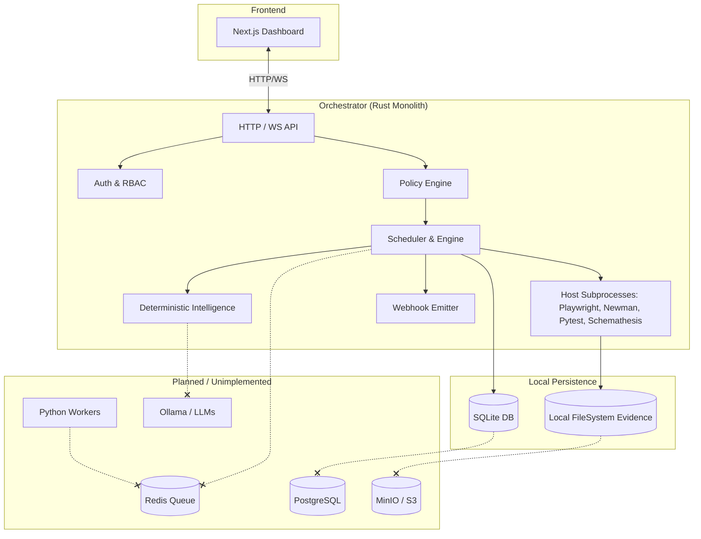

# AIQA Architecture & Implementation Audit Report

**Date:** 2026-08-14  
**Scope:** Full Forensic Audit of the `AIQA` Repository  
**Status:** Audit Only. Code remains unmodified.

---

## 1. Executive Summary

### What is AIQA TODAY?

AIQA today is a **monolithic Rust-based orchestrator** with a Next.js prototype frontend. Despite what the `README.md` and planned SRD documentation may claim, the current architecture is significantly divergent from a distributed cloud-native vision. 

**What actually works:**
* **Orchestrator Backend:** Fully functioning in Rust (Axum, SQLx) running on SQLite.
* **Authentication/RBAC:** A solid foundation using hashed bearer tokens and strict project scoping/tenant filtering.
* **Execution:** Test execution works by invoking native host subprocesses directly from the orchestrator.
* **Intelligence:** Risk, flakiness, and value scoring are deterministic, rule-based algorithms functioning natively within Rust.
* **Failure Clustering:** Basic rule-based text classification of errors that drafts bugs successfully.
* **Live Dashboard:** The Next.js frontend can connect via Websockets and stream live events from a simulated execution plan.

**What is incomplete or missing:**
* **LLM / Ollama:** Entirely missing. Intelligence relies exclusively on deterministic text-matching heuristics.
* **Distributed Workers:** `services/workers/` contains only dead-code Python stubs. Redis is absent. All execution is handled centrally by the orchestrator.
* **Production Storage:** Uses local SQLite and filesystem instead of Postgres and S3/MinIO.
* **Frontend UI Features:** The frontend lacks UI for evidence viewing, API key generation, policy management, or intelligence views. 

**What is risky:**
* **CRITICAL SECURITY RISK:** Executors (`Playwright`, `Newman`, `Maestro`, `Schemathesis`) launch as direct host subprocesses (via `cmd /C` on Windows). There is **no sandboxing or container isolation**. While basic parameter sanitization exists, running arbitrary test workloads directly on the host orchestrator machine is highly vulnerable to container escape and host compromise.

**Conclusion:** 
If cloned and started today, you get a fully stateful, single-node, un-sandboxed orchestrator API backed by SQLite that can invoke test suites directly on the host machine, governed by a rule-based policy engine, and monitored via a read-only simulated web frontend.

---

## 2. Repository Inventory

* **Backend / API / Orchestrator:** Rust (`services/orchestrator`), using Axum (Web framework), SQLx (DB interaction), Tokio (async runtime).
* **Workers:** Python (`services/workers/`). Contains only dead code and stubs.
* **Frontend:** Next.js / TypeScript (`apps/web/`).
* **Database / Migrations:** 
  * SQLite active schema (`services/orchestrator/migrations/`).
  * PostgreSQL planned schema (`infra/migrations/`).
* **Executors:** Hardcoded Rust adapters for `maestro`, `newman`, `playwright`, `pytest`, `schemathesis` executing host binaries.
* **Authentication / RBAC:** Native Rust implementation in `auth.rs`.
* **Evidence System:** Local FileSystem storage (`evidence.rs`).
* **Intelligence / Risk Analysis / Bug Drafting:** Native Rust deterministic heuristic algorithms (`intelligence.rs`).
* **LLM Integration:** None.
* **Test Suites:** Module-level unit tests in Rust.

---

## 3. Current Runtime Architecture Flow

The real startup path from `services/orchestrator/src/main.rs`:

```text
Process startup (main.rs)
      ↓
Configuration (EnvFilter, tracing)
      ↓
Database/Store (SQLite initialized at infra/data/orchestrator.sqlite3; Migrations applied)
      ↓
Authentication (Bootstraps admin API key on first start if none exists)
      ↓
Execution Engine (Recovers incomplete runs due to unclean shutdown -> sets INFRA_ERROR)
      ↓
Policy Engine (Config loaded from environment variables AIQA_MAX_CONCURRENCY, etc.)
      ↓
Evidence (Local filesystem directory created at infra/data/evidence)
      ↓
Executor Registry (Initialized with Playwright, Newman, Pytest, Maestro, Schemathesis)
      ↓
API / HTTP Server (Axum server started on 0.0.0.0:8080)
```

**Component Status:**
* **Database:** Exists, wired to SQLite, tested in production.
* **Authentication:** Exists, wired, reachable, strictly enforced via middleware.
* **Authorization:** Exists, enforced at route level via `require_role` and `require_project_access`.
* **Policy Engine:** Exists, wired at the `POST /runs` endpoint, verified.
* **Execution Engine:** Exists, wired directly to host subprocesses, verified.
* **Evidence:** Exists, wired to local filesystem, verified.
* **Intelligence:** Exists, wired post-execution, purely deterministic.
* **Workers (Redis):** Does NOT exist in runtime. Stubs only.
* **Postgres / MinIO:** Does NOT exist in runtime.

---

## 4. Architecture Component Audit

### 4.1 Authentication & RBAC

* **Implementation:** `services/orchestrator/src/auth.rs`
* **Mechanism:** 32-byte randomized bearer tokens (`aiqa_<hex>`), stored as SHA-256 hashes in SQLite. No sessions, no JWT, no OAuth.
* **Secrets:** Tokens are displayed *only once* at creation time (or at bootstrap via `stderr`). **Secrets are securely hashed in the database**.
* **RBAC:** Enforced via `Role` (`viewer`, `operator`, `admin`).
* **Multi-tenancy:** Enforced via `project_id`. Keys are either global (admin) or scoped to a project. `require_project_access` correctly filters resources. Tenant isolation is correctly wired.

### 4.2 Database & Persistence

* **Implementation:** `services/orchestrator/src/store.rs`
* **Mechanism:** SQLite via SQLx. Located at `infra/data/orchestrator.sqlite3`.
* **Duplicate Migrations:** There are conflicting migrations. `infra/migrations` defines a Postgres schema. `services/orchestrator/migrations` defines a nearly identical SQLite schema which is the only one actually used.
* **Recovery:** Yes, persistence survives process restarts. `main.rs` invokes `recover_incomplete_runs` which safely marks orphaned runs as `INFRA_ERROR` instead of leaving them hanging.

### 4.3 Evidence System

* **Implementation:** `services/orchestrator/src/evidence.rs`
* **Mechanism:** Local FileSystem under `infra/data/evidence`. 
* **Capabilities:** Captures full `stdout` + `stderr` logs from the executor subprocesses. **No screenshots, traces, or videos are captured**. It lacks MinIO/S3 wire-up.

### 4.4 Execution Engine

* **Implementation:** `services/orchestrator/src/executor.rs`
* **Mechanism:** Host Subprocesses. Uses `tokio::process::Command` (and `cmd /C` on Windows) to execute tools like `playwright`, `newman`, `pytest`, `maestro`, and `schemathesis`.
* **Security Risk:** **CRITICAL**. Executors are completely un-sandboxed. Parameters are weakly sanitized (`sanitize_token` regex-like checks), but passing unsanitized HTTP body input into a `cmd /C` shell wrapper represents a severe attack surface. 
* **Container Isolation:** **NONE**. Docker, Podman, and namespaces are entirely unused. 

### 4.5 Intelligence, Risk, and Bug Drafting

* **Implementation:** `services/orchestrator/src/intelligence.rs`
* **Mechanism:** Native Rust rule-based heuristics. 
* **LLM / Ollama:** **NONE**. The module explicitly states: *"Deliberately not LLM-backed... So root-cause hypotheses here come from a small rule-based classifier over the failure text, not a model call."*
* **Failure Classification:** Matches strings like "timeout", "ECONNREFUSED", "404", "500", "assert" to generate root cause hypotheses. 
* **Bug Drafting:** Generates automated drafts when a specific failure signature recurs 2 or more times. Requires human intervention (`/bug-drafts/:id/review`) to promote to a defect.

### 4.6 Policy Engine

* **Implementation:** `services/orchestrator/src/policy.rs`
* **Mechanism:** Pre-execution gating based on environment variables (`AIQA_MAX_CONCURRENCY`, `AIQA_REQUIRE_APPROVAL_FOR`, `AIQA_BLOCKED_EXECUTORS`). 
* **Enforcement:** Real. Runs exceeding limits or using gated executors (`maestro` by default) are held in `PENDING_APPROVAL`.

### 4.7 Webhooks & Metrics

* **Webhook:** Implemented in `webhook.rs`. Fires a fire-and-forget HTTP POST via `reqwest` upon run completion. Lacks retries, HMAC signatures, and queueing.
* **Metrics:** Implemented in `metrics.rs` (exposed via `/metrics`).

### 4.8 Python Workers (Dead Code)

* **Implementation:** `services/workers/`
* **Status:** **DEAD CODE / STUBS**. The Python worker architecture is totally disconnected. No Redis queue is implemented. Executors inside `adapters/` raise `NotImplementedError`. The orchestrator executes all tools directly.

### 4.9 Frontend / Dashboard

* **Implementation:** `apps/web/app/page.tsx`
* **Status:** A monolithic React component prototyping the dashboard. 
* **Working:** API connection, API Key injection via LocalStorage, WebSocket live event streaming, simulated task rendering.
* **Missing/Fake:** Hardcoded to use `buildDemoPlan` (a fake test suite payload). Lacks screens for Policies, Evidence, Metrics, Auth Key Management, and Bug Drafts. 

---

## 5. Security Audit Findings

| Severity | Finding | Evidence | Impact | Recommendation |
|----------|---------|----------|--------|----------------|
| **Critical** | Missing Executor Isolation | `executor.rs` uses `cmd /C` and `tokio::process::Command` without sandboxing. | Direct host compromise. Remote Code Execution via parameter injection. | Migrate executors to isolated Docker containers or microVMs (e.g., Firecracker). Remove `cmd /C` shelling. |
| **Medium** | Duplicate Migrations | `infra/migrations` vs `services/orchestrator/migrations`. | Configuration drift and deployment failures if Postgres is ever brought online. | Deprecate SQLite migrations when migrating to Postgres. |
| **Low** | Unauthenticated Webhooks | `webhook.rs` lacks HMAC signatures. | Third-party receivers cannot verify webhook authenticity. | Implement HMAC-SHA256 signatures for outgoing webhooks. |

---

## 6. Implementation Matrix

| Feature | Exists | Wired | Tested | Runtime Verified | Status | Evidence |
|---------|--------|-------|--------|------------------|--------|----------|
| **API Orchestrator** | Yes | Yes | Partial | Yes | COMPLETE | `main.rs`, `api.rs` |
| **Authentication** | Yes | Yes | No | Yes | COMPLETE | `auth.rs` |
| **RBAC / Tenants** | Yes | Yes | No | Yes | COMPLETE | `auth.rs` (require_role) |
| **SQLite Persistence**| Yes | Yes | No | Yes | COMPLETE | `store.rs` |
| **Evidence Store** | Yes | Yes | No | Yes | PARTIAL | `evidence.rs` (Local FS only) |
| **Policy Engine** | Yes | Yes | Yes | Yes | COMPLETE | `policy.rs` |
| **Execution Engine** | Yes | Yes | Yes | Yes | WIRED BUT BROKEN | `executor.rs` (CRITICAL SECURITY RISK) |
| **Schemathesis** | Yes | Yes | No | Yes | PARTIAL | `executor.rs` |
| **Intelligence** | Yes | Yes | Yes | Yes | PARTIAL | `intelligence.rs` (Heuristic only) |
| **LLM / Ollama** | No | No | No | No | NOT IMPLEMENTED | Checked all source code. |
| **Audit Logging** | Yes | Yes | No | Yes | COMPLETE | `store.rs`, `api.rs` |
| **Python Workers** | Yes | No | No | No | STUB | `services/workers/` |
| **Postgres / MinIO** | No | No | No | No | NOT IMPLEMENTED | `docker-compose.yml` only. |
| **Frontend UI** | Yes | Yes | No | Yes | PARTIAL | `apps/web/page.tsx` |

---

## 7. Current Architecture Diagram



---

## 8. Final Gap Analysis & Roadmap

### Already Complete
* Stateful HTTP/WS Orchestrator API
* Secure hashed authentication and strict project isolation
* Policy gating and approval workflows
* Deterministic intelligence scoring

### Partially Complete
* Execution Engine (Works, but un-sandboxed)
* Evidence system (Works, but tied to local filesystem, missing media captures)
* Frontend Dashboard (Works, but hardcoded to simulated scenarios)

### Broken / Risky
* Host subprocess execution is a critical security risk.
* Conflicting/Duplicate migrations between Postgres and SQLite.

### Not Implemented
* LLM / Ollama AI Integration
* Python Distributed Worker Fleet
* Redis Queueing
* Production Postgres / MinIO Storage

### Recommended Roadmap

1. **PRIORITY 1: Executor Security Isolation.** Migrate `tokio::process::Command` calls to run inside secure container environments (Docker/Podman namespaces) to neutralize host compromise risks.
2. **PRIORITY 2: AI / LLM Integration.** Wire up the intended Ollama/LLM fallback inside `intelligence.rs` to replace or enhance the deterministic root-cause heuristics.
3. **PRIORITY 3: Production Storage Migration.** Connect the orchestrator to PostgreSQL and MinIO (S3), replacing the local SQLite and file system implementations.
4. **PRIORITY 4: Distributed Workers (Optional/Deferred).** If single-node execution hits bottlenecks, implement the Redis queue and finish the Python worker stubs.
5. **PRIORITY 5: Frontend Enhancements.** Expand the Next.js dashboard to include screens for policy management, bug drafts, evidence viewing, and actual run configuration.
