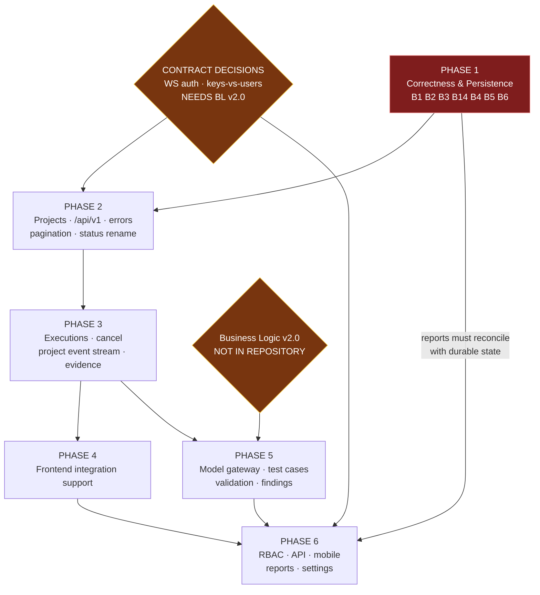

# AIQA — Backend Implementation Plan
## Version 1.0

**Scope:** Backend only (`services/orchestrator`). Planning document — **no code was written**.
**Date:** 17 August 2026

**Constraints honoured:** No frontend file touched. `forentend/` untouched. `apps/web/` untouched. API Contract v1.0 unmodified. Acceptance Matrix v1.0 unmodified. No endpoint invented.

**Authoritative sources (all verified present in repository root):**
`AIQA_API_CONTRACT_v1.0.md` · `AIQA_ACCEPTANCE_MATRIX_v1.0.md` · `AIQA_FRONTEND_AUDIT_REPORT.md` · `AIQA_BACKEND_AUDIT_REPORT.md` · `AIQA_DEEP_AUDIT_REPORT.md` · `AIQA_ARCHITECTURE_AUDIT_REPORT.md`

**Method:** Direct inspection of the Rust source, the three SQL migrations, and live probing against a running orchestrator. One **new** finding (B14) was discovered and live-verified while producing this plan.

**Work ownership tags:** `[BACKEND]` `[API-CONTRACT-DEP]` `[FRONTEND-DEP]` `[TESTING]`

---

## 1. Current Backend Architecture

```
main.rs ──── bootstrap admin key · run recovery · executor registry · CORS(Any) · :8080
   │
api.rs ───── 16 HTTP routes + 1 WS · auth middleware layer · audit calls
   │
   ├── auth.rs ......... Bearer SHA-256 · viewer<operator<admin · project_id scope
   ├── policy.rs ....... Allow / RequireApproval / Deny at run creation
   ├── scheduler.rs .... pure DAG state machine (side-effect free, unit-tested)
   ├── engine.rs ....... async driver · semaphore concurrency · event emit · persistence
   │      └── executor.rs .... Playwright · Newman · Pytest · Maestro · Schemathesis · Simulated
   ├── intelligence.rs . signature normalisation · clustering · bug drafts · risk scoring
   ├── evidence.rs ..... local object store (root/run_id/task-kind-uuid.log)
   ├── metrics.rs ...... Prometheus text, computed on demand
   ├── webhook.rs ...... outbound run-completion POST (unconfigured)
   └── store.rs ........ SQLite via sqlx · 15 tables · 3 migrations
```

**Stack:** Rust · Axum 0.7 · tokio · sqlx (SQLite) · 4,073 LOC across 15 modules.

**Architectural strength worth preserving:** `scheduler.rs` is pure and I/O-free, which is why the SRD §25 continue-on-failure semantics are directly unit-testable. `engine.rs` wraps it with all I/O. That separation should not be dissolved during the work below.

**Architectural weakness:** every defect in this plan lives in a module with **zero tests** — `engine.rs`, `store.rs`, `api.rs`, `auth.rs`. The four modules that have tests produced no findings above Low.

---

## 2. Current Implemented Capabilities

Verified working, live:

| Capability | Evidence |
|---|---|
| DAG scheduling + continue-on-failure | SRD §25: 8/10 independents ran after t2/t7 failed |
| Transitive dependency blocking | 2-level cascade: `contract` FAILED → `perf` BLOCKED → `deploy` BLOCKED |
| Product vs infra failure distinction | `FAILED` vs `INFRA_ERROR` preserved end to end |
| Real subprocess executors | pytest ran, failed genuinely, real traceback captured |
| Evidence capture + retrieval | 970-byte real artifact stored and served with content type |
| API-key auth + roles | 401 no key · 401 bad key · 200 valid · 403 wrong role |
| Project scoping (partial) | `require_project_access` on runs/events/evidence/WS |
| Audit log | writes on auth failure, run create, approve/reject, key ops |
| Realtime WS | sequence-numbered, durable replay on connect, `?since=` catch-up |
| Policy gate + human approval | allow / require-approval / deny, audited |
| Failure clustering + bug drafts | human-gated promotion, confidence capped ≤0.6 |
| Injection defence | `sanitize_token` + regression tests; SQL fully parameterised |
| Persistence across restart | runs survive; recovery pass runs at startup |

`cargo check --all-targets` clean · `cargo test` 12/12 passing.

---

## 3. Current Routes

**16 HTTP + 1 WebSocket.** None carries `/api/v1`. None is project-scoped **in its path**.

| Route | Method | Role gate | Project scoped? |
|---|---|---|---|
| `/health` | GET | none (public) | n/a |
| `/runs` | POST | Operator | via key attribute |
| `/runs` | GET | Viewer | ✅ `list_run_ids(project_filter)` |
| `/runs/:id` | GET | Viewer | ✅ `require_project_access` |
| `/runs/:id/events` | GET | Viewer | ✅ |
| `/runs/:id/approve` | POST | Operator | ✅ |
| `/runs/:id/reject` | POST | Operator | ✅ |
| `/runs/:id/evidence` | GET | Viewer | ✅ |
| `/evidence/:id/content` | GET | Viewer | ✅ (via parent run) |
| `/intelligence/tests` | GET | Viewer | ✅ `project_filter` |
| `/intelligence/failure-clusters` | GET | Viewer | ✅ `project_filter` |
| `/bug-drafts` | GET | Viewer | ❌ **NO FILTER — see B14** |
| `/bug-drafts/:id/review` | POST | Operator | ❌ no project check |
| `/metrics` | GET | Viewer | ❌ global counts |
| `/admin/api-keys` | POST/GET | Admin | n/a |
| `/admin/api-keys/:id` | DELETE | Admin | n/a |
| `/admin/audit-log` | GET | Admin | ❌ `list_audit(limit)` only |
| `/runs/:id/ws?key=` | WS | Viewer | ✅ checked before upgrade |

---

## 4. Complete API Contract Gap Matrix

All **59** endpoint declarations in the contract, plus the WebSocket path in §14 (written without a method prefix, so it is listed separately).

**Legend:** `IMPLEMENTED` = exists at contract path with contract shape · `PARTIAL` = analogue exists, incomplete · `MISMATCH` = analogue exists at a different path/shape/scope · `MISSING` = no backend analogue.

### §5 Projects
| # | Contract endpoint | Backend today | Status |
|---|---|---|---|
| 1 | `GET /api/v1/projects` | — | **MISSING** |
| 2 | `POST /api/v1/projects` | — | **MISSING** |
| 3 | `GET /api/v1/projects/{project_id}` | — | **MISSING** |
| 4 | `PATCH /api/v1/projects/{project_id}` | — | **MISSING** |

### §6 Context ingestion
| 5 | `GET .../context` | — | **MISSING** |
| 6 | `POST .../context` | — | **MISSING** |
| 7 | `GET .../context/{context_id}` | — | **MISSING** |

### §7 Quality graph / requirements
| 8 | `GET .../quality-graph` | tables `quality_nodes`/`quality_relations` exist; **no route** | **MISSING** (schema PARTIAL) |
| 9 | `GET .../requirements` | — | **MISSING** |
| 10 | `GET .../features` | — | **MISSING** |
| 11 | `GET .../features/{feature_id}/flow` | — | **MISSING** |

### §8 Test generation
| 12 | `POST .../test-generation` | — | **MISSING** |
| 13 | `GET .../test-generation/{generation_id}` | — | **MISSING** |
| 14 | `GET .../test-cases` | — | **MISSING** |
| 15 | `GET .../test-cases/{test_case_id}` | — | **MISSING** |

### §9 Validation
| 16 | `POST .../test-validation` | — | **MISSING** |
| 17 | `GET .../test-validation/{validation_id}` | — | **MISSING** |

### §10 Suites / plans
| 18 | `POST .../test-suites` | — | **MISSING** |
| 19 | `GET .../test-suites/{test_suite_id}` | — | **MISSING** |
| 20 | `POST .../test-plans` | `RunPlan` accepted inline in `POST /runs`; not a persisted entity | **MISSING** |

### §11 Orchestrator plans
| 21 | `POST .../orchestrator/plans` | `scheduler.rs` DAG engine exists; no plan API | **MISSING** |
| 22 | `GET .../orchestrator/plans/{plan_id}` | — | **MISSING** |

### §12 Execution
| 23 | `POST .../executions` | `POST /runs` | **MISMATCH** — path, no `/api/v1`, no project scope; body is `RunPlan` not `{test_case_ids, test_suite_id, environment_id, execution_mode}`; response `{run_id, state}` vs `{run_id, status}` |
| 24 | `GET .../executions/{run_id}` | `GET /runs/:id` | **MISMATCH** — path/scope; returns `RunSummary`+`tasks` flattened |
| 25 | `POST .../executions/{run_id}/cancel` | — | **MISSING** — no cancellation anywhere in the codebase |
| 26 | `GET .../executions/{run_id}/tasks` | tasks embedded in `GET /runs/:id` | **PARTIAL** — no standalone endpoint, no pagination |
| 27 | `GET .../executions/{run_id}/tasks/{task_id}` | — | **MISSING** |

### §15 Evidence
| 28 | `GET .../executions/{run_id}/evidence` | `GET /runs/:id/evidence` | **MISMATCH** — path/scope only; shape is usable |
| 29 | `GET .../evidence/{evidence_id}` | `GET /evidence/:id/content` | **MISMATCH** — contract wants **metadata + artifact reference**; backend returns **raw bytes**. Contract §2.2 forbids embedding binaries in normal JSON responses |

### §16 Findings / RCA
| 30 | `GET .../findings` | `/intelligence/failure-clusters` + `/bug-drafts` | **MISMATCH** — two endpoints, different names/shape; no unified `finding_id` |
| 31 | `GET .../findings/{finding_id}` | — | **MISSING** |
| 32 | `POST .../findings/{finding_id}/analysis` | — | **MISSING** — no on-demand analysis trigger |

### §17 RBAC
| 33 | `GET .../rbac/roles` | 3 hardcoded enum roles, no CRUD | **MISSING** |
| 34 | `GET .../rbac/users` | **no user model exists** | **MISSING** |
| 35 | `GET .../rbac/permissions` | — | **MISSING** |
| 36 | `GET .../rbac/matrix` | — | **MISSING** |
| 37 | `POST .../rbac/test-generation` | — | **MISSING** |

### §18 API testing
| 38 | `GET .../api/specifications` | `executors/schemathesis/openapi.yaml` on disk | **MISSING** |
| 39 | `POST .../api/test-generation` | — | **MISSING** |
| 40 | `POST .../api/executions` | Newman/Schemathesis reachable only via a run plan | **MISSING** |
| 41 | `GET .../api/telemetry` | — | **MISSING** — no latency/p95/p99 captured |

### §19 Mobile
| 42 | `GET .../mobile/devices` | — | **MISSING** |
| 43 | `GET .../mobile/devices/{device_id}` | — | **MISSING** |
| 44 | `POST .../mobile/devices/{device_id}/lock` | — | **MISSING** — no resource-lock primitive at all |
| 45 | `POST .../mobile/devices/{device_id}/unlock` | — | **MISSING** |
| 46 | `POST .../mobile/executions` | Maestro executor exists | **MISSING** |

### §20 Custom testing
| 47 | `POST .../custom-tests` | — | **MISSING** |

### §21 Reports
| 48 | `GET .../reports` | — | **MISSING** |
| 49 | `POST .../reports` | — | **MISSING** |
| 50 | `GET .../reports/{report_id}` | — | **MISSING** |
| 51 | `GET .../reports/{report_id}/export` | — | **MISSING** — no PDF/Excel generation |

### §22 Model gateway
| 52 | `GET /api/v1/ai/models/health` | — | **MISSING** |
| 53 | `GET /api/v1/ai/models` | — | **MISSING** |
| 54 | `GET /api/v1/ai/models/telemetry` | — | **MISSING** — no model client of any kind |

### §23 Dashboard / KPIs
| 55 | `GET .../dashboard` | `GET /metrics` | **MISMATCH** — Prometheus **text**, not JSON; global not project-scoped; no health/ratio concepts |
| 56 | `GET .../kpis` | — | **MISSING** — none of the 11 KPI concepts computed |

### §24 Settings
| 57 | `GET .../settings` | env vars only (`PolicyConfig::from_env`) | **MISSING** |
| 58 | `PATCH .../settings` | — | **MISSING** |

### §25 Audit
| 59 | `GET .../audit` | `GET /admin/audit-log` | **MISMATCH** — path/scope; **admin-only** vs project-scoped; `list_audit()` has no project filter |

### §14 Realtime (path declared without a method)
| — | `WS /api/v1/projects/{project_id}/events` | `WS /runs/:id/ws?key=` | **MISMATCH** — per-**run** not per-**project**; `sequence` is per-run so it collides across concurrent runs on a project stream; event vocabulary differs; envelope lacks `project_id`; **contract does not specify WS auth** |

### 4.1 Totals

| Status | Count |
|---|---:|
| IMPLEMENTED | **0** |
| PARTIAL | 1 |
| MISMATCH | 7 (+1 WS) |
| MISSING | **51** |
| **Total** | **59 + 1 WS** |

**8 of 60 have any backend analogue. None is at the contract path.**

---

## 5. Persistence / Recovery Blockers

**Investigated first, per instruction. All re-verified open at the time of writing.**

### B1 — Silent persistence corruption `[BACKEND]` **CRITICAL**

`store.rs:54-58` opens SQLite with only `create_if_missing` and `foreign_keys` — **no `journal_mode(Wal)`, no `busy_timeout`** — while `SqlitePoolOptions::max_connections(8)` permits concurrent writers. Default rollback-journal takes an exclusive write lock; without a busy timeout a blocked writer fails immediately.

`engine.rs` then discards **8 distinct persistence failures** with `warn!`/`error!` and continues (lines 105, 269, 272, 303, 356, 389 and the evidence path at 334/338).

**Evidence (live):** 7 × `database is locked` under ordinary load, including
`ERROR failed to persist run completion for a0071d45…`.

**Proven divergence** — same runs read before a restart (memory) and after (database):

| Run | Before restart | After restart |
|---|---|---|
| 500 tasks | COMPLETED · 500 PASSED · 1002 events | COMPLETED · **498 PASSED + 2 stuck RUNNING** · **1001 events** |
| 50 tasks | **COMPLETED** · 50 PASSED · 102 events | **FAILED** · 50 PASSED · 103 events |

Two tasks that passed are permanently `RUNNING`; one event is gone from a log SRD §5 requires to be gap-free.

**Why it blocks everything:** `/metrics`, the audit log, intelligence scoring and every report read this store. A frontend built on it renders corruption faithfully, and no frontend defect could be separated from backend corruption.

### B2 — Recovery marks fully-passed runs FAILED `[BACKEND]` **CRITICAL**

`engine.rs:229`:
```rust
let final_state = if touched_any { RunState::Partial } else { RunState::Failed };
```
If recovery had to force nothing terminal — i.e. all tasks already finished and only the run-level write was lost (exactly the B1 case) — the run is marked `Failed`. That is inverted: all-tasks-passed is the strongest evidence the run did not fail. **Proven:** run `a0071d45`, 50/50 PASSED in the DB, run state `FAILED`.

### B3 — Cross-tenant intelligence contamination `[BACKEND]` **HIGH**

`store.rs:569` `task_history_by_name(name, limit)` filters on task **name only**. `intelligence.rs:154` has `pid` in scope and does not pass it.
**Proven:** project `beta` ran a task once, successfully → reported `failure_rate=0.75`, window `3/4`. Those three failures belong to `alpha`.

### B14 — `/bug-drafts` returns every project's drafts `[BACKEND]` **HIGH — NEW, found while writing this plan**

`api.rs:401` binds `Extension(_ctx)` — the auth context is **explicitly discarded** — and `store.rs:834` `list_bug_drafts()` takes no project parameter and emits no `WHERE`.

**Live-verified with a project-scoped *viewer* key for `alpha`:**

```
/intelligence/failure-clusters  (SCOPED)   -> 1 row   cluster d2b8edfb
/bug-drafts                     (UNSCOPED) -> 2 rows
     draft from cluster d2b8edfb
     draft from cluster 717e0780   <-- NOT in this project's clusters
```

A viewer-level, project-scoped key receives a bug draft — title, description, severity, confidence — derived from a run in a different tenant. `POST /bug-drafts/:id/review` likewise performs **no project check**, so that key can also *promote or dismiss another project's draft*.

This is a more direct exposure than B3: B3 contaminates a score; B14 discloses content and permits cross-tenant mutation.

### B15 — Audit log is global `[BACKEND]` **MEDIUM**

`store.rs:905` `list_audit(limit)` has no project filter. Currently mitigated by the admin-only gate, but contract §25 specifies a **project-scoped** `/audit`, so scoping must exist before that endpoint ships.

### Secondary correctness blockers

| ID | Blocker | Evidence |
|---|---|---|
| **B4** | `started_at` recorded before a task can run. `engine.rs:290-296` marks all eligible started; permit acquired at **309** | 5×600 ms at `concurrency:1` → identical start instants, durations 2.5–3.1 s. Pollutes `execution_cost_ms` = **15% of risk score** |
| **B5** | No executor timeout — `grep tokio::time::timeout executor.rs` → **0** | Hung tool holds its permit forever; `TaskStatus::Timeout` unreachable for real executors |
| **B6** | `POST /runs` fails at ~100 tasks — un-batched, un-transactional inserts | 10→201 (0.77 s) · 50→201 (8.58 s) · **100→HTTP 500** · 250→500. Matrix §12 targets ~1,000 tests |
| **B11** | Approve/reject are process-local (`api.rs:270`) | 404 after restart; pending approvals void |
| **B12** | `CorsLayer::new().allow_origin(Any)` (`main.rs:101`) | Permissive; every route still Bearer-gated |

---

## 6. Authentication

**Current:** opaque `aiqa_<64-hex>` bearer tokens, SHA-256 hashed at rest, three ordered roles (`viewer < operator < admin`), optional `project_id` on the key, bootstrap admin minted once on first start. Middleware `auth::require_auth` wraps every route but `/health`; `/runs/:id/ws` authenticates via `?key=`. Auth failures are audited. **This works and is verified.**

**Contract position:** §2.4 requires "an authenticated identity"; §26.1 mandates server-side RBAC; §17 specifies `rbac/users` and `rbac/roles`, which implies a **user** model rather than keys.

**The unresolved question `[API-CONTRACT-DEP]`:** does AIQA authenticate **users** (sessions/OAuth) or **API keys**? No available document settles it. *Business Logic & Architecture v2.0* — top of the contract's source hierarchy — is not present in the repository. **This blocks §17 RBAC entirely and must be answered before Phase 4.**

**Plan:**
- Phases 1–3 `[BACKEND]`: keep API-key auth unchanged. It is sufficient to unblock everything through execution and realtime.
- Phase 2 `[BACKEND]`: restrict CORS (B12).
- Phase 2 `[API-CONTRACT-DEP]`: resolve **WS authentication** — contract §14 is silent, and browsers cannot set headers on a WS upgrade. Options: query param (current backend behaviour, key may reach server logs), short-lived ticket minted over HTTP, or cookie (requires the session model above). **Not chosen here; it is a contract decision.**
- Phase 4 `[API-CONTRACT-DEP]`: resolve keys-vs-users, then build §17.

---

## 7. Project Isolation

**Current state is genuine but incomplete.** `require_project_access` is enforced on runs, events, evidence and the WS handshake — that part is real and probe-verified (403 on cross-project access). But:

- There is **no `projects` table and no project entity**. `project_id` is a free-text attribute on an API key and a nullable column on `runs`.
- `tasks`, `run_events`, `evidence`, `bug_drafts`, `task_dependencies`, `risk_assessments`, `test_value_assessments`, `flakiness_metrics`, `quality_relations`, `change_impacts` carry **no `project_id`**. Scoping is reachable only by joining back to `runs`.
- Three endpoints bypass scoping entirely: `/bug-drafts` (B14), `/bug-drafts/:id/review` (B14), `/admin/audit-log` (B15). `/metrics` reports global counts.
- `list_test_intelligence` / `list_failure_clusters` map a global key (`project_id: None`) to the literal tenant `"default"` — so an admin key sees **only the default bucket**, not all projects. That is a silent behavioural surprise worth fixing when projects land.

**Plan `[BACKEND]`:**
1. Migration `0004`: `projects` table; FK from `runs.project_id`.
2. Denormalise `project_id` onto `tasks`, `run_events`, `evidence`, `bug_drafts` (+ index). Required to close B3/B14 and to make scoped queries indexable.
3. Enforce scope in a **shared extractor**, not per handler, so a new endpoint cannot forget it.
4. Backfill migration for existing rows.
5. Define global-key semantics explicitly (sees all projects, or must select one).

---

## 8. Database Changes

**Current:** SQLite, 15 tables, 3 migrations. `project_id` present only on `runs`, `quality_nodes`, `failure_clusters`, `api_keys`, `audit_log`.

| Migration | Purpose | Phase |
|---|---|---|
| `0004_projects` | `projects` table; FK from `runs`; backfill existing `project_id` values | 2 |
| `0005_project_denormalisation` | `project_id` + index on `tasks`, `run_events`, `evidence`, `bug_drafts`; backfill via `runs` join | 2 |
| `0006_status_rename` | `INFRA_ERROR` → `INFRASTRUCTURE_ERROR` in `tasks.status` and `run_events.status`; **data migration, not a rename** | 2 |
| `0007_indexes` | `tasks(name, project_id)` (closes the full scan behind B3), `tasks(run_id, status)`, `evidence(run_id, task_id)` | 2 |
| `0008_test_cases` | `test_cases`, `test_suites`, `test_plans` | 5 |
| `0009_findings` | unified `findings` with stable `finding_id` over clusters/drafts | 5 |
| `0010_reports` | `reports` + artifact references | 6 |
| `0011_settings` | per-project settings persistence | 6 |
| `0012_rbac` | `users`, `roles`, `permissions` — **gated on the §6 auth decision** | 6 |

**Connection configuration change (Phase 1, part of B1):** enable WAL and a busy timeout. This is a `SqliteConnectOptions` change, not a migration.

**Postgres:** `store.rs` was written so the swap is a connection-string and type change. Re-evaluate at Phase 3 exit against the ~1,000-test target (Matrix §12). Not a Phase 1–3 dependency.

---

## 9. Realtime / WebSocket Architecture

**Current:** `WS /runs/:id/ws?key=`. On connect it replays the run's durable event log, then streams. Envelope: `{event_id, run_id, task_id, sequence, timestamp, schema_version, type, status, summary}`. `sequence` is a per-run monotonic counter assigned by a single writer. `?since=` catch-up exists on the REST side. **The hard parts — ordering, replay, idempotency-enablement — are already correct.**

**Gaps vs contract §14:**

| Aspect | Contract | Backend |
|---|---|---|
| Path | `/api/v1/projects/{project_id}/events` | `/runs/:id/ws` |
| Granularity | project | run |
| Envelope | includes `project_id`, `data` | no `project_id`, no `data` |
| Vocabulary | `RUN_STATUS_CHANGED`, `TASK_STATUS_CHANGED`, `TASK_PROGRESS`, `EVIDENCE_CREATED`, `FINDING_CREATED`, `MODEL_*`, `WORKER_STATUS_CHANGED`, `API_TELEMETRY`, `RBAC_ACCESS_PATH`, `REPORT_READY`, `ERROR` | `RUN_SCHEDULED`, `TASK_STARTED`, `TASK_PASSED/FAILED/BLOCKED/...`, `RUN_COMPLETED` |
| Auth | **unspecified** | `?key=` |

**The subtlest item in this plan `[BACKEND]`:** `sequence` is monotonic **per run**. A project-scoped stream multiplexes concurrent runs, so per-run sequences **collide** — two events can share `sequence: 7`. Any consumer keyed on sequence (the contract's idempotency requirement, ACC-008) would then drop or duplicate events. A project-level monotonic sequence must be introduced, or the envelope must carry a composite key. **Design and test this explicitly before Phase 3 exit.**

**Also required:** fix the `Lagged` path (`api.rs:586`) — a slow client is silently skipped with no resync signal, so it misses events permanently. Broadcast capacity is 1,024 and a 500-task run emits 1,002 events, so this is reachable.

**Plan:** add the project-scoped stream; keep the per-run socket internally; map vocabulary (or amend the contract — a §31 decision, not an implementation choice) `[API-CONTRACT-DEP]`.

---

## 10. Execution / Orchestration Architecture

**Current:** `POST /runs` accepts a whole `RunPlan` (name, tasks[], concurrency). `validate_plan` rejects duplicate ids, unknown prerequisites and cycles. `policy::evaluate` returns Allow / RequireApproval / Deny. `engine::spawn_run` drives a semaphore-bounded loop: compute eligible → mark started → dispatch → await one completion → cascade BLOCKED → repeat.

**Preserve:** the pure `scheduler.rs`/`engine.rs` split, continue-on-failure semantics, the policy gate, and the executor registry pattern.

**Change:**

| Item | Work |
|---|---|
| B4 | Acquire the semaphore permit **before** `mark_started` and before emitting `TASK_STARTED` |
| B5 | `tokio::time::timeout` per executor invocation; map expiry to `TaskStatus::Timeout` (currently unreachable for real executors); release the permit |
| B6 | Single transaction + batched inserts in `insert_run` |
| §12.3 | **Cancellation does not exist** — needs a cancellation token through `engine.rs`, policy-aware and auditable |
| §12.1 | Request body shape: contract sends `{test_case_ids, test_suite_id, environment_id, execution_mode}`; backend expects a full `RunPlan`. Reconciling this **depends on the test-case catalogue (Phase 5)** — until test cases exist there is nothing to reference by id |
| SRD §7 | Resource locks (needed for mobile device locking, §19) do not exist |

**Sequencing consequence:** `POST /api/v1/projects/{id}/executions` cannot take its contract shape until test cases are persisted. Phase 3 should ship it accepting the **existing plan shape at the contract path/scope**, and adopt the contract body in Phase 5. This is a real, temporary divergence and must be recorded — not silently chosen — per contract §31 `[API-CONTRACT-DEP]`.

---

## 11. Evidence Architecture

**Current:** `LocalEvidenceStore` writes `<root>/<run_id>/<task>-<kind>-<uuid>.log`, DB row holds `object_key`, `content_type`, `size_bytes`. `resolve()` blocks `..` and re-checks containment after canonicalisation. Full executor stdout+stderr captured. **Verified live**: real pytest traceback stored and retrieved.

This satisfies SRD §15's actual requirement — immutable blob referenced by key, never inlined into a DB row.

**Gaps:**

| Gap | Detail |
|---|---|
| §15.2 shape | Contract wants **metadata + artifact reference**; backend returns **raw bytes** at `/evidence/:id/content`. §2.2 forbids embedding binaries in normal JSON responses. Needs a metadata endpoint plus a separate artifact fetch |
| Kinds | Only `log`. Contract lists screenshots, traces, request/response, timing, mobile artifacts — each needs the executor's own flags wired (e.g. Playwright `--trace=on`) |
| `evidence.project_id` | Absent — scoping requires a join to `runs` |
| L2 (audit) | `kind` is interpolated unsanitised into the filename; currently always the literal `"log"`, latent if another caller appears |
| Backend | Local disk, not S3/MinIO. Acceptable through Phase 3 |

---

## 12. RBAC / Security

**Working today:** server-side role enforcement (`require_role` on every privileged handler), project access checks, SHA-256 key hashing, audited auth failures, parameterised SQL (no injection), `sanitize_token` command-injection defence with regression tests, evidence path-traversal protection.

**Security gaps, ordered by severity:**

| ID | Gap | Severity |
|---|---|---|
| **B14** | `/bug-drafts` + `/bug-drafts/:id/review` ignore project scope — cross-tenant read **and mutation** | **HIGH** |
| **B3** | Intelligence history crosses tenants | **HIGH** |
| B12 | `allow_origin(Any)` | Medium |
| B15 | Audit log global | Medium |
| M2 (audit) | SSRF: `schemathesis.url` / `pytest.base_url` accept any host; `sanitize_token` permits `:` and `/`. Schemathesis will actively fuzz an arbitrary target from the orchestrator's network position | Medium |
| M3 (audit) | No bound on plan size — policy checks concurrency only | Medium |
| §17 | No user/role/permission model, no matrix | Feature gap |

**Contract §26 mandatory items status:** server-side RBAC ✅ (roles, not users) · project isolation ⚠️ (three bypasses) · secrets not in logs ✅ · security executors isolated ❌ (Strix not implemented) · destructive/production authorization ⚠️ (policy engine exists, no production concept) · agent actions auditable ✅ · unsupported AI conclusions not confirmed ✅.

---

## 13. Model Gateway

**Current: nothing.** No model client, no provider integration, no routing, no telemetry anywhere in 4,073 lines. `intelligence.rs` is deliberately rule-based, with confidence capped ≤0.6 and documented as non-LLM.

**Contract §22 requires:** `/ai/models`, `/ai/models/health`, `/ai/models/telemetry`; routing by task type / context size / latency / availability / cost; local-first with API fallback; **failure must produce controlled fallback or `NEEDS_REVIEW`, never fabricated output**.

**Blocks:** §8 test generation, §9 validation, §16 `POST .../analysis`, §17 RBAC test generation, §18 API test generation, §20 custom tests. **This is the single largest feature dependency in the product.**

**`[API-CONTRACT-DEP]` — provider selection, cost policy and fallback ordering are business decisions requiring *Business Logic & Architecture v2.0*, which is absent.** Do not begin before it is available. Phase 5.

---

## 14. Reports

**Current: nothing.** No report entity, no generation, no export.

**Contract §21 requires:** Bug Report, Test Report, Final Audit Report; `GET/POST /reports`, `GET /reports/{id}`, `GET /reports/{id}/export`; **PDF and Excel**; and reports **MUST reconcile with durable execution state**.

**Hard dependency:** that last clause makes reports depend directly on **B1/B2**. A report generated from the current store would reconcile against corrupted data — a 50-task run where everything passed would be reported `FAILED`. **Reports must not be built before Phase 1 completes.** Phase 6.

---

## 15. Missing APIs

51 of 59 endpoints. Grouped by what unblocks the most frontend surface:

| Priority | Group | Endpoints | Unblocks |
|---|---|---:|---|
| 1 | **Projects** §5 | 4 | **all 12 frontend pages** — nothing else can be scoped |
| 2 | **Dashboard/KPIs** §23 | 2 | Dashboard (the frontend's landing page) |
| 3 | **Findings** §16 | 3 | Reports, Validator |
| 4 | **Settings** §24 | 2 | Settings page |
| 5 | **Test cases** §8 | 4 | Generator, Validator, Execution |
| 6 | **Validation** §9 | 2 | Validator |
| 7 | **Suites/plans** §10 | 3 | Execution |
| 8 | **Orchestrator plans** §11 | 2 | Orchestrator page |
| 9 | **RBAC** §17 | 5 | RBAC page — gated on auth decision |
| 10 | **API testing** §18 | 4 | API Testing page |
| 11 | **Mobile** §19 | 5 | Mobile page — needs resource locks |
| 12 | **Reports** §21 | 4 | Reports page — gated on B1/B2 |
| 13 | **Model gateway** §22 | 3 | generation/validation/analysis — gated on BL v2.0 |
| 14 | **Context** §6 | 3 | Generator upload |
| 15 | **Quality graph** §7 | 4 | Feature Map — *schema already exists*, cheapest real capability |
| 16 | **Custom tests** §20 | 1 | Custom Testing |
| — | Cancel §12.3, task detail §12.5 | 2 | Execution |

---

## 16. API / Schema Mismatches

Beyond paths, these are **shape** conflicts requiring explicit resolution:

| # | Mismatch | Contract | Backend | Resolution |
|---|---|---|---|---|
| 1 | **Status vocabulary** | `INFRASTRUCTURE_ERROR` (§13) | `INFRA_ERROR` | Backend renames. **Data migration** — the literal is stored in `tasks.status`, `run_events.status`, and appears as a `/metrics` label. Do it in Phase 2, before reports/dashboards depend on the string |
| 2 | **Error envelope** | `{error:{code,message,details,request_id}}` (§2.5) | plain-text body | Backend adopts; add `request_id` |
| 3 | **No `/api/v1`** | mandatory (§2.1) | absent | Backend adds |
| 4 | **Pagination** | `page`/`page_size` (§3.3) | none (`limit` only on 2 routes) | Backend adds |
| 5 | **Filtering/sort** | §3.4 | none | Backend adds |
| 6 | **Execution request body** | `{test_case_ids, test_suite_id, environment_id, execution_mode}` | full `RunPlan` | Deferred to Phase 5 (needs test cases). **Record the divergence** |
| 7 | **Execution response** | `{run_id, status}` | `{run_id, state, policy_notes}` | Rename field |
| 8 | **Evidence detail** | metadata + artifact reference (§15.2, §2.2) | raw bytes | Split into metadata + artifact endpoints |
| 9 | **Findings model** | single `finding_id` (§16) | two concepts: `failure_clusters` + `bug_drafts` | Introduce unified `findings` |
| 10 | **Dashboard format** | JSON (§23) | Prometheus text | New JSON endpoint; keep `/metrics` for scrapers |
| 11 | **Event vocabulary** | 15 normalised types (§14) | 11 different types | Map, or amend contract — **§31 decision** |
| 12 | **Event sequence scope** | per project stream | per run | Re-base (see §9) |
| 13 | **Timestamps** | RFC 3339 with timezone (§3.2) | ✅ chrono UTC | conformant |
| 14 | **Opaque ids** | §3.1 | ✅ UUIDs / strings | conformant |

---

## 17. Automated Test Strategy `[TESTING]`

**Current: 12 tests, all in modules that produced no findings.** `scheduler` (3), `policy` (3), `executor` (4), `intelligence` (2). **Zero** in `engine.rs`, `store.rs`, `api.rs`, `auth.rs` — which is precisely where every Critical and High finding lives. Closing this gap is the highest-leverage testing work in the plan.

| Suite | Target | Must cover |
|---|---|---|
| **T-A `store.rs`** | persistence | concurrent writes under WAL; write failure surfaces as `Err` not a log line; transaction rollback; project-scoped queries return only their tenant; **B3/B14 regressions** |
| **T-B `engine.rs`** | execution | permit-before-`mark_started` (**B4**); executor timeout → `TIMEOUT` + permit released (**B5**); recovery derives state from tasks (**B2**); continue-on-failure at the driver level (existing test covers the pure scheduler only) |
| **T-C `api.rs`** | HTTP | role gate per route; project scope per route (**would have caught B14**); structured error envelope; pagination |
| **T-D `auth.rs`** | auth | key hashing, revocation, role ordering, global-vs-scoped semantics |
| **T-E realtime** | events | per-project sequence monotonicity under concurrent runs; replay idempotency; `Lagged` resync |
| **T-F property** | scheduler | random DAGs — no deadlock, all tasks terminal, blocked ⇒ a non-passing prerequisite |

**Rule:** every fix B1–B6, B11, B12, B14, B15 lands **with a test that fails against the current code first.**

---

## 18. Integration Test Strategy `[TESTING]`

Real processes, real HTTP, no mocks — the style already used to produce these audits.

| ID | Test | Verifies |
|---|---|---|
| IT-1 | Auth boundary matrix: no key / bad key / wrong role / valid | ACC-021 |
| IT-2 | **Cross-tenant probe across every project-scoped endpoint** | B3, B14, B15; ACC-001 |
| IT-3 | Create run → poll → terminal, all statuses reachable | ACC-007 |
| IT-4 | SRD §25 continue-on-failure via HTTP | ACC-007 |
| IT-5 | **Restart mid-run → verify DB matches pre-restart truth** | **B1/B2** — the exact reproduction from the backend audit |
| IT-6 | 1,000-task plan accepted within budget | B6, Matrix §12 |
| IT-7 | Hung executor → `TIMEOUT`, run completes | B5 |
| IT-8 | WS connect → events → disconnect → reconnect `?since=` → no gap/duplicate | ACC-008 |
| IT-9 | Concurrent runs on one project stream → sequence strictly monotonic | §9 collision risk |
| IT-10 | Evidence round-trip: execute → capture → metadata → artifact | ACC-009 |
| IT-11 | Policy gate: deny, require-approval, approve, reject — each audited | ACC-006/020 |

**IT-5 is the Phase 1 exit gate.**

---

## 19. E2E Test Strategy `[TESTING]`

Matrix §28 defines seven scenarios. Backend-side reachability:

| Scenario | Backend-testable after | Blocked on |
|---|---|---|
| **E2E-005** Realtime recovery | **Phase 3** | — *(the first E2E that can pass)* |
| E2E-001 Project → Report | Phase 6 | test cases, generation, reports |
| E2E-002 RBAC flow | Phase 6 | user model (auth decision) |
| E2E-003 API flow | Phase 6 | API test APIs + telemetry |
| E2E-004 Security flow | Phase 6 | Strix / security executor isolation |
| E2E-006 Model failure | Phase 5 | model gateway + BL v2.0 |
| E2E-007 Mobile flow | Phase 6 | device inventory + resource locks |

Backend E2E runs headless against the API. Full E2E including UI is `[FRONTEND-DEP]` and out of this plan's scope.

---

## 20. Implementation Phases

### PHASE 1 — Correctness & Persistence `[BACKEND]` `[TESTING]`
*No feature work. Nothing else may start.*
1. B1 — WAL + `busy_timeout`; **stop swallowing persistence failures** (all 8 sites)
2. B2 — derive recovery state from task statuses
3. B14 — scope `/bug-drafts` and `/bug-drafts/:id/review`
4. B3 — tenant predicate on `task_history_by_name`
5. B4 — permit before `mark_started`
6. B5 — executor timeouts; make `TIMEOUT` reachable
7. B6 — transaction + batched inserts
8. T-A, T-B suites; IT-1, IT-2, IT-5, IT-6, IT-7

### PHASE 2 — API Foundation `[BACKEND]` `[API-CONTRACT-DEP]`
9. Resolve WS auth (§14 silence) and keys-vs-users **[API-CONTRACT-DEP]**
10. Migration 0004 `projects` + 0005 denormalisation + 0007 indexes
11. `/api/v1` prefix; all routes under `/projects/{project_id}/...`; shared scope extractor
12. Structured error envelope + `request_id`
13. Pagination + filtering
14. Migration 0006 status rename → `INFRASTRUCTURE_ERROR`
15. Restrict CORS
16. T-C, T-D

### PHASE 3 — Execution, Evidence, Realtime `[BACKEND]`
17. `POST/GET .../executions` (+ `/tasks`, `/tasks/{id}`) at contract paths
18. `POST .../executions/{run_id}/cancel` — new capability
19. Project-scoped event stream; **project-level sequence**; `Lagged` resync
20. Evidence metadata + artifact split
21. `GET .../audit` project-scoped
22. JSON `GET .../dashboard` + `.../kpis`
23. T-E; IT-3, IT-4, IT-8, IT-9, IT-10, IT-11; **E2E-005**

### PHASE 4 — Frontend Integration Support `[BACKEND]` `[FRONTEND-DEP]`
24. Contract-conformance fixes surfaced by real frontend consumption
25. Fix B11 (durable approvals) and B15 if not already done
26. Performance profiling under real UI load

### PHASE 5 — Intelligence & Generation `[BACKEND]` `[API-CONTRACT-DEP]`
27. Model gateway §22 — **gated on BL v2.0**
28. Test-case catalogue §8; adopt contract execution body (§16 mismatch 6)
29. Validation §9; unified findings §16; quality-graph route §7
30. E2E-006

### PHASE 6 — Remaining Modules `[BACKEND]`
31. RBAC §17 (gated on auth decision); API testing §18; mobile §19 + resource locks; reports §21 (gated on Phase 1); settings §24; context §6; custom §20
32. E2E-001/002/003/004/007; final Acceptance Matrix sign-off

---

## 21. Dependencies Between Phases



**Critical path:** `P1 → P2 → P3 → P4`.

**Two non-code gates, resolvable in parallel with Phase 1:**
- Contract decisions (WS auth, keys-vs-users) — block Phase 2 and Phase 6
- *Business Logic & Architecture v2.0* — blocks Phase 5 entirely

**Note the Phase 1 → Phase 6 edge:** contract §21 requires reports to reconcile with durable execution state, so reports inherit B1/B2 directly.

---

## 22. Definition of Done — Per Phase

### Phase 1 DoD
- [ ] WAL + `busy_timeout` enabled; **zero** `database is locked` across a 1,000-task load run
- [ ] No persistence failure is logged-and-ignored; every write error propagates or degrades the run explicitly
- [ ] **IT-5 passes:** a 500-task run read after restart matches its pre-restart truth exactly — no stuck `RUNNING`, no lost events
- [ ] A run whose tasks all passed but whose completion write was lost recovers as `COMPLETED`, never `FAILED`
- [ ] Project-scoped viewer key receives **only its own** bug drafts; cross-project review returns 403
- [ ] Two projects sharing a task name have provably independent histories
- [ ] 5×600 ms at `concurrency:1` → distinct `started_at`, ~600 ms durations
- [ ] Hung executor → `TIMEOUT`, permit released, run reaches terminal
- [ ] 1,000-task plan accepted within an agreed latency budget
- [ ] `engine.rs` + `store.rs` have test suites; every fix has a test that failed against the old code
- [ ] `cargo test` green; `cargo check --all-targets` clean

### Phase 2 DoD
- [ ] WS auth + keys-vs-users decisions recorded in the source documents
- [ ] `projects` CRUD live; every resource route under `/api/v1/projects/{project_id}/...`
- [ ] Scope enforced by a shared extractor — a new route cannot omit it
- [ ] Every error is the §2.5 envelope with `request_id`
- [ ] Pagination + filtering on all collections
- [ ] `INFRASTRUCTURE_ERROR` end to end incl. migrated rows and `/metrics` labels
- [ ] CORS restricted; cross-project probe (IT-2) passes on **every** endpoint

### Phase 3 DoD
- [ ] Contract-path executions incl. **cancel**, policy-aware and audited
- [ ] Project event stream with strictly monotonic project-level `sequence` under concurrent runs
- [ ] Lagging client receives a resync signal
- [ ] Evidence metadata and artifact are separate; §2.2 respected
- [ ] `GET .../audit` project-scoped; `.../dashboard` and `.../kpis` return JSON from authoritative state
- [ ] **E2E-005 passes**

### Phase 4 DoD
- [ ] Frontend completes an authenticated request, project selection, run creation, live events, evidence retrieval
- [ ] No contract deviation discovered during integration remains undocumented
- [ ] B11 and B15 closed

### Phase 5 DoD
- [ ] Model gateway routes live; failure → controlled fallback or `NEEDS_REVIEW`, **never fabricated output**
- [ ] Test cases persisted; execution accepts the contract body shape; divergence (mismatch 6) retired
- [ ] Unified `findings` with stable ids; quality-graph route live
- [ ] **E2E-006 passes**

### Phase 6 DoD
- [ ] RBAC, API testing, mobile + locks, reports with PDF/Excel, settings, context, custom tests
- [ ] Reports reconcile with durable state (verifiable only because Phase 1 is done)
- [ ] E2E-001/002/003/004/007 pass; Matrix §33 Final Quality Gate satisfied

---

## 23. Risks and Blockers

| # | Risk | Likelihood | Impact | Mitigation |
|---|---|---|---|---|
| R1 | Feature work starts before Phase 1 → everything built on a corrupting store | High if skipped | **Critical** | Phase 1 is a hard gate; IT-5 is the exit test |
| R2 | B14 exists in production data today — cross-tenant drafts already readable and mutable | **Certain** (live-verified) | **High** | Phase 1 item 3; treat as a security fix, not a refactor |
| R3 | `/api/v1` + scoping underestimated as a "path rename" — it touches every route, handler and test | High | High | Budget Phase 2 as a first-class refactor with its own test pass |
| R4 | Per-project sequence mis-designed → duplicate/missing UI events under concurrent runs | Medium | High | Design + IT-9 before Phase 3 exit |
| R5 | Contract decisions (WS auth, keys-vs-users) unresolved → Phase 2/6 stall | **Medium-High** | High | Start in parallel with Phase 1 — they are document decisions, not code |
| R6 | BL v2.0 absent → model gateway, and therefore generation/validation, cannot start | **Certain today** | High | Obtain before Phase 5; it is top of the contract's own source hierarchy |
| R7 | Status rename lands late → migration across stored rows, metrics labels, reports | Medium | Medium | Phase 2, before anything depends on the literal |
| R8 | Execution body divergence (mismatch 6) becomes permanent | Medium | Medium | Record it explicitly per §31; retire in Phase 5 |
| R9 | SQLite ceiling under the ~1,000-test target even after B6 | Medium | Medium | Re-evaluate Postgres at Phase 3 exit; `store.rs` designed for the swap |
| R10 | "8 of 60 endpoints" read as "nearly done" | Medium | High | §4 matrix is the reference |
| R11 | SSRF via executor URL params (audit M2) reachable by any operator key | Medium | Medium | Host allow-list; schedule with Phase 2 security work |
| R12 | Fixes land without tests, reopening the same class of defect | Medium | High | §17 rule: no fix merges without a test that failed first |

---

## PHASE 1 GO / NO-GO

### **GO — Phase 1 is cleared to begin.**

Phase 1 is **the** unblocking work. It has no upstream dependency: it needs no contract decision, no missing document, and no frontend input. Every item is a correctness fix inside `services/orchestrator` against defects that are reproduced, evidenced and localised to specific lines.

It is also the only work whose absence invalidates everything downstream — reports must reconcile with durable state (§21), dashboards read the same store, and intelligence scores derive from it. Building features first would mean building on data that is provably wrong.

### Exact prerequisites before implementation begins

**Must be true (all currently satisfied):**

| # | Prerequisite | Status |
|---|---|---|
| 1 | All six authoritative documents present and readable in repository root | ✅ verified |
| 2 | `cargo check --all-targets` clean · `cargo test` 12/12 | ✅ verified |
| 3 | Blockers reproduced and localised to file/line | ✅ B1 `store.rs:54` · B2 `engine.rs:229` · B3 `store.rs:569` · B14 `api.rs:401`+`store.rs:834` · B4 `engine.rs:290` · B5 `executor.rs` · B6 `store.rs:66` |
| 4 | Git baseline exists for revert | ✅ 6 commits on `master` |
| 5 | Reproduction procedures documented | ✅ in the backend audit and §5 above |

**Must be agreed before the first commit:**

| # | Prerequisite | Owner |
|---|---|---|
| 6 | **Phase 1 changes no API paths, no schemas, no request/response shapes.** Correctness only — path/scope work is Phase 2 | `[BACKEND]` |
| 7 | **No fix merges without a test that fails against current code first** | `[TESTING]` |
| 8 | IT-5 (restart-integrity) is the accepted exit gate | `[TESTING]` |
| 9 | Latency budget agreed for the 1,000-task acceptance (B6) | `[BACKEND]` |
| 10 | B14 is triaged as a **security** fix — existing data may already be cross-tenant exposed | `[BACKEND]` |

**Explicitly NOT prerequisites for Phase 1** (they gate Phase 2+, and should be pursued in parallel):
- WS authentication decision `[API-CONTRACT-DEP]`
- Keys-vs-users decision `[API-CONTRACT-DEP]`
- *Business Logic & Architecture v2.0* availability
- Any frontend readiness `[FRONTEND-DEP]`

### Work separation summary

| Category | Phase 1 scope |
|---|---|
| **BACKEND WORK** | B1, B2, B3, B14, B4, B5, B6 — all inside `services/orchestrator` |
| **API CONTRACT DEPENDENCY** | **None for Phase 1.** No path, schema or status changes |
| **FRONTEND DEPENDENCY** | **None.** No frontend file is read or written |
| **TESTING** | T-A, T-B suites; IT-1, IT-2, IT-5, IT-6, IT-7 |

---

## Document Control

**Document:** AIQA Backend Implementation Plan
**Version:** 1.0
**Status:** Planning baseline — no code written
**Depends on:** API Contract v1.0 (unmodified) · Acceptance Matrix v1.0 (unmodified) · Frontend Audit · Backend Audit · Deep Audit · Architecture Audit · *Business Logic & Architecture v2.0* **(absent — gates Phase 5)**
**New finding introduced by this plan:** **B14** — `/bug-drafts` cross-tenant read and mutation, live-verified
**Next step:** Phase 1 implementation — Correctness & Persistence
