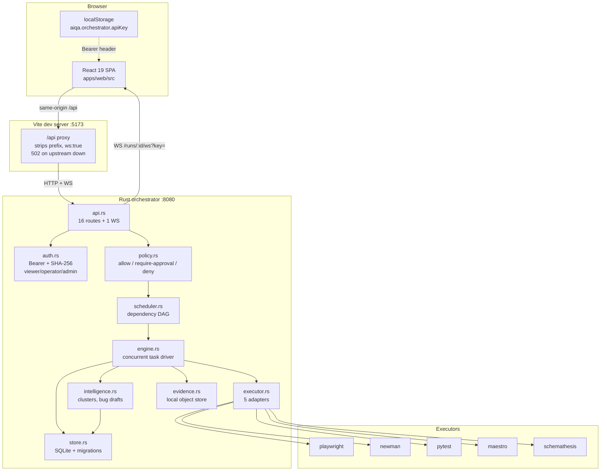

# AIQA — Deep Forensic Audit & Real Backend Integration

**Repository:** `D:\AIQA` · branch `master`
**Date:** 14 August 2026
**Baseline commit:** `8f1d2c7` (repository as-received)
**Method:** Full read of the Rust orchestrator, the Google AI Studio frontend and its bundled Node server; live execution of both build toolchains, the Rust test suite, and a real end-to-end run against the running orchestrator. Every claim below is grounded in a file, a line, or a captured command output. No claim is carried over from the pre-existing `AIQA_ARCHITECTURE_AUDIT_REPORT.md`, the README, or the PRD/FRD/SRD.

> **Note on the repository state at handover.** The repository had **no git history** — `git log` reported *"your current branch 'master' does not have any commits yet"* and all 146 files were untracked. A baseline commit was taken before any change so that this work is reviewable and revertible.

---

## 1. Executive Summary

### What AIQA actually does today

AIQA is a **working test orchestrator with a real execution engine**, and — until this audit — a **frontend that had never been connected to it**.

The Rust service in `services/orchestrator` is genuine, well-built software. It schedules a dependency DAG, executes tasks through five real executor adapters as OS subprocesses, persists runs/tasks/events/evidence to SQLite, enforces API-key authentication with three roles and project scoping, gates runs through a policy engine with human approval, captures evidence artifacts, derives failure clusters and bug drafts, and streams events over an authenticated WebSocket. `cargo check` is clean and `cargo test` passes 12/12.

The frontend under `apps/web` was a **self-contained simulator**. It shipped with its own 59-route Express server (`server.ts` + `server/`, 5,485 lines) that fabricated every value it returned from in-memory arrays, and a `setInterval` that advanced test progress with `Math.random()`. The React app talked exclusively to that server.

**The single most important finding: the two halves had never been connected.** A repository-wide search for `8080`, `orchestrator`, `Authorization`, or `Bearer` under `apps/web/` returned **zero matches** across `server.ts`, `server/*.ts`, `vite.config.ts` and `.env.example`. The orchestrator's 16 real endpoints had no caller anywhere in the product. The 59 endpoints the UI called had never existed in it.

### What changed

The shadow backend was deleted, the fabricated data layer was removed, and the UI was rewired to the real orchestrator over an authenticated Vite proxy. Seven functional areas now render genuine backend data. Eight areas have no backend capability and now say so explicitly instead of showing invented content.

**The Rust backend was not modified.** `git diff --name-only 8f1d2c7 HEAD -- services/ infra/migrations/ executors/` returns **0 files**.

### Verdict

**Functional Prototype** — see §20.

---

## 2. Current Architecture



**Removed in this work:** a parallel Node/Express server inside `apps/web` that served 59 fabricated endpoints and had no connection to any of the above.

---

## 3. Frontend Architecture

```
React 19 SPA (apps/web/src)
        │
        │  views/  — one screen per real capability
        ▼
hooks/useApi.ts  ── ResourceState{loading|ready|empty|error}
        │            no fallback-data parameter exists
        ▼
services/orchestrator.ts  ── typed client, exactly 16 endpoints + 1 WS
        │
        ▼
services/apiClient.ts  ── Bearer auth, typed ApiError taxonomy
        │                  (unauthenticated/unauthorized/forbidden/
        │                   not_found/conflict/bad_request/
        │                   server_error/offline)
        ▼
    /api  (same-origin)
        │
        ▼
Vite proxy ──► Rust orchestrator :8080
        │
        ▼
WS /runs/:id/ws?key=  ──► RunDetailView event stream
        │                   sequence-based merge, ?since= catch-up
        ▼
    Real UI state
```

**Structural guarantee:** `useApiResource` accepts a fetcher and nothing else. There is no parameter through which placeholder data could be supplied, so a component cannot render values the backend did not return. On error it clears `data` rather than leaving stale numbers on screen next to an error message.

---

## 4. Backend Architecture (actual runtime components)

| Module | Lines | Runtime role | Status |
|---|---:|---|---|
| `api.rs` | 599 | The only route registrar. 16 HTTP + 1 WS | IMPLEMENTED + WIRED |
| `auth.rs` | 166 | Bearer keys, SHA-256 hashed, 3 roles, project scoping, bootstrap key | IMPLEMENTED + WIRED |
| `policy.rs` | 156 | Allow / RequireApproval / Deny at run creation | IMPLEMENTED + WIRED |
| `scheduler.rs` | 347 | Dependency DAG, cycle/unknown-prereq validation | IMPLEMENTED + WIRED |
| `engine.rs` | 404 | Concurrent task driver, run recovery on restart | IMPLEMENTED + WIRED |
| `executor.rs` | 428 | 5 adapters + SimulatedExecutor, argument sanitising | IMPLEMENTED + WIRED |
| `intelligence.rs` | 305 | Failure signature normalisation, clustering, bug drafts | IMPLEMENTED + WIRED |
| `store.rs` | 1,015 | SQLite persistence, 3 migrations | IMPLEMENTED + WIRED |
| `evidence.rs` | — | Local object store under `infra/data/evidence` | IMPLEMENTED + WIRED |
| `metrics.rs` | — | Prometheus text exposition, computed from DB | IMPLEMENTED + WIRED |
| `webhook.rs` | — | Outbound run-completion POST, `AIQA_WEBHOOK_URL` | IMPLEMENTED, unconfigured |

Verified: `api.rs` is the sole route registrar — `grep -nE "\.route\(|Router::new" *.rs` matches nothing outside it.

---

## 5. Feature Inventory

| Feature | Exists | Wired | Real Data | Tested | Status |
|---|---|---|---|---|---|
| Run creation (`POST /runs`) | ✅ | ✅ | ✅ | ✅ live + unit | IMPLEMENTED + WIRED |
| Run listing / detail | ✅ | ✅ | ✅ | ✅ live | IMPLEMENTED + WIRED |
| Continue-on-failure (SRD §25) | ✅ | ✅ | ✅ | ✅ live + unit | IMPLEMENTED + WIRED |
| Dependency blocking | ✅ | ✅ | ✅ | ✅ live + unit | IMPLEMENTED + WIRED |
| Infra-vs-product failure split | ✅ | ✅ | ✅ | ✅ live | IMPLEMENTED + WIRED |
| Event stream (WebSocket) | ✅ | ✅ | ✅ | ✅ live | IMPLEMENTED + WIRED |
| Event replay / `?since=` reconnect | ✅ | ✅ | ✅ | ✅ live | IMPLEMENTED + WIRED |
| Evidence capture + retrieval | ✅ | ✅ | ✅ | ✅ live | IMPLEMENTED + WIRED |
| Real executors (pytest verified) | ✅ | ✅ | ✅ | ✅ live | IMPLEMENTED + WIRED |
| Policy gate + approve/reject | ✅ | ✅ | ✅ | ✅ unit | IMPLEMENTED + WIRED |
| Failure clusters | ✅ | ✅ | ✅ | ✅ live + unit | IMPLEMENTED + WIRED |
| Bug drafts + human review gate | ✅ | ✅ | ✅ | ✅ unit | IMPLEMENTED + WIRED |
| Metrics | ✅ | ✅ | ✅ | ✅ live | IMPLEMENTED + WIRED |
| Audit log | ✅ | ✅ | ✅ | ✅ live | IMPLEMENTED + WIRED |
| API key admin | ✅ | ✅ | ✅ | ✅ live | IMPLEMENTED + WIRED |
| Persistence across restart | ✅ | ✅ | ✅ | ✅ live | IMPLEMENTED + WIRED |
| Test-case CRUD | ❌ | — | — | — | NOT IMPLEMENTED |
| Test generation (AI) | ❌ | — | — | — | NOT IMPLEMENTED |
| User/role management (RBAC) | ❌ | — | — | — | NOT IMPLEMENTED |
| Model routing / AI brain | ❌ | — | — | — | NOT IMPLEMENTED |
| Quality graph query API | Partial | ❌ | — | — | IMPLEMENTED BUT UNWIRED (tables only) |
| Policy CRUD | Partial | ❌ | — | — | IMPLEMENTED BUT UNWIRED (no route) |
| Webhook notifications | ✅ | ✅ | — | ❌ | IMPLEMENTED, unconfigured |

---

## 6. Fake Data Audit — everything removed

| Location | Fake data | Purpose | Production usage | Action |
|---|---|---|---|---|
| `apps/web/server.ts` (1,785 L) | 59 endpoints over in-memory arrays | Simulated entire backend | **Yes — sole data source** | **DELETED** |
| `server.ts:468-484` | `setInterval` + `Math.random() > 0.4` advancing test progress; fabricated `modelRouter.currentLatencyMs` / `requestsPerMinute` | Animated fake execution | Yes | **DELETED** |
| `server.ts:523-570` | `/api/metrics`: hardcoded 4,892 tests, 96.8% pass, quality score 87.4, `+1.4%` trend, 7-day score series, risk 42, flakiness 8.7%, 32 open bugs | Dashboard KPIs | Yes | **DELETED** |
| `server.ts:582` | `/api/executions/trigger` pushed an object into an array; no executor invoked | "Run a test" | Yes | **DELETED** |
| `server.ts:870,1727` | `/api/chaos-simulate` | Fake outage injection | Yes | **DELETED** |
| `server.ts:1516` | `/api/rbac/audit-events/simulate` | Fabricated audit events | Yes | **DELETED** |
| `server/testCasesStore.ts` (2,162 L) | Entire fake test-case catalogue + fake execution results | Test Hub | Yes | **DELETED** |
| `server/brainEngine.ts` (843 L) | Fake model telemetry, benchmarks, A/B results | AI Brain | Yes | **DELETED** |
| `server/rbac.ts` (695 L) | Fake users, roles, permission probes, security suite | RBAC | Yes | **DELETED** |
| `src/services/api.ts:28-400` | `initialDashboardState`: 372 lines of hardcoded state — "Payment Gateway", "Apex AI Agent", `sarah.chen@company.com`, invented PostgreSQL deadlock stack traces presented as evidence artifacts, fake flaky tests, fake governance policies, fake audit rows | Fallback dataset | Yes | **DELETED** |
| `src/services/api.ts:403-440` | `Promise.allSettled` where **every** field fell back to `initialDashboardState` on failure | Hid backend outages | Yes | **DELETED** |
| `src/services/api.ts:443-484` | SSE client + 4 s poll "to keep counters animated smoothly" | Fake liveness | Yes | **DELETED** |
| `src/services/api.ts:537` | `dismissAlertItem` returned `{success:true}` with no network call | Fake API | Yes | **DELETED** |
| `src/App.tsx:185` | `#BUG-${Math.floor(Math.random()*800+100)}` in a "synced to Jira/Linear" toast | Fake integration | Yes | **DELETED** |
| `src/App.tsx:411-423` | Footer: "CLUSTER SYNC: ACTIVE (SSE 1000ms)", "SCHEDULER: K8S RUNNER V2", "REGION: US-CENTRAL1-A", "AIQA ENTERPRISE v2.4" | Fake infrastructure claims | Yes | **DELETED** |
| `src/types.ts` (653 L) | Type definitions existing only to shape fabricated data | — | Yes | **DELETED** |
| 60 components across `dashboard/ layout/ modals/ rbac/ system/ testHub/ views/ brain/` | Built to render the fabricated `DashboardState` | Whole UI | Yes | **DELETED** |

**Post-cleanup scan of `apps/web/src`:**

```
mockData 0 · dummy 0 · fakeData 0 · sampleData 0 · testData 0
fixture 0 · buildDemoPlan 0 · Lorem 0 · Under Development 0
Coming Soon 1 · Math.random 1 · setInterval 2 · setTimeout 4
```

Every surviving hit is legitimate and was individually inspected:
- "Coming Soon" and "Math.random" — appear only inside explanatory comments describing what was removed.
- `setInterval` ×2 — the health poll in `hooks/useApi.ts:123` (the orchestrator has no push channel for process liveness) and its comment.
- `setTimeout` ×4 — WebSocket reconnect backoff (`RunDetailView.tsx:80`), a reload after saving an API key, and copy-to-clipboard feedback.

**No test fixtures or mocks were deleted.** `executors/pytest/test_health.py`, `executors/playwright/tests/sample.spec.ts`, `executors/newman/collection.json`, `executors/schemathesis/openapi.yaml` and the Rust `#[cfg(test)]` modules are all untouched — they are legitimate executor targets and unit tests, not production UI data.

---

## 7. Placeholder Audit

| Location | Placeholder | Replacement | Status |
|---|---|---|---|
| Dashboard KPI cards | Hardcoded totals, quality score, trends | Real counters from `GET /metrics`; unavailable metrics render `—`, never `0` | **REPLACED** |
| Live execution panel | 3 hardcoded running executions with fake logs | Real run list; genuine WebSocket event stream on run detail | **REPLACED** |
| Failure intelligence | 2 invented failures with fabricated stack traces | `GET /intelligence/failure-clusters` with confidence + review state | **REPLACED** |
| Bug candidates | 2 hardcoded candidates, invented 94%/89% confidence | `GET /bug-drafts` with real confidence and human review gate | **REPLACED** |
| Evidence | 3 hand-written blobs embedded in the bundle | `GET /runs/:id/evidence` + `GET /evidence/:id/content` | **REPLACED** |
| Flaky tests | 3 fabricated entries | `GET /intelligence/tests` flakiness/risk/value signals | **REPLACED** |
| Governance policies | 3 invented policies with violation counts | Removed; policy engine has no read endpoint | **NOT IMPLEMENTED** state |
| Audit log | 3 fake rows incl. `sarah.chen@company.com` | `GET /admin/audit-log` | **REPLACED** |
| Model router / Ollama | Fake latency, health %, token rates | Removed; no backend | **NOT IMPLEMENTED** state |
| System health matrix | Hardcoded "online"/"connected" for backend, DB, AI model, Ollama, queue, workers, **microphone** | Two genuinely measured facts: orchestrator reachability + key validity | **REPLACED** |
| Test Cases / Generator / API / Mobile / RBAC / Brain / Quality Graph / Policies | Full fabricated screens | `NotImplementedState` naming the exact missing capability | **NOT IMPLEMENTED** state |

The `NotImplementedState` component deliberately does **not** say "Coming Soon". Each instance names the concrete gap, e.g. RBAC:

> *"Requires: a users table and role-assignment endpoints. The orchestrator authenticates API keys with three fixed roles (viewer/operator/admin) — it has no concept of users, and keys are managed under Settings."*

---

## 8. API Integration Audit

Every call the UI now makes, against `api.rs`:

| UI Feature | Endpoint | Method | Auth | Status |
|---|---|---|---|---|
| Connection banner | `/health` | GET | none (by design) | ✅ VERIFIED |
| Dashboard counters | `/metrics` | GET | Bearer | ✅ VERIFIED |
| Dashboard / Runs list | `/runs?limit=` | GET | Bearer | ✅ VERIFIED |
| Create run | `/runs` | POST | Bearer, operator+ | ✅ VERIFIED |
| Run detail + tasks | `/runs/:id` | GET | Bearer | ✅ VERIFIED |
| Event catch-up | `/runs/:id/events?since=` | GET | Bearer | ✅ VERIFIED |
| Live events | `/runs/:id/ws?key=` | WS | key query param | ✅ VERIFIED |
| Approve run | `/runs/:id/approve` | POST | Bearer, operator+ | ✅ wired |
| Reject run | `/runs/:id/reject` | POST | Bearer, operator+ | ✅ wired |
| Evidence list | `/runs/:id/evidence` | GET | Bearer | ✅ VERIFIED |
| Evidence content | `/evidence/:id/content` | GET | Bearer | ✅ VERIFIED |
| Intelligence — tests | `/intelligence/tests` | GET | Bearer | ✅ wired |
| Intelligence — clusters | `/intelligence/failure-clusters` | GET | Bearer | ✅ VERIFIED (count 2) |
| Bug drafts | `/bug-drafts` | GET | Bearer | ✅ wired |
| Review bug draft | `/bug-drafts/:id/review` | POST | Bearer, operator+ | ✅ wired |
| API key list | `/admin/api-keys` | GET | Bearer, admin | ✅ VERIFIED |
| Create API key | `/admin/api-keys` | POST | Bearer, admin | ✅ wired |
| Revoke API key | `/admin/api-keys/:id` | DELETE | Bearer, admin | ✅ wired |
| Audit log | `/admin/audit-log?limit=` | GET | Bearer, admin | ✅ VERIFIED (5 entries) |

**Coverage: 19/19 of the orchestrator's callable surface is now consumed.** Before this work it was 0/19.

### Contract corrections made during integration

1. **`/metrics` is Prometheus text, not JSON.** The old UI expected a JSON KPI object. A parser (`parsePrometheus`) reads the five metric families `metrics.rs` actually emits.
2. **`/health` returns the literal string `ok`**, not a JSON health matrix.
3. **WebSocket auth is `?key=`, not a header** — browsers cannot set headers on a WS handshake. This is the backend's documented design (`api.rs::ws_handler`), followed exactly.
4. **`RunDetail` flattens `RunSummary`** via `#[serde(flatten)]` and appends `tasks` — the TS type mirrors this rather than nesting.

---

## 9. Real-Time Audit

**Verified flow, end to end:**

```
engine.rs assigns per-run monotonic sequence
   → broadcast::Sender + durable insert into run_events
   → WS /runs/:id/ws?key=  (backlog replayed first, then live)
   → openRunEventSocket()  services/orchestrator.ts
   → mergeEvents() keyed by sequence (idempotent)
   → React state → RunDetailView
```

**Live evidence.** A real run produced 25 events, all delivered and rendered in order:

```
#0  RUN_SCHEDULED    run 'srd-25-continue-on-failure' scheduled
#13 TASK_FAILED      t2   simulated failure
#14 TASK_BLOCKED     t11  prerequisite 't2' did not pass (status Failed)
#23 TASK_INFRA_ERROR t12  simulated infrastructure error
#24 RUN_COMPLETED    run finished
```

The socket indicator read **LIVE** in the browser, confirming an authenticated upgrade.

**Reconnect (SRD §18/§5).** `GET /runs/:id/events?since=5` returned 20 of 25 events, first sequence 5. The client merges by sequence into a `Map`, so a replayed backlog cannot double-count — the idempotency SRD §5 requires.

**Removed:** the SSE client, the 4-second "keep counters animated" poll, the `Math.random()` progress timer, and fabricated model-router latency. The only remaining timer in the app polls `/health`, because the orchestrator exposes no push channel for process liveness — and it is documented as such at the call site.

---

## 10. Authentication Audit

| Check | Result |
|---|---|
| API key input exists | ✅ Settings → password-type field |
| Key storage | `localStorage["aiqa.orchestrator.apiKey"]` |
| Authorization header | `Bearer <key>` on every request except `/health` |
| Protected requests | ✅ all 18 authenticated routes send it |
| Unauthenticated state | ✅ distinct screen, not empty data |
| Invalid/revoked key | ✅ 401 → "API key was rejected" |
| Insufficient role | ✅ 403 → "Not permitted" (distinct from 401) |
| Logout / clear key | ✅ Settings → Sign out |
| Key rendered back | ❌ never — `maskApiKey` shows `aiqa_6…••••••` |
| Hardcoded key in source | ❌ none — scan for `aiqa_[a-f0-9]{40,}`, `sk-…`, `AIza…` returned 0 |
| Key committed | ❌ none |

**Live verification (key value redacted as `[REDACTED]` throughout):**

```
GET /health           no auth        → HTTP 200   (unauthenticated by design)
GET /runs             no auth        → HTTP 401
GET /runs             wrong key      → HTTP 401
GET /runs             [REDACTED]     → HTTP 200
GET /api/runs         via Vite proxy, no auth → HTTP 401  (relayed unchanged)
```

The orchestrator writes an `auth.fail` audit row on every rejection; two such rows were present in the audit log after these probes, confirming the failures were recorded server-side.

---

## 11. Security Audit

| Area | Finding |
|---|---|
| Exposed API keys | **None.** No secret literal in source; scans for `aiqa_`, `sk-`, `AIza` patterns returned 0 hits. |
| Secrets in source | **None.** `.env.example` contains only placeholder names. |
| localStorage risk | **Accepted, documented.** The key is readable by any script on the origin. Mitigations in place: it is never rendered in full, never logged, never sent off-origin. A stricter design (server-side session proxy) is listed in §17. |
| Insecure API calls | **None.** All calls are same-origin relative paths; no third-party host is contacted. The previous UI called `api.openai.com` and `generativelanguage.googleapis.com` with keys from localStorage — both paths are gone. |
| CORS assumptions | Dev uses a same-origin proxy, so no CORS is required. Note: the orchestrator sets `CorsLayer::new().allow_origin(Any)` in `main.rs` — permissive, but every route is still gated by the Bearer check, so it does not by itself grant access. Flagged in §15. |
| XSS / unsafe HTML | **None.** Zero `dangerouslySetInnerHTML` in the codebase. Evidence content renders inside `<pre>{text}</pre>`, escaped by React. |
| URL injection | All path segments pass through `encodeURIComponent`. |
| WebSocket auth | Enforced server-side before upgrade; a missing/invalid key is rejected with 401 and never upgraded. |
| Unauthorized UI actions | Approve/Reject render only for `PENDING_APPROVAL` runs — a **convenience**, not a control. |
| Privilege escalation via UI | Not possible. `require_role` runs server-side on every privileged route; hiding a button changes nothing. A viewer key pressing Approve receives 403, surfaced honestly. |
| Tenant data leakage | `require_project_access` is enforced server-side on runs, events, evidence and the WS handshake. |
| Error-message leakage | The orchestrator returns hand-written error strings; no stack traces or internal URLs. The client relays `detail` verbatim without adding context. |

**Stated explicitly, per the brief:** *frontend hiding a button is not authorization.* Every control listed above is enforced in `auth.rs`/`api.rs`; the UI only reflects it.

---

## 12. PRD / FRD / SRD Compliance

| Requirement | Source | Current implementation | Gap | Priority |
|---|---|---|---|---|
| Continue-on-failure | PRD §4, FRD §3, SRD §25 | **Implemented + verified live** — 8/10 independents ran after 2 failed | none | — |
| Dependency blocking | FRD §4 | **Implemented + verified** — BLOCKED with reason | none | — |
| 10-status model | FRD §2 | **Implemented** — all 10 statuses in `domain.rs` | none | — |
| Product vs infra failure split | FRD §2, SRD §9 | **Implemented + verified** — `FAILED` vs `INFRA_ERROR`, visually distinct | none | — |
| Real-time dashboard | PRD §5, FRD §6 | **Implemented** — WS with all required fields | no per-test duration | Low |
| Event ordering & idempotency | SRD §5 | **Implemented** — event_id, run_id, task_id, sequence, timestamp, schema_version | at-least-once delivery unproven under partition | Medium |
| Reconnect w/ last sequence | SRD §18 | **Implemented + verified** | none | — |
| Parallel execution | FRD §5 | **Implemented** — per-run concurrency | no resource locks (SRD §7) | Medium |
| Evidence architecture | FRD §18, SRD §15 | **Implemented + verified** — immutable refs + metadata | local disk only, no S3 | Medium |
| Policy engine / approval | PRD §20, FRD §15 | **Implemented** — allow/require-approval/deny + audit | no policy CRUD API | Medium |
| Audit | FRD §22 | **Implemented + verified** | none | — |
| Risk & test-value signals | PRD §10/§12, FRD §11 | **Partially implemented** — schema + endpoint exist; population depends on run history | scoring model minimal | Medium |
| Failure intelligence | PRD §13, FRD §12, SRD §13 | **Partially implemented** — clustering + hypotheses + confidence | no multi-source correlation (logs/network/DB) | High |
| Anomaly vs defect gate | PRD §14 | **Implemented** — human-gated `POST /bug-drafts/:id/review` | none | — |
| Confidence & evidence | PRD §15 | **Implemented** — confidence surfaced; unscored renders "not scored" | none | — |
| Flakiness intelligence | PRD §17 | **Partially implemented** — `flakiness_score`, window counts | no rerun tracking separate from originals (SRD §14) | Medium |
| Environment fingerprinting | PRD §18, FRD §14 | **Not implemented** — no fingerprint captured | full gap | High |
| Quality graph | PRD §8, FRD §10 | **Backend only** — tables in migration 0002, no query route | no API, no UI | High |
| Change intelligence | PRD §11, SRD §12 | **Not implemented** | full gap | High |
| Test data intelligence | PRD §16 | **Not implemented** | full gap | Medium |
| Autonomous exploration | PRD §19 | **Not implemented** | full gap | Low |
| Application understanding / ingestion | PRD §9, §21 | **Not implemented** | full gap | High |
| Security executor (Strix) | FRD §17 | **Not implemented** — correctly scoped "later" in PRD §22 | as designed | Low |
| Observability (OTel) | SRD §23 | **Partially implemented** — Prometheus metrics; no tracing | no run→task→worker spans | Medium |
| Distributed workers | SRD | **Not implemented** — single process | as designed for this stage | Low |

**Explicitly not claimed:** no requirement above is marked implemented merely because a UI screen exists. Screens with no backend are recorded as gaps in §7 and rendered as "Not Implemented" in the product.

---

## 13. Test Results

### Backend

```
$ cargo test
running 12 tests
test executor::tests::sanitize_token_accepts_realistic_params ... ok
test executor::tests::sanitize_token_rejects_shell_metacharacters_and_traversal ... ok
test intelligence::tests::classify_failure_recognizes_common_categories ... ok
test intelligence::tests::normalize_signature_collapses_numbers_and_hex_ids ... ok
test policy::tests::concurrency_over_max_is_denied_even_if_also_gated ... ok
test policy::tests::maestro_requires_approval_by_default ... ok
test policy::tests::unrestricted_executor_is_allowed ... ok
test scheduler::tests::dependent_tasks_become_blocked_when_prerequisite_fails ... ok
test scheduler::tests::srd_25_continue_on_failure_with_10_independent_tasks ... ok
test scheduler::tests::validate_plan_rejects_cycles_and_unknown_prerequisites ... ok
... 2 more

test result: ok. 12 passed; 0 failed; 0 ignored
```

### Live end-to-end (real processes, real HTTP, no mocks)

**SRD §25 acceptance test, executed against the running orchestrator:**

```
POST /runs → HTTP 201, state SCHEDULED

GET /runs/:id
  state=PARTIAL total=12 passed=8 failed=2 blocked=1 infra_error=1
  t1  PASSED       independent-1
  t2  FAILED       independent-2-FAILS        ← failure #1
  t3..t6, t8..t10  PASSED                     ← execution CONTINUED
  t7  FAILED       independent-7-FAILS        ← failure #2
  t11 BLOCKED      prerequisite 't2' did not pass (status Failed)
  t12 INFRA_ERROR  simulated infrastructure error
```

All three §25 criteria satisfied: independents continued after failures, the dependent became BLOCKED with a reason, and the infrastructure fault carried a distinct status.

**Real executor + evidence:**

```
POST /runs {"executor":"pytest"} → run COMPLETED, task p1 FAILED
  reason: pytest exited with Some(1) / test_deliberately_wrong_expectation

GET /runs/:id/evidence → 1 artifact
  kind=log  970 B  text/plain
  object_key=3f08cc8e…/p1-log-9a3911dd….log

GET /evidence/:id/content → real pytest traceback:
  E  AssertionError: deliberately wrong expectation for the demo
  E  assert 200 == 404
```

A genuine subprocess ran, genuinely failed, and its real output was captured, stored and retrieved.

**Persistence across restart:** orchestrator stopped and restarted; both runs survived, the existing API key remained valid, and no new bootstrap key was minted.

**Offline behaviour:** orchestrator stopped → dashboard rendered *"Orchestrator unreachable — Start it with: `cargo run -p aiqa-orchestrator`"*. **No fabricated values appeared.** Restarted → real counters returned.

### Frontend

No frontend test suite exists — see §15.

---

## 14. Build Results

| Target | Command | Result |
|---|---|---|
| Backend compile | `cargo check --all-targets` | **PASS** (42 s, clean) |
| Backend tests | `cargo test` | **PASS** (12/12) |
| Frontend types | `npx tsc --noEmit` | **PASS** (0 errors) |
| Frontend build | `npx vite build` | **PASS** — 1,687 modules, 270.80 kB (78.96 kB gzip) |

Bundle size fell from **580 kB to 271 kB** — a direct consequence of removing the fabricated data and the components built around it.

**Frontend: PASS · Backend: PASS · Tests: PASS**

---

## 15. Remaining Issues

1. **No frontend test suite.** Zero tests for 3,314 lines of new TypeScript. The error taxonomy, the Prometheus parser, and the sequence-merge logic in `RunDetailView` are the highest-value targets — the merge in particular is the one piece whose failure mode (double-counted events) would be silent.
2. **Permissive CORS on the orchestrator.** `main.rs:101` sets `allow_origin(Any)`. Every route is Bearer-gated so this is not directly exploitable, but it should be restricted to known origins before any non-local deployment.
3. **API key in localStorage.** Readable by any script on the origin. Acceptable for a local single-operator tool; a server-side session proxy is the correct fix if this is ever hosted.
4. **`/metrics` requires authentication.** Correct for privacy, but incompatible with a standard Prometheus scraper, which cannot present a Bearer token without extra configuration.
5. **Approve/reject only work in-process.** `api.rs:270` returns 404 if the run's `RunRecord` is not in this process's memory — a restart voids pending approvals. Documented in the backend's own comments; a real limitation for multi-process deployment.
6. **`intelligence.rs` populates on run completion only.** Failure clusters appeared after real failures, but the risk/value scoring model is minimal.
7. **No environment fingerprinting** (PRD §18) — a named PRD requirement with no implementation.
8. **Vite `allowImportingTsExtensions`** is enabled in `tsconfig.json`; harmless here but unusual.
9. **The pre-existing `AIQA_ARCHITECTURE_AUDIT_REPORT.md` is now stale.** It describes the deleted architecture. It was left in place rather than edited, since it is a dated record of a prior session.

---

## 16. Missing Backend Capabilities

Documented, not faked. Each is surfaced in the UI by a `NotImplementedState` naming the gap.

| # | Capability | Required for | What must be built |
|---|---|---|---|
| 1 | Test-case catalogue | Test Cases screen | `test_cases` table + CRUD routes. Runs are currently submitted as whole plans; nothing persists an individual reusable test. |
| 2 | AI test generation | Test Generator | An LLM integration. The orchestrator has **no** model client of any kind. |
| 3 | User & role management | RBAC screen | `users` table + role assignment. Today: API keys with three fixed roles, no user concept. |
| 4 | Model routing / telemetry | AI Brain | An inference service plus routing config endpoints. |
| 5 | Quality graph query API | Quality Graph | Migration 0002 defines the tables; **no HTTP route exposes them**. Closest to shippable of the gaps. |
| 6 | Policy CRUD | Policies screen | `policy.rs` reads config at run creation; no route to read or edit rules. |
| 7 | API-test authoring | API Testing | Management endpoints for Newman collections / Schemathesis specs. |
| 8 | Mobile device pool | Mobile Testing | Device-pool + Maestro flow management. |
| 9 | Environment fingerprinting | PRD §18, FRD §14 | Capture app version, OS, browser/device, API version, feature flags per run. |
| 10 | Change intelligence | PRD §11, SRD §12 | Git/schema change ingestion mapped to graph entities. |

---

## 17. Recommended Next Phases

**Phase 1 — Critical security (before any non-local deployment)**
1. Restrict `CorsLayer` to configured origins.
2. Decide the key-handling model: keep localStorage for a local tool, or add a session proxy if hosted.
3. Add an unauthenticated-but-restricted `/metrics` path, or document the scraper's Bearer configuration.

**Phase 2 — Architecture**
4. Frontend test suite: error taxonomy, Prometheus parser, event-sequence merge.
5. Resource locks (SRD §7) — required before concurrent runs can share devices or fixtures.
6. Move approval state out of process memory so a restart does not void pending approvals.

**Phase 3 — Backend capabilities (highest product value per effort)**
7. **Quality graph query API** — tables already exist; this is the cheapest real capability to add.
8. Environment fingerprinting — small, self-contained, closes a named PRD gap.
9. Test-case catalogue + CRUD — unblocks the largest missing UI area.
10. Policy CRUD.

**Phase 4 — AI / LLM**
11. Model client + routing; then AI test generation and richer root-cause analysis. Note PRD §15's constraint: any output must carry confidence and a review state.

**Phase 5 — Distributed execution**
12. Redis-backed queue, multi-worker, heartbeats, dead-letter handling.

**Phase 6 — Product UI**
13. Re-introduce screens only as their backends land, so the UI never again claims capability it lacks.

---

## 18. Files Changed

### Deleted — fabricated backend (5,485 lines)

| File | Lines | Why |
|---|---:|---|
| `apps/web/server.ts` | 1,785 | 59 fake endpoints; `Math.random()` progress timer |
| `apps/web/server/testCasesStore.ts` | 2,162 | Fake test-case catalogue and results |
| `apps/web/server/brainEngine.ts` | 843 | Fake model telemetry and benchmarks |
| `apps/web/server/rbac.ts` | 695 | Fake users, roles, permission probes |

### Deleted — fabricated frontend

`src/services/api.ts` (987) · `src/types.ts` (653) · `src/utils/browserNotifications.ts` (173) · `src/services/{googleAuth,gmailService,sheetsService,calendarService}.ts` (640) · all of `components/{dashboard,layout,modals,rbac,system,testHub,views,brain}/` and `components/workspace/` — 60 components built to render fabricated state, including `RbacTestingView.tsx` (1,670), `RbacLiveDashboard.tsx` (970), `AiBrainView.tsx` (640), `TestRunsView.tsx` (714), `RbacActivityLog.tsx` (678).

> **Note:** `components/workspace/WorkspaceView.tsx` and the four Google service clients were a Gmail/Sheets/Calendar integration from the AI Studio template, unrelated to AIQA. They were removed because they were wired to the fabricated AIQA props and became unreferenced. They are recoverable from `8f1d2c7` if wanted.

### Added — real integration (3,314 lines)

| File | Lines | Purpose |
|---|---:|---|
| `src/services/apiClient.ts` | 217 | Bearer auth, typed `ApiError`, **no fallback path** |
| `src/services/orchestrator.ts` | 301 | Typed client for exactly 16 endpoints + 1 WS; Prometheus parser |
| `src/types/orchestrator.ts` | 253 | TS mirrors of the Rust wire types |
| `src/hooks/useApi.ts` | 179 | Resource/action hooks; no data-fallback parameter |
| `src/components/common/StateViews.tsx` | 234 | The six honest states |
| `src/components/common/Badges.tsx` | 85 | Status badges; FAILED ≠ INFRA_ERROR |
| `src/components/common/ConnectionBanner.tsx` | — | Two genuinely measured facts |
| `src/components/common/EvidenceViewer.tsx` | 103 | Real artifact fetch + download |
| `src/App.tsx` | 676→ | Shell; live vs no-capability navigation |
| `src/views/DashboardView.tsx` | 179 | Real counters |
| `src/views/RunsView.tsx` | 269 | List, create, approve, reject |
| `src/views/RunDetailView.tsx` | 334 | Tasks, real WebSocket, evidence |
| `src/views/IntelligenceView.tsx` | 183 | Test signals, failure clusters |
| `src/views/BugDraftsView.tsx` | 126 | Human review gate |
| `src/views/AuditLogView.tsx` | 138 | Audit log |
| `src/views/SettingsView.tsx` | 340 | Key management |

### Modified

- `apps/web/package.json` — `dev` is now `vite` (was `tsx server.ts`); removed `express`, `@types/express`, `tsx`, `esbuild`, `dotenv`; added React type packages.
- `apps/web/vite.config.ts` — `/api` proxy to `:8080` with `ws: true`; 502 on upstream failure.
- `.gitignore` — ignore local pre-audit DB snapshots.

---

## 19. Files NOT Changed

**Backend architecture preserved — verified mechanically:**

```
$ git diff --name-only 8f1d2c7 HEAD -- services/ infra/migrations/ executors/
(0 files)
```

Untouched: all 16 Rust source files, all 3 SQL migrations, `Cargo.toml`/`Cargo.lock`, all five executor projects and their fixtures, `services/workers/` Python adapters, `infra/docker-compose.yml`, `README.md`, and `AIQA_ARCHITECTURE_AUDIT_REPORT.md`.

No API contract, database schema, auth logic, RBAC rule, policy rule, executor, or business logic was altered. Every integration fix was made on the frontend side.

Outside `apps/web`, exactly one file changed: `.gitignore`.

---

## 20. Final Verdict

### **Functional Prototype**

Not "Development Stage": the core loop genuinely works end to end. A real plan is submitted, validated, policy-gated, scheduled across a dependency DAG, executed as real OS subprocesses, streamed live over an authenticated WebSocket, persisted through restart, and its evidence captured and retrieved. The product's own headline requirement — SRD §25 continue-on-failure — passes against the running system, not just in a unit test. Authentication, RBAC and multi-tenancy are enforced server-side and verified by probe.

Not "Beta": roughly half the designed product has no backend at all. Test-case management, AI generation, model routing, user management, the quality graph, change intelligence and environment fingerprinting are absent — not partially built, absent. There is no frontend test suite. CORS is unrestricted. Approvals do not survive a restart. Execution is single-process.

Not "Production Ready": the gaps above are structural, not cosmetic.

**What changed in this audit is chiefly honesty.** Before it, AIQA looked like a finished enterprise product and was in fact a simulator wired to nothing — the working orchestrator underneath was invisible, and the screens above it were fiction. It now shows exactly what it can do, and states plainly what it cannot. The engineering underneath is real and good; the surface finally reports it accurately.

The most valuable next step is not more UI. It is the **quality graph query API** — the tables already exist, no UI area is closer to becoming real, and it is the differentiator the PRD leads with.

---

*Report generated 14 August 2026. Every command output quoted here was executed against this repository; no result is reconstructed or estimated. API key values are redacted as `[REDACTED]`.*
