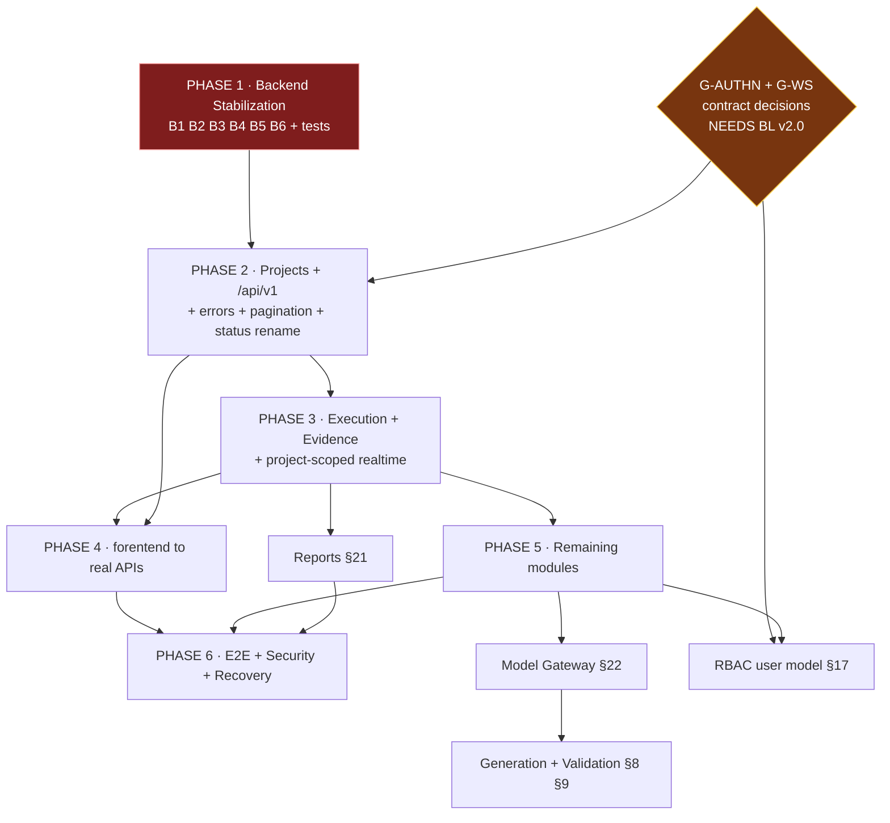

# AIQA — Integration Implementation Plan
## Version 1.0

**Document type:** Architecture decision + backend/API gap plan
**Date:** 17 August 2026
**Status:** Planning baseline — no source code was modified to produce this document

**Inputs read:**
- `AIQA_API_CONTRACT_v1.0.md` (authoritative interface — **not modified by this plan**)
- `AIQA_ACCEPTANCE_MATRIX_v1.0.md`
- `AIQA_FRONTEND_AUDIT_REPORT.md`
- `AIQA_BACKEND_AUDIT_REPORT.md`, `AIQA_DEEP_AUDIT_REPORT.md`
- `services/orchestrator` Rust source (re-verified live for this plan)
- `apps/web/` integration layer (inspected for reuse)

**Not available:** *AIQA Business Logic & Architecture v2.0*. It sits at the top of the contract's source-of-truth hierarchy (§2.2), so any decision below that would depend on it is marked **[NEEDS BL v2.0]** rather than assumed.

**Work ownership tags used throughout:** `[BACKEND]` `[FRONTEND]` `[SHARED/API]` `[INTEGRATION]` `[TESTING]`

---

## 1. Architecture Decision

### 1.1 Decision

AIQA proceeds as **one contract, one backend, one frontend**:

```
forentend/ (Google AI Studio UI)   ← target production frontend
        │
        │  HTTP + WebSocket, /api/v1/projects/{project_id}/...
        ▼
services/orchestrator (Rust/Axum)  ← single authoritative backend
        │
        ▼
SQLite (→ Postgres later) + local evidence store + 5 executors
```

`apps/web/` is retained as a **reference implementation only**, not built, not deployed, not linked.

### 1.2 The decision that must be locked first

The API Contract and the backend describe two different systems:

| | API Contract v1.0 | Backend today |
|---|---|---|
| Path shape | `/api/v1/projects/{project_id}/...` | `/runs`, `/bug-drafts`, `/admin/...` |
| Versioning | `/api/v1` mandatory (§2.1) | none |
| Scoping | project-scoped resources (§2.3) | flat; `project_id` exists only as an API-key attribute |
| Surface | ~61 endpoints | 16 + 1 WebSocket |
| Realtime | per-project event stream (§14) | per-run socket |

The brief forbids changing the contract. Contract §31 additionally forbids undocumented divergence. **Therefore the backend moves to the contract.** This is a breaking change to the backend's own surface and is the single largest item in this plan.

**Consequence for reuse:** every endpoint path in `apps/web/services/orchestrator.ts` encodes the flat shape and becomes obsolete. Its *transport and error machinery* does not — see §3.

### 1.3 What is explicitly NOT decided here

- Postgres migration timing — SQLite is adequate through Phase 3 once §7/B1 is fixed.
- Multi-agent orchestration internals — **[NEEDS BL v2.0]**.
- Model provider selection behind the gateway — **[NEEDS BL v2.0]**.
- Directory rename `forentend/` → `frontend/` — deferred by instruction (§8, F6).

---

## 2. Target Frontend Decision

**Target: `forentend/`.** Confirmed and locked.

### 2.1 Why this is the right call despite scoring 2.9/10

The frontend audit scored `forentend/` low on *integration*, not on *product*. The two axes separate cleanly:

| Axis | `forentend/` | `apps/web/` |
|---|---|---|
| Product surface | **12 pages covering ~18 of 22 ACC areas** | 6 screens covering ~7 |
| Contract feature coverage | broad | narrow (models the current backend, not the contract) |
| Integration | zero | real, working |
| Design system | complete, consistent | functional, minimal |
| LOC | 11,444 | 3,314 |

Integration is **additive and mechanical**; product surface is **expensive and design-led**. Rebuilding 12 pages inside `apps/web` costs far more than adding a client layer to `forentend`. The audit also found the fake data centralised in a single file (`AIQAContext.tsx`) and a correctly-placed service seam (`services/aiqaApi.ts`) — meaning the integration layer has exactly one insertion point per concern.

### 2.2 Retention policy for `apps/web/`

Retained **read-only** as reference until Phase 4 exit. It is excluded from build, CI and deployment. It is deleted only after every component in §3 marked *ADOPT* has been ported and verified. Neither frontend is deleted now.

---

## 3. `apps/web/` Reusable Components

Assessed by reading the actual source. Nothing is copied by this plan.

### 3.1 ADOPT — port with minimal change

| Component | File | LOC | Why reusable | Change required |
|---|---|---:|---|---|
| **Error taxonomy + HTTP client core** | `services/apiClient.ts` | 217 | Path-independent. 8-kind `ApiError` (`unauthenticated`/`unauthorized`/`forbidden`/`not_found`/`conflict`/`bad_request`/`server_error`/`offline`), `kindForStatus()` incl. the 502/503/504 → *offline* mapping that distinguishes "backend down" from "backend errored". Bearer injection, key storage, `maskApiKey()`. | Swap `API_BASE` to `/api/v1`; add structured-error parsing for Contract §2.5 (`{error:{code,message,details,request_id}}`) — the current client reads plain text. **~85% reusable.** |
| **Resource/action hooks** | `hooks/useApi.ts` | 179 | `useApiResource` takes **no fallback-data parameter**, so a component *cannot* render data the backend did not send. That single design choice structurally enforces Acceptance Matrix §32. Plus `usePolledResource`, `useApiAction`, `useIsAuthenticated`, AbortController lifecycle, stale-response guards. | None functional. **~95% reusable.** |
| **Six-state model** | `components/common/StateViews.tsx` | 234 | Loading / Empty / Error / Unauthorized / Offline / NotImplemented + `ResourceView` switcher that only calls `children()` on genuine data. Directly satisfies Contract §28.4. | **Logic adopt, markup rewrite** — `forentend` has its own design system. Port the state machine, re-skin the presentation. **~60% reusable.** |
| **Event sequence reconciliation** | `views/RunDetailView.tsx:53–95` | ~45 | Map-keyed-by-`sequence` merge (idempotent — a replayed backlog cannot double-count), `lastSequenceRef`, `catchUp()` via `?since=`, 5 s reconnect. This is ACC-008's requirement implemented and verified live. | **Extract into a reusable `useEventStream` hook** — it is currently embedded in a view. Re-target to the project-scoped stream. **Algorithm 100% reusable, packaging must change.** |

### 3.2 ADAPT — pattern reusable, content rewritten

| Component | File | Verdict |
|---|---|---|
| Wire-type mirrors | `types/orchestrator.ts` (253) | The *practice* of mirroring backend types 1:1 with a header naming the Rust source is excellent and should continue. The *types* mirror the flat backend; contract resources (Project, Finding, Report, Suite) don't exist. **Rewrite content, keep the discipline.** |
| WebSocket opener | `services/orchestrator.ts:262–300` | `?key=` query-param handshake exists because browsers cannot set headers on a WS upgrade — a **universal constraint** that will apply to the contract's stream too. Keep the technique; re-target the URL. See §11 and §6/G-WS. |

### 3.3 DO NOT REUSE

| Component | Reason |
|---|---|
| `services/orchestrator.ts` endpoint functions (301) | Encodes flat, unscoped paths. Obsolete under §1.2. |
| `views/*` (7 views) | `forentend` has richer equivalents. |
| `components/common/{Charts,Badges,Card,RunVisuals,ConnectionBanner,EvidenceViewer}` | Different design system; `forentend` equivalents exist. |
| `vite.config.ts` proxy | Useful as a **pattern** (dev proxy + 502-on-upstream-down); config itself is app-specific. |

### 3.4 Net

**~675 lines of genuinely reusable integration machinery** out of 3,314. Everything reusable is transport/state logic; nothing product-specific transfers. `[FRONTEND]`

---

## 4. `forentend/` Components to Preserve

Preserve as-is through integration. These are the reason the frontend was chosen.

| Preserve | Detail |
|---|---|
| All 12 pages + navigation | Broad ACC coverage; the product surface being bought |
| Design system | `common/` primitives, Tailwind treatment, dark palette |
| `StatusBadge.tsx` (185 LOC) | Already encodes canonical statuses; one spelling fix (§12) |
| `EmptyState.tsx` + its 5 usages | Genuine empty-state handling already present |
| `GeneratedTestCasesView.tsx` (871) | Deepest feature surface in the product |
| `TraceabilityGraph`, `FeatureMapFlowPage` | Only visualisation of Contract §4 traceability chain |
| `CommandPalette` (⌘K), sidebar toggle (⌘B) | Real, working interactions |
| `types.ts` (541) | Domain vocabulary; reconcile against contract, don't discard |
| Centralised state in `AIQAContext.tsx` | **Structure preserved, contents replaced** — one insertion point |

**Must be replaced, not preserved** (Acceptance Matrix §32): every literal dataset in `AIQAContext.tsx`, all of `services/aiqaApi.ts` (stub bodies), `triggerNewRun()`/`executeApiTest()` fabrication, hardcoded `backendState`, and `policyApprovalState: 'APPROVED'` (Contract §27 breach). **Not yet — see §13 sequencing.** `[FRONTEND]`

---

## 5. Backend Current Capability Map

Verified live against `services/orchestrator/src/api.rs` for this plan.

### 5.1 What genuinely works

| Capability | Evidence |
|---|---|
| DAG scheduling + continue-on-failure | SRD §25 acceptance test passes live: 8/10 independents ran after 2 failed |
| Transitive dependency blocking | 2-level cascade verified (`contract` FAILED → `perf` BLOCKED → `deploy` BLOCKED) |
| Product vs infrastructure failure split | `FAILED` vs `INFRA_ERROR` distinct end to end |
| Real executors | Playwright, Newman, Pytest, Maestro, Schemathesis as real subprocesses; pytest verified |
| Evidence capture + retrieval | Real 970-byte pytest traceback stored and served |
| API-key auth, 3 roles, project scoping | 401/403 verified by probe; `require_project_access` enforced on runs/events/evidence/WS |
| Audit log | Writes on auth failure, run create, approve/reject, key ops |
| Realtime WS | Sequence-numbered, durable replay on connect, `?since=` catch-up |
| Policy gate + human approval | allow / require-approval / deny + audit |
| Failure clustering + bug drafts | Human-gated promotion (PRD §14) |
| Command-injection defence | `sanitize_token` + regression tests |
| SQL injection | None — fully parameterised |

`cargo check` clean; `cargo test` 12/12.

### 5.2 Endpoint inventory (16 + 1 WS)

```
GET  /health                       GET  /runs                POST /runs
GET  /runs/:id                     GET  /runs/:id/events     POST /runs/:id/approve
POST /runs/:id/reject              GET  /runs/:id/evidence   GET  /evidence/:id/content
GET  /intelligence/tests           GET  /intelligence/failure-clusters
GET  /bug-drafts                   POST /bug-drafts/:id/review
GET  /metrics                      POST|GET /admin/api-keys  DELETE /admin/api-keys/:id
GET  /admin/audit-log              WS   /runs/:id/ws?key=
```

**None carries `/api/v1`. None is project-scoped in its path.**

---

## 6. API Contract Gap Matrix

`IMPL` = exists and usable · `PARTIAL` = analogue exists, wrong path/shape/scope · `MISSING` = nothing

| § | Area | Contract eps | Backend | Status | Gap |
|---|---|---:|---|---|---|
| 5 | Projects | 5 | — | **MISSING** | No project entity. **Blocks all scoping.** |
| 6 | Context ingestion | 2 | — | **MISSING** | No upload/processing pipeline |
| 7 | Quality graph / requirements | 4 | tables in migration 0002 | **PARTIAL** | Schema exists, **no HTTP route** |
| 8 | Test generation | 4 | — | **MISSING** | No LLM integration of any kind |
| 9 | Test validation | 2 | — | **MISSING** | |
| 10 | Suites / plans | 3 | `RunPlan` in POST body | **PARTIAL** | Plans not persisted as reusable entities |
| 11 | Orchestrator plans | 2 | `scheduler.rs` DAG | **PARTIAL** | Engine exists, no plan API |
| 12 | Execution | 5 | `/runs*` | **PARTIAL** | Path + scope mismatch; **no cancel endpoint** (§12.3) |
| 13 | Canonical statuses | — | 10 statuses | **PARTIAL** | `INFRA_ERROR` ≠ `INFRASTRUCTURE_ERROR` (§12) |
| 14 | Realtime events | 1 WS | `/runs/:id/ws` | **PARTIAL** | Per-**run** not per-**project**; event vocabulary differs; **WS auth unspecified in contract** |
| 15 | Evidence | 2 | `/runs/:id/evidence`, `/evidence/:id/content` | **PARTIAL** | Works; wrong path/scope |
| 16 | Findings / RCA | 3 | `/intelligence/*`, `/bug-drafts` | **PARTIAL** | Concept present, different names; **no `POST .../analysis`** |
| 17 | RBAC | 6 | API keys + 3 fixed roles | **PARTIAL** | **No user model, no role CRUD, no matrix** |
| 18 | API testing | 4 | Newman/Schemathesis executors | **PARTIAL** | Reachable only by submitting a run plan; no spec/telemetry API |
| 19 | Mobile | 5 | Maestro executor | **PARTIAL** | No device inventory, health or locking |
| 20 | Custom tests | 1 | — | **MISSING** | |
| 21 | Reports | 4 | — | **MISSING** | No generation, no PDF/Excel export |
| 22 | Model gateway | 3 | — | **MISSING** | No model client anywhere |
| 23 | Dashboard / KPIs | 2 | `/metrics` | **PARTIAL** | **Prometheus text, not JSON**; no KPI concepts |
| 24 | Settings | 2 | env-only config | **MISSING** | No persistence, no API |
| 25 | Audit | 1 | `/admin/audit-log` | **PARTIAL** | Works; admin-only, unscoped, wrong path |

**Totals:** IMPL **0** · PARTIAL **14** · MISSING **8** · contract endpoints with a usable backend today: **~7 of 61**.

### 6.1 Cross-cutting gaps

| ID | Gap | Owner |
|---|---|---|
| G-VER | No `/api/v1` prefix anywhere (§2.1) | `[BACKEND]` |
| G-SCOPE | No project entity; `project_id` is only an API-key attribute (§2.3) | `[BACKEND]` |
| G-ERR | Errors are plain strings, not `{error:{code,message,details,request_id}}` (§2.5) | `[BACKEND]` + `[FRONTEND]` |
| G-PAGE | No `page`/`page_size` on any collection (§3.3) | `[BACKEND]` |
| G-FILTER | No filter/search/sort (§3.4) | `[BACKEND]` |
| G-AUTHN | API keys only; no user identity (§2.4) | `[SHARED/API]` **[NEEDS BL v2.0]** |
| G-WS | **Contract §14 does not specify how the WebSocket authenticates.** Browsers cannot set headers on a WS upgrade. | `[SHARED/API]` |
| G-STATUS | Three spellings of one status (§12) | `[SHARED/API]` |
| G-EVENT | Contract event vocabulary (`TASK_STATUS_CHANGED`, `MODEL_*`, `RBAC_ACCESS_PATH`…) ≠ backend's (`TASK_PASSED`, `TASK_FAILED`…) | `[SHARED/API]` |

**G-WS and G-AUTHN are genuine contract ambiguities, not implementation defects.** They must be resolved in the source documents before realtime and auth work starts. This plan does not resolve them and does not modify the contract.

---

## 7. Backend Blockers

Re-verified live for this plan — **all still open**.

### 7.1 Must fix before ANY frontend integration

**B1 — Silent persistence corruption `[BACKEND]` CRITICAL**
`store.rs:54-58` still opens SQLite with no `journal_mode(Wal)` and no `busy_timeout`; `engine.rs` still swallows **8** persistence failures with `warn!`/`error!` then continues.
Proven: a 500-task run stored as **498 PASSED + 2 stuck RUNNING**, 1 event lost; a 50-task run where all 50 passed stored as **FAILED**.
*Why it blocks:* the frontend would faithfully display corrupted data, and no frontend bug could be distinguished from backend corruption. **Integrating before this fix makes frontend correctness untestable.**

**B2 — Recovery mislabels passing runs `[BACKEND]` CRITICAL**
`engine.rs:229` — `if touched_any { Partial } else { Failed }`, unchanged. A run whose tasks all passed but whose completion write was lost is recorded `FAILED`.

**B3 — Cross-tenant intelligence leak `[BACKEND]` HIGH**
`store.rs:569` `task_history_by_name` still has no tenant predicate. Proven: project `beta` shows `failure_rate=0.75` over a `3/4` window having run the task once, successfully — those failures belong to `alpha`.
*Why it blocks:* project scoping is the foundation of Phase 2. Shipping scoping while intelligence silently crosses it would make ACC-001/ACC-021 unverifiable.

### 7.2 Must fix before execution UI is trustworthy

**B4 — `started_at` recorded before a task can run `[BACKEND]` HIGH**
`engine.rs:290–296` marks every eligible task started; the permit is acquired at line **309**. Proven: 5×600 ms tasks at `concurrency:1` all report the same start instant and durations of 2.5–3.1 s. Pollutes `execution_cost_ms`, which carries **15% of the risk score**.

**B5 — No executor timeout `[BACKEND]` HIGH**
`grep tokio::time::timeout executor.rs` → **0**. A hung tool holds its semaphore permit forever and stalls the run. `TaskStatus::Timeout` is unreachable for real executors.

**B6 — `POST /runs` fails at ~100 tasks `[BACKEND]` HIGH**
Un-batched, un-transactional inserts. Measured: 10→201 (0.77 s), 50→201 (8.58 s), **100→HTTP 500**. Acceptance Matrix §12 targets ~1,000 tests.

### 7.3 Structural (Phase 2+)

**B7** no project entity · **B8** no `/api/v1` · **B9** unstructured errors · **B10** no pagination/filtering · **B11** approvals process-local (`api.rs:270` 404s after restart) · **B12** permissive CORS (`allow_origin(Any)`) · **B13** `/metrics` auth-gated Prometheus text, unusable as a JSON dashboard source

---

## 8. Frontend Blockers

| ID | Blocker | Owner |
|---|---|---|
| **F1** | **No integration surface** — 0 `fetch`/`axios`/`WebSocket`/`EventSource` in 11,444 LOC | `[FRONTEND]` |
| **F2** | **No authentication** — no login, no token, no storage, no `Authorization` header. Backend requires Bearer on 18 of 19 routes, so the first real request 401s | `[FRONTEND]` |
| **F3** | **Fabricated data throughout** — `backendState` hardcoded `connected`; `triggerNewRun()` invents runs; `executeApiTest()` always PASSED/200 | `[FRONTEND]` |
| **F4** | **Frontend owns backend decisions** — `policyApprovalState:'APPROVED'` set client-side (Contract §27) | `[FRONTEND]` |
| **F5** | **No routing** — `switch(activePage)`, no URLs, nothing deep-linkable or reload-safe | `[FRONTEND]` |
| **F6** | Project scoping cosmetic — selector exists, **0** places filter by project id | `[FRONTEND]` |
| **F7** | No realtime consumption — `LIVE` badge, no socket | `[FRONTEND]` |
| **F8** | Error handling absent — **1 `catch`** in 11,444 lines, no boundary | `[FRONTEND]` |
| **F9** | Zero tests, no framework | `[TESTING]` |
| **F10** | No audit/governance page (ACC-020) — backend already serves it | `[FRONTEND]` |

---

## 9. Authentication Strategy

### 9.1 Current

Backend: opaque `aiqa_<64-hex>` bearer keys, SHA-256 hashed, roles `viewer < operator < admin`, optional `project_id` scope, bootstrap admin key printed once. Enforced server-side on every route but `/health`. **Working and verified.**
Frontend: none.
Contract §2.4: "Protected APIs require an authenticated identity"; §26.8: frontend checks are UX only.

### 9.2 The unresolved question

Contract §2.4 says *identity*; the backend has *keys*, not users. Contract §17 requires `rbac/users` and `rbac/roles`, implying a user model. Whether AIQA authenticates **users** (sessions/OAuth) or **API keys** is not settled by any document available. **[NEEDS BL v2.0]** `[SHARED/API]`

### 9.3 Interim strategy (Phases 1–3)

Adopt API-key auth as-is — it is real, tested and sufficient to unblock integration:

1. `[FRONTEND]` Port `apps/web/services/apiClient.ts` Bearer machinery: key entry, `localStorage`, `maskApiKey()` for display, never log the value.
2. `[FRONTEND]` Handle `401 → unauthorized`, `403 → forbidden` as distinct states (both already in the ported taxonomy).
3. `[FRONTEND]` Settings screen gains a key field + "sign out". Do **not** hardcode a key or commit one.
4. `[BACKEND]` Restrict `CorsLayer` from `Any` to configured origins (B12).
5. `[SHARED/API]` Decide keys-vs-users before Phase 5 — RBAC (ACC-011) cannot be built without it.

**Not chosen now:** OAuth/OIDC, sessions, refresh tokens — all depend on 9.2.

### 9.4 WebSocket authentication `[SHARED/API]`

Browsers cannot set headers on a WS upgrade. The backend solves this with `?key=`; the contract is silent. Options, to be decided before Phase 3:
(a) query parameter (matches backend today; key may appear in server logs),
(b) short-lived ticket minted over HTTP then presented on connect (safer, more work),
(c) cookie-based (requires the session model from 9.2).
**This plan does not choose** — it is a contract decision.

---

## 10. Project-Scoping Strategy

Project scoping is the **foundation** of the contract: 20 of 25 sections are project-scoped. Nothing above it can be built correctly first.

### 10.1 Gap

Backend has no project entity. `project_id` exists as a nullable API-key attribute and a `runs` column, enforced by `require_project_access` — real isolation, but no CRUD, no listing, no lifecycle. `tasks` has **no** `project_id`, which is precisely why B3 leaks.

### 10.2 Strategy `[BACKEND]`

1. **Migration 0004** — `projects` table (id, name, description, created_at, …).
2. **Denormalise `project_id` onto child tables** (`tasks`, `run_events`, `evidence`) or add joins. Required to close B3 and to make scoped queries indexable.
3. **`/api/v1/projects` CRUD** (Contract §5.1–5.4).
4. **Path migration** — every resource route moves under `/api/v1/projects/{project_id}/...`.
5. **Scope enforcement at the extractor layer**, not per-handler, so a new endpoint cannot forget it.
6. **Index `(project_id, …)`** on every scoped query path; add the missing `tasks(name, project_id)` index (audit M4).

### 10.3 Strategy `[FRONTEND]`

7. Project selection becomes **global app state**, not a Dashboard-local control.
8. Every request carries the selected project id **in the path**.
9. Changing project **invalidates all cached resource state** — the current behaviour (labels change, data doesn't) is exactly what ACC-001 forbids.
10. No project selected → explicit empty/selection state, never a default like the current hardcoded `prj-aiqa`.

---

## 11. Realtime Strategy

### 11.1 Gap

| | Contract §14 | Backend | Frontend |
|---|---|---|---|
| Endpoint | `/api/v1/projects/{id}/events` | `WS /runs/:id/ws?key=` | none |
| Granularity | project | run | — |
| Envelope | `{event_id,event_type,project_id,run_id,task_id,timestamp,sequence,data}` | `{event_id,run_id,task_id,sequence,timestamp,schema_version,type,status,summary}` | — |
| Vocabulary | `RUN_STATUS_CHANGED`, `TASK_STATUS_CHANGED`, `MODEL_*`, `RBAC_ACCESS_PATH`, `REPORT_READY`… | `TASK_PASSED`, `TASK_FAILED`, `RUN_COMPLETED`… | — |
| Auth | **unspecified** | `?key=` | — |

Backend already satisfies the *hard* parts: monotonic per-run `sequence`, durable replay on connect, `?since=` catch-up. Those are the properties ACC-008 actually tests.

### 11.2 Strategy

`[BACKEND]`
1. Add project-scoped stream `/api/v1/projects/{id}/events`, multiplexing that project's runs. Keep the per-run socket internally.
2. Map internal event types onto the contract vocabulary (G-EVENT) — or amend the contract; **that is a §31 decision, not an implementation choice.**
3. Add `project_id` to the envelope.
4. Make `sequence` monotonic **per project stream** (currently per run) — otherwise the frontend's merge key collides across concurrent runs. **This is the subtlest item in the plan.**
5. Fix the `Lagged` path (audit M5): a lagging client is silently skipped with no resync signal. Close with a distinct code or emit a resync marker.

`[FRONTEND]`
6. Port the sequence-merge + reconnect algorithm from `apps/web/views/RunDetailView.tsx:53–95`, **extracted into a `useEventStream` hook**.
7. Reconnect must re-fetch authoritative REST state, not just replay events (Contract §14, ACC-008).
8. Handle disconnect visibly — no silent staleness.

`[TESTING]`
9. ACC-008 procedure: start → disconnect → let run continue → reconnect → assert reconciliation and no duplicates.

---

## 12. Status Vocabulary Reconciliation

**One canonical status currently has three spellings:**

| Source | Value |
|---|---|
| Contract §13 (authoritative) | `INFRASTRUCTURE_ERROR` |
| Backend `domain.rs` | `INFRA_ERROR` |
| `forentend` | `infraErrors`, `infraFailuresCount` |

Contract §13: *"Frontend MUST NOT create alternate spellings."* The contract is authoritative and unmodifiable here, so **backend and frontend both move to `INFRASTRUCTURE_ERROR`.**

### Required work

`[BACKEND]` Change `TaskStatus::InfraError` serde + `as_db_str()`/`from_db_str()` to `INFRASTRUCTURE_ERROR`.
`[BACKEND]` **Data migration** — existing rows store the literal `'INFRA_ERROR'`; `/metrics` label values change too. This is a schema-affecting change, not a rename.
`[FRONTEND]` Rename fields; `StatusBadge.tsx` map key.
`[SHARED/API]` Verify the other nine statuses match exactly (they do today).
`[TESTING]` Assert every canonical status round-trips backend → API → UI.

**Do this early.** It is cheap now and expensive after reports, metrics and dashboards depend on the string.

---

## 13. Recommended Implementation Order

Sequenced so each phase is independently verifiable and never builds on unverified ground.

### PHASE 1 — Backend Stabilization `[BACKEND]` `[TESTING]`
*Nothing else may start. Everything downstream reads this store.*
1. B1 — WAL + `busy_timeout`; stop swallowing persistence errors.
2. B2 — derive recovery state from task statuses, not from `touched_any`.
3. B3 — tenant predicate on `task_history_by_name` + `tasks.project_id`.
4. B4 — acquire permit **before** `mark_started`.
5. B5 — `tokio::time::timeout` per executor; make `TIMEOUT` reachable.
6. B6 — transaction + batched inserts in `insert_run`.
7. Tests for `engine.rs` and `store.rs` — **every finding lives in an untested module.**
**Exit:** the 500-task and 50-task corruption cases pass; concurrency-1 timing is honest; 1,000-task plan accepted.

### PHASE 2 — Projects + Auth + API Foundation `[BACKEND]` `[SHARED/API]`
8. Resolve G-WS and G-AUTHN in the source documents. **[NEEDS BL v2.0]**
9. Migration 0004: `projects` + `project_id` denormalisation.
10. `/api/v1` prefix; move all routes under project scope.
11. Structured error contract (§2.5) + `request_id`.
12. Pagination + filtering (§3.3–3.4).
13. §12 status rename + data migration.
14. JSON dashboard/KPI endpoints (§23) — replaces Prometheus-text-as-UI-source.
15. Restrict CORS.
**Exit:** contract-shaped, project-scoped, structured-error API for the endpoints that exist.

### PHASE 3 — Real Execution + Evidence + Realtime `[BACKEND]`
16. `POST .../executions` + **cancel** (§12.3, currently missing).
17. Project-scoped event stream + per-project sequence + contract vocabulary.
18. Evidence + findings under contract paths.
19. Audit under `/api/v1/projects/{id}/audit`.
**Exit:** ACC-007/008/009/010/020 backend-verifiable.

### PHASE 4 — Google AI Studio UI → Real APIs `[FRONTEND]` `[INTEGRATION]`
20. Port §3.1 ADOPT components into `forentend`.
21. Auth: key entry, storage, 401/403 states.
22. Routing (F5); global project selection (F6).
23. **Replace fabrication screen by screen, backend-ready first:** Audit → Evidence → Execution → Dashboard.
24. `useEventStream`; reconnect reconciliation.
25. Remove each literal **only when its endpoint is live** (§13.1).
**Exit:** every wired screen shows real data or an honest state; zero fabricated values on wired paths.

### PHASE 5 — Remaining Modules `[BACKEND]` `[FRONTEND]`
26. Test-case CRUD → generation → validation (needs model gateway).
27. Model gateway (§22) — **[NEEDS BL v2.0]** for provider policy.
28. RBAC user/role model (needs 9.2).
29. API testing + telemetry; mobile devices + locking; reports + PDF/Excel; settings persistence; context ingestion; quality-graph query.

### PHASE 6 — E2E + Security + Recovery `[TESTING]`
30. E2E-001…007.
31. Security/RBAC negative tests (ACC-021).
32. Recovery tests (ACC-022) — re-verify B1/B2 under load.
33. Fake/stub/placeholder audit (Matrix §32).
34. Final Acceptance Matrix sign-off.

### 13.1 Sequencing rule

**Do not delete fabricated data before its replacement endpoint is live.** Removing it first yields a blank product with no diagnostic value and no demo. Replace screen by screen; the app stays demonstrable throughout. *(Consistent with the standing instruction: do not delete fake data yet.)*

---

## 14. Dependency Graph



**Critical path:** `B1 → Projects/`/api/v1` → Execution+Realtime → Frontend integration → E2E`.

**Two hard gates:**
- **B1 (Phase 1)** — technical. Everything reads the store; a corrupting store invalidates all downstream verification.
- **G-AUTHN + G-WS** — documentary. Not code. Can be resolved **in parallel with Phase 1**, and should be, because Phase 2 blocks on them.

**Parallelisable:** frontend §3.1 ports, routing and the design work can proceed during Phases 1–2 against the *shape* of the contract, provided nothing is wired to fabricated data.

---

## 15. Backend Milestones `[BACKEND]`

| # | Milestone | Exit criteria |
|---|---|---|
| BE-1 | Persistence integrity | 500-task run survives restart with correct statuses; 0 `database is locked`; no swallowed write |
| BE-2 | Recovery correctness | All-passed run with lost completion write recovers as COMPLETED, not FAILED |
| BE-3 | Tenant isolation in intelligence | Two projects, same task name: histories provably independent |
| BE-4 | Honest timing | 5×600 ms at concurrency 1 → distinct `started_at`, ~600 ms durations |
| BE-5 | Executor timeouts | Hung tool → `TIMEOUT`, permit released, run completes |
| BE-6 | Bulk plan capacity | 1,000-task plan accepted inside an agreed latency budget |
| BE-7 | Backend test coverage | `engine.rs` + `store.rs` covered; BE-1…BE-6 pinned by tests |
| BE-8 | Projects API | §5.1–5.5 with server-side isolation |
| BE-9 | `/api/v1` + scoped routing | All routes contract-shaped |
| BE-10 | Structured errors | §2.5 envelope + `request_id` on every error |
| BE-11 | Status rename | `INFRASTRUCTURE_ERROR` end to end + data migration |
| BE-12 | Dashboard/KPI JSON | §23.1–23.2 from authoritative state |
| BE-13 | Execution + cancel | §12.1–12.5 incl. auditable cancel |
| BE-14 | Project event stream | §14 with per-project sequence + resync-on-lag |
| BE-15 | Evidence/findings/audit on contract paths | §15, §16, §25 |

---

## 16. Frontend Milestones `[FRONTEND]`

| # | Milestone | Exit criteria |
|---|---|---|
| FE-1 | Integration layer exists | Real client in `services/aiqaApi.ts` — first `fetch` in the codebase |
| FE-2 | Auth | Key entry, storage, masked display, 401/403 distinct states |
| FE-3 | Six states | Loading/Empty/Error/Unauthorized/Offline/NeedsReview in `forentend`'s design system |
| FE-4 | Routing | Every page addressable, reload-safe, back/forward correct |
| FE-5 | Global project scope | Selection app-wide; switching invalidates caches; no default project |
| FE-6 | Audit page | ACC-020 against real `/audit` — **first fully real screen** |
| FE-7 | Evidence viewer | Real artifacts fetched and rendered |
| FE-8 | Execution hub real | Real runs/tasks; **`policyApprovalState` no longer set client-side** |
| FE-9 | Realtime | `useEventStream` + reconnect reconciliation |
| FE-10 | Dashboard real | Every KPI from `/dashboard` or `/kpis`; unavailable → `—`, never `0` |
| FE-11 | Fabrication removed on wired paths | `Math.random`, `setTimeout`-as-work, literal datasets gone from integrated screens |
| FE-12 | Status vocabulary | `INFRASTRUCTURE_ERROR`; all 9 others verified |

---

## 17. Integration Milestones `[INTEGRATION]`

| # | Milestone | Verifies |
|---|---|---|
| INT-1 | Auth handshake | Key → authenticated request → 401 on bad key |
| INT-2 | Project selection → scoped data | ACC-001; cross-project access denied |
| INT-3 | Create + observe a run | ACC-007; real executors |
| INT-4 | Realtime during execution | ACC-008 |
| INT-5 | Disconnect → reconnect → reconcile | ACC-008 / E2E-005 |
| INT-6 | Evidence retrieval | ACC-009 |
| INT-7 | Failure → finding → NEEDS_REVIEW | ACC-010 |
| INT-8 | Audit record for an auditable action | ACC-020 |
| INT-9 | Permission denied surfaces correctly | ACC-021 |
| INT-10 | Report reconciles with run data | ACC-016 |

---

## 18. Test Milestones `[TESTING]`

| # | Milestone | Scope |
|---|---|---|
| T-1 | Backend unit coverage for `engine.rs`/`store.rs` | Closes the gap where **every audit finding lived in an untested module** |
| T-2 | Contract tests | Endpoint availability, request validation, response + error schema, auth, isolation, status transitions (§30) |
| T-3 | Frontend test framework | None exists today (F9) |
| T-4 | Client + error taxonomy tests | Each `ApiErrorKind` maps to the right state |
| T-5 | Event-merge tests | Idempotency, out-of-order, duplicate, gap-after-reconnect |
| T-6 | E2E-001…007 | Acceptance Matrix §28 |
| T-7 | Security/RBAC negatives | ACC-021 |
| T-8 | Recovery under load | ACC-022; re-runs the B1/B2 reproductions |
| T-9 | Fake/stub/placeholder audit | Matrix §32 — automated scan in CI |

---

## 19. Risks

| # | Risk | Likelihood | Impact | Mitigation |
|---|---|---|---|---|
| R1 | Integration starts before B1 → corrupted data mistaken for frontend bugs | **High** if Phase 1 is skipped | **Critical** | Phase 1 is a hard gate |
| R2 | `/api/v1` + project scoping is a bigger backend change than it appears (touches every route, handler, test) | High | High | Treat Phase 2 as a first-class refactor with its own test pass, not a path rename |
| R3 | G-AUTHN/G-WS unresolved → Phase 2 stalls | **Medium-High** | High | Resolve in parallel with Phase 1; they are document decisions, not code |
| R4 | Per-project sequence numbering (§11.4) mis-specified → duplicate/missing UI events under concurrent runs | Medium | High | Design and test explicitly before Phase 3 exit |
| R5 | Status rename lands late → migration across metrics, reports, stored rows | Medium | Medium | Do it in Phase 2 (§12) |
| R6 | Fabricated data removed before endpoints exist → blank product, no demo | Medium | Medium | §13.1 rule |
| R7 | Model gateway blocked on **[NEEDS BL v2.0]** → generation/validation stall | Medium | High | Obtain BL v2.0 before Phase 5 |
| R8 | 61 contract endpoints vs 16 today read as "nearly done" | Medium | High | This matrix (§6) is the reference; ~7 have a usable analogue |
| R9 | `apps/web` drifts or gets partially revived | Low | Medium | Excluded from build/CI; delete only after §3.1 ports verified |
| R10 | 1.03 MB unsplit bundle degrades as integration adds code | Medium | Low | Code-split in Phase 4 |
| R11 | SQLite ceiling under 1,000-test target even after B6 | Medium | Medium | Re-evaluate Postgres at Phase 3 exit; `store.rs` was written to make the swap a connection change |

---

## 20. Final Go / No-Go Decision for Integration

### **NO-GO for frontend integration today.**

Two independent gates are unmet.

**Gate 1 — Backend data integrity (technical, blocking).**
B1 and B2 remain open, re-verified live for this document. The store silently corrupts durable state under ordinary load: a 500-task run persisted as 498 PASSED + 2 stuck RUNNING, and a 50-task run in which every task passed persisted as FAILED. Any frontend built against this would render corrupted data faithfully, and no frontend defect could be separated from backend corruption. Integrating now would not merely risk bugs — it would make frontend correctness **unverifiable**.

**Gate 2 — Contract/backend shape (structural, blocking).**
The frontend must consume `/api/v1/projects/{project_id}/...`. The backend serves 16 flat, unversioned, unscoped routes, of which ~7 have any analogue to the ~61 the contract defines. There is no project entity to scope by. Wiring the frontend to today's paths would encode a shape that Phase 2 then breaks — paying for the integration twice.

### What IS cleared to proceed now

| Work | Owner | Why unblocked |
|---|---|---|
| Phase 1 backend stabilization | `[BACKEND]` | The gate itself |
| Resolve G-AUTHN + G-WS | `[SHARED/API]` | Document decisions; Phase 2 blocks on them |
| Port §3.1 ADOPT components into `forentend` | `[FRONTEND]` | Transport-layer, contract-neutral; wire to nothing yet |
| Routing (F5) + global project state shell (F6) | `[FRONTEND]` | Structural, no backend dependency |
| Frontend test framework (T-3) | `[TESTING]` | No dependency |
| Status vocabulary decision (§12) | `[SHARED/API]` | Cheap now, expensive later |

### Go condition

Integration becomes **GO** when:

1. BE-1…BE-7 pass (Phase 1 exit), **and**
2. BE-8…BE-10 pass — projects, `/api/v1` scoping, structured errors (Phase 2 core), **and**
3. G-AUTHN and G-WS are resolved in the source documents.

At that point the first genuinely real screen — **Audit (FE-6)** — can be integrated against a backend endpoint that already works today, giving an early, verifiable end-to-end proof before the larger surfaces follow.

### Standing constraints honoured by this plan

No source code was modified. No frontend was deleted. No fake data was removed. No UI was redesigned. No API was invented. API Contract v1.0 was not changed — the two ambiguities found in it (G-WS, G-AUTHN) are reported for resolution in the source documents, per Contract §1 and §31.

---

## Document Control

**Document:** AIQA Integration Implementation Plan
**Version:** 1.0
**Status:** Planning baseline
**Depends on:** API Contract v1.0; Acceptance Matrix v1.0; Frontend Audit; Backend Audit; Business Logic & Architecture v2.0 *(unavailable — items marked **[NEEDS BL v2.0]**)*
**Target frontend:** `forentend/` · **Reference only:** `apps/web/`
**Next step:** Phase 1 development prompt — Backend Stabilization (BE-1…BE-7)
