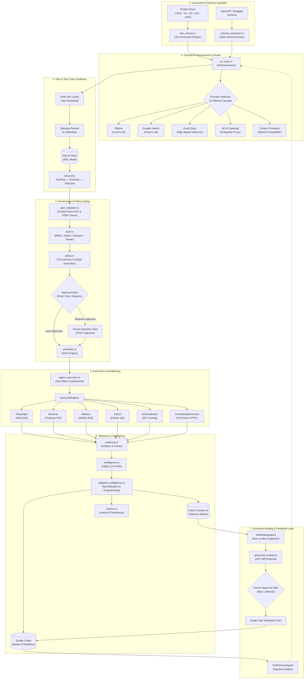

# AIQA — Autonomous & Governed QA Intelligence Platform

> **Production-Grade Test Orchestration, Deterministic Multi-Executor Execution, Governed Self-Healing, and Adaptive QA Intelligence.**

---

## 1. Overview

**AIQA** is an enterprise-grade autonomous and governed Quality Assurance (QA) platform written natively in **Rust** (backend orchestrator) and **TypeScript / React 19** (web control plane). 

Unlike conventional test-generation tools that generate brittle test scripts in the background, AIQA enforces a **governed execution model**:
- **Authoritative Central Orchestration**: All scheduling, execution dispatch, policy enforcement, evidence collection, and state transitions are managed deterministically by the Rust orchestrator.
- **Closed Action AST Invariant**: AI agents and self-healing algorithms operate exclusively on structured, immutable Action Abstract Syntax Trees (`execution_plan::Action`). Arbitrary code execution, source file mutations, and unmonitored shell executions are architecturally impossible.
- **Human-in-the-Loop Governance**: Healing proposals, production runs, and gated executors enforce policy gates requiring human operator review and approval prior to execution.
- **Multi-Tenant & Multi-Project Isolation**: Every query, execution run, telemetry record, and agent interaction is strictly scoped by project and tenant identifiers.
- **Empirical Closed-Loop Intelligence**: Execution telemetry is normalized in real-time, clustered using cryptographic SHA-256 fingerprinting with dynamic token masking, and integrated into a dynamic Quality Graph that recalibrates planning agents and healing confidence.

---

## 2. Key Capabilities

* **Grounded AI Test Generation**: Extracts actual text from product specifications (`.docx`, `.txt`, `.md`, `.json`, `.yaml`) and OpenAPI schemas, generating grounded, requirement-traceable test cases across 17+ domain modules.
* **Deterministic DAG Scheduler**: Asynchronous dependency-graph execution engine implementing Kahn's topological cycle detection, concurrency budgeting, and timeout enforcement.
* **OS-Level Process Sandboxing**: Windows Job Object process-tree containment ensuring child process isolation and 100% clean termination of runaway test runners.
* **Multi-Executor Architecture**: Pluggable registry supporting browser automation (`Playwright`), API collection execution (`Newman`), mobile testing (`Maestro`), Python unit/contract testing (`Pytest`), and OpenAPI property-based fuzzing (`Schemathesis`), alongside high-performance in-process HTTP test execution (`CompiledApiExecutor`).
* **Safe Diagnostic Probing**: In-process diagnostic tools (`schema_inspector`, `dom_prober`, `requirement_lookup`, `security`) allowing multi-turn specialized agents to reason without mutating target applications or executing live suites.
* **Governed Self-Healing**: Deterministic failure diagnosis, AST diff calculation, risk classification, approval gating, and strictly bounded single-attempt verification loops.
* **Adaptive QA Intelligence**: Automatic failure clustering, statistical flakiness tracking with state-flip scoring, healing strategy reliability benchmarking, and directional quality trend analysis.
* **Full Observability & Auditability**: Prometheus exposition endpoint (`/metrics`), live WebSocket event streams (`/events`), structured tamper-evident audit logs, and PDF / Excel compliance report generation.

---

## 3. System Architecture



---

## 4. AI Architecture & Router

The AI subsystem (`services/orchestrator/src/ai_router.rs`) provides a resilient, provider-agnostic intelligence abstraction across all planning, generation, and hypothesis tasks.

### Multi-Provider Architecture
* **Local & Offline**: Native integration with local **Ollama** instances (`http://127.0.0.1:11434`), enabling air-gapped testing without external network egress.
* **Cloud & Enterprise**: First-class support for **Google Gemini** (`gemini-1.5-pro`, `gemini-1.5-flash`), **Groq Cloud** (`llama-3.3-70b-versatile`), the **MJ AI Gateway**, and arbitrary **OpenAI-compatible** endpoints.
* **Custom AI Providers**: Users can dynamically register custom AI providers with custom base URLs and headers through the Settings UI without restarting the orchestrator.

### Routing Modes & Resilience
* **Auto Mode**: Ranks active providers using capabilities, token limits, and health latency, executing an automatic fallback cascade if the primary provider times out or returns a rate limit (429).
* **Manual Mode**: Enforces explicit operator model and provider pin.
* **Per-Task Overrides**: Directs specific tasks (e.g. `TestPlanning`, `DomAnalysis`, `BugHypothesis`) to optimal model configurations.
* **TTL-Bounded Health Probing**: Periodically probes provider health with background caching (`AI_HEALTH_TTL_SECS`), guaranteeing the application never hangs on unreachable AI services.

---

## 5. Test Generation Workflow

```
Specification Doc (.docx / .txt / .md / .json / .yaml)
                       ↓
       POST /documents/extract-text (docx paragraph & run parser)
                       ↓
       Diagnostic Schema Probing (schema_inspector)
                       ↓
       AiInfrastructure Grounded Prompt Construction
                       ↓
       POST /test-cases/generate-ai (Draft Generation)
                       ↓
       Operator Calibration & Validation Review
                       ↓
       POST /test-cases (Persistence to SQLite Store)
                       ↓
       Structured Hierarchy: Test Plan -> Test Suite -> Test Case
```

1. **Document Text Extraction (`doc_extract.rs`)**:
   - Parses `.docx` files natively by reading `word/document.xml` within the Zip archive, extracting structured paragraph text while ignoring XML table formatting attributes.
   - Reads `.txt`, `.md`, `.json`, and `.yaml` specifications directly.
   - Enforces safe text extraction ceilings (capped at 20,000 characters per document) with explicit truncation notices.
2. **Deterministic Pre-Validation**: Validates target endpoints against SSRF policies and verifies schema parameters before sending prompts to the LLM.
3. **Draft Separation Invariant**: AI generation produces non-persisted drafts. An operator must review and explicitly commit cases through `POST /api/v1/projects/:project_id/test-cases`.
4. **Hierarchical Organization**: Test cases belong to Test Suites, which roll up into comprehensive Test Plans (`0011_test_plan_suite_hierarchy.sql`).

---

## 6. Execution Architecture & Sandboxing

### Authoritative DAG Scheduler (`scheduler.rs` & `engine.rs`)
The orchestrator executes test runs as Directed Acyclic Graphs (DAGs):
- **Cycle Detection**: Applies Kahn's topological sorting algorithm to validate prerequisite task relationships.
- **Concurrency Budgeting**: Enforces strict concurrency limits (`AIQA_MAX_CONCURRENCY`) to prevent resource exhaustion.
- **Graceful Cancellation & Recovery**: Interrupted runs caused by unclean host reboots are automatically detected and transitioned to terminal states (`INTERRUPTED`) upon orchestrator startup.

### Process Containment & Sandboxing (`executor.rs`)
Every external executor subprocess (`Playwright`, `Newman`, `Maestro`, `Pytest`, `Schemathesis`) runs under isolated process boundaries:
- **Windows Win32 Job Objects**: Each subprocess is assigned to an isolated Windows Job Object (`JOB_OBJECT_LIMIT_KILL_ON_JOB_CLOSE`). If a task times out or is cancelled, Windows guarantees the immediate termination of the entire child process tree, preventing orphaned browsers or zombie processes.
- **SSRF Network Protection**: Target URLs and action endpoints are verified against private network blacklists (`10.0.0.0/8`, `172.16.0.0/12`, `192.168.0.0/16`, `127.0.0.1`, `169.254.169.254`).
- **Resource Timeouts**: Tasks enforce hard execution ceilings (`AIQA_TASK_TIMEOUT_SECS`), transitioning exceeding tasks to `TIMEOUT`.

### Compiling a Case Against a Real Application (`execution_plan.rs`, `grounding.rs`)
A browser case is compiled from prose, and prose names no selector. Naming a finished crawl (`crawl_run_id`, and the `role` the case runs as) in `POST .../test-cases/:id/compile`, or in a `compile_and_execute` handoff, grounds the compile in it:
- **Real selectors only**: the crawl records every link, button and form field with a locator it checked matches exactly one element; the AI is shown those most to do with the case and told to copy from them. A plan that uses a selector the crawl never found is `NOT_EXECUTABLE`, whatever the AI said. An element that only appears after an interaction is not in a crawl of a page's first state, so a case that needs one stays `NOT_EXECUTABLE` until it is crawled in that state.
- **Login first, secrets at run time**: the role's login steps run before the case. Their credentials are `env:NAME` references (`NAME` starting `AIQA_LOGIN_` or `AIQA_SECRET_`) read from the orchestrator's environment when the test runs: the plan, the generated spec, the stored run and the evidence hold only the names, and a run whose variable is not set is refused before it starts. A role crawled with a literal password cannot be used for this — crawl it again with `env:` references.
- **Task routing**: the compile is the `TestCaseCompilation` task, so Settings → task routing decides who answers it (a local model, Groq, ...).
- **Evidence**: the run's log lists each step (`AIQA_STEP {...}`, never a value) and the page it ended on (`AIQA_FINAL`).

### Checking the Documents Against the Application (`gap_check.rs`)
The requirements read out of the uploaded documents (`requirements.rs`) and a crawl of the running application (`crawler.rs`) can be lined up: `POST /api/v1/projects/:project_id/gap-check` (optional body `{crawl_run_id, role, document_ids}`; with no crawl named, the project's most recent one) answers, without calling any AI provider:
- **Per requirement**: `FOUND` (a page carries the words the requirement is about: in its address, title, headings, a link, a button or a field), `WEAK` (something related is on a page, not enough to say the feature is there), `MISSING` (no page carries them) or `NOT_CHECKABLE` (a crawl cannot show a response time, an API, a lock-out rule or background text). Each comes with the pages and the words behind it, so a person can see why. It is evidence that a feature has somewhere to live, not a proof that it works.
- **Per page**: the pages no requirement points at (`undocumented_pages`, "not in the documents").
- **Per requirement, its cases**: how many saved (not rejected) cases test it, by status and by technique (`technique:<t>` tags), and which techniques that kind of requirement still lacks. The summary counts requirements the application shows that no case tests, and requirements with cases the crawl found no sign of.
- **Two optional steps** narrow down what the words left `WEAK` or `MISSING` (both need the Operator role, both are reported in the response's `method` and neither can turn a requirement into `FOUND` on its own say-so):
  - `use_embeddings: true` compares meaning with the embedder (Gemini, `GEMINI_API_KEY`): a page clearly closer in meaning than the crawl's others is named as a candidate, a `MISSING` requirement with one becomes `WEAK` (resting on `embedding`, unconfirmed). Needs at least 6 pages; at most 150 embedder calls; stops after 3 failures in a row. The similarity thresholds are starting points, not tuned against a real corpus.
  - `verify: true` (with `max_verifications`, default 12, at most 60) asks the router's AI (`Traceability` in Settings → task routing, so a local model, Groq or a paid one) about the unclear requirements, several to a call, each call sized to the provider's window: `CONFIRMED` (the pages it names — only ones it was shown — make the requirement `FOUND`, resting on `ai`), `NOT_FOUND` or `UNCLEAR`, with its reason kept beside the verdict. The page list and the requirement texts are data in the prompt, not instructions; a confirmation that names no page is `UNCLEAR`. Recorded in the audit log as `gap_check.verify`.
- **A crawl that looks for the requirements' pages first**: `POST .../crawl` with `focus_requirements: true` gives the crawl the words the project's requirements are about (stems of the words of the functional, usability, data and security requirements, without the words nearly every requirement shares; at most 200). Links whose text or address mention them are followed before the others and may take up to 10 pages beyond the usual limit of 20 per role, so on a large application the pages the documents talk about are not left to breadth-first order. It orders and extends a crawl; a crawl without the option is exactly what it was. The crawl form (Test Case Generator → Crawl This Application) has it as a checkbox, "Visit the pages the requirements mention first", off by default. The Playwright crawler also records each page's `h1`-`h3` headings now, which the gap check reads.
- **On screen**: Requirement Coverage (`RequirementCoveragePage.tsx`, in the navigation). It lists the project's crawls, runs the words check against the newest one that finished (again when the crawl or the role changes) and shows the counts, each requirement with its status, its best page and how many cases test it (a row opens to the words and the elements behind a match, and to the techniques still without a case), and the pages no requirement mentions. The embedder and the AI check are ticked there and run only from a button, and the page says what each step did. Settings → task routing lists the gap check as `Requirement gap check`.

### Suggesting a Role's Login Steps (`login_suggest.rs`)
A crawl as `anonymous` records the login page's fields, each with a locator it checked matches one element, in the order they are in the page. `POST /api/v1/projects/:project_id/login-suggestion` with `{role, crawl_run_id?, use_ai?}` (with no crawl named, the project's newest one that has a page with a password field) reads them and proposes the steps that log the role in, which the person reads and confirms before a crawl or a run uses them:
- **By rules, no provider**: open the page that has the password field (the `anonymous` role's first, one whose address looks like a login before others), fill the text field nearest before the password field, fill the password field, click the button after it whose words say log in (`Log in`, `Sign in`, `Continue`…; never `Forgot password`, `Sign up` or a social login). Every locator is one the crawl recorded, and the two values are `env:AIQA_LOGIN_<ROLE>_USERNAME` / `_PASSWORD` references named after the role — never a credential; the response names the variables not yet set in the orchestrator's environment.
- **How sure**: `high` when each part's own words say what it is, `medium` when a part was found only by where it sits (a field whose label does not say user name, a button no words explain), `low` when a person must look (a login form beside a sign-up form, no user name field, no button). Each choice comes with its reason.
- **With the AI** (`use_ai: true`, Operator role; only asked when the rules are not `high`): the router's AI (task `GeneralAi`, so a small local model can do it) is shown the page's title, headings and elements as `E1…En` and answers which ids are the user name, the password and the submit. Anything it names must be a listed element of the right kind, so it cannot invent a selector; its answer is at most `medium`; when it differs, both come back (`suggestion` and `alternatives`): the rules' one first when it was `medium`, the AI's first when the rules were `low`. Recorded in the audit log as `login_suggestion.ai`.

### What an Autopilot Run Would Cost (`autopilot_estimate.rs`)
`POST /api/v1/projects/:project_id/autopilot/estimate` (Operator role; reads only, calls no AI) says what a run over the project's requirements would take before anyone starts it. Body, every field optional: `{requirement_document_ids, skills, depth, coverage_top_up, roles, focus_requirements, verify_gaps, execute, run_concurrency}`. The answer is ranges (a minimum and a maximum, never one figure that looks exact):
- **Steps** in the order a run takes them (requirements, crawl, gap check, generate, validate, approve, execute, report), each with its AI calls and seconds; **tasks** (generation, compiling, the gap check's AI step) with the provider and model each would go to right now, its calls, tokens, seconds and dollars.
- **Where the numbers come from**: the calls are the generation plan's (`requirement_generation::plan_calls`) plus a quarter for answers that cannot be read and the top-up rounds; the tokens are the plan's own estimate; the dollars are the two rates of a metered provider (`Unmetered` costs `0`; a task nothing can serve has no cost figure at all, not `0`). The time of a call is **measured** once at least 3 earlier calls to that provider and model are recorded (`ai_call_stats`, migration 0021: every generation call adds its time and tokens, whichever page or run made it), and **assumed** for the kind of provider before that (a local model 20 tokens a second, a hosted one 100), and the estimate says which.
- **Assumptions and warnings** are listed: no provider for a task, a run that may cost money (`totals.paid`), no depth chosen, requirements no selected skill tests. The wait for a person to approve the cases is not counted.

### Autopilot Runs (`autopilot.rs`, `autopilot_runner.rs`, `autopilot_steps.rs`)
One run takes a project from its uploaded requirements towards a report of executed tests. It is made with the estimate above, starts only when a person accepts that, and every step calls a route the application already has, as the key that made the run — so nothing happens in a run that this key could not do by hand.
- **Making a run**: `POST /api/v1/projects/:project_id/autopilot/runs` (Operator role) with `{base_url, roles: [{name, login_actions}], crawl_run_id?, requirement_document_ids?, skills?, depth?, coverage_top_up?, focus_requirements?, verify_gaps?, execute?, run_concurrency?, approval?, name?}`. The roles carry the login steps a person confirmed (`login-suggestion` proposes them; their values are `env:NAME` references, never credentials). It stores the run with its estimate and starts nothing, and refuses what could only fail later: an address or login steps a crawl would refuse, a variable that is not set (it is named), no requirements to test, a `crawl_run_id` that is not a finished crawl of the project. A project has one run that has not ended at a time (the `409` names the one in the way).
- **Accepting the cost**: `POST .../autopilot/runs/:run_id/start` with `{"accept_estimate": true}`, and `"accept_paid": true` as well when the run's estimate says a provider that charges is among those it would call. Without either, nothing starts. Making, starting and cancelling a run are audited (`autopilot.create`, `autopilot.start`, `autopilot.cancel`).
- **Steps** (in order; each is a row with its state, its attempts and what it found): `REQUIREMENTS` (the documents have requirements: counts by kind), `CRAWL` (starts a crawl through `POST .../crawl` as the roles given, or uses `crawl_run_id`; the crawl's run id is saved the moment it is known, and the step watches that run until it ends, is cancelled or takes longer than 30 minutes), `GAP_CHECK` (`POST .../gap-check` against that crawl, with the AI's look at unclear requirements when `verify_gaps` is set), `GENERATE`, `VALIDATE` and `APPROVE` (below). A step that fails ends the run `FAILED` with the step's name and the service's own reason.
- **Generating**: the run makes a suite named after itself and asks the AI for cases ten requirements at a time (`POST .../test-cases/generate-ai` with the crawl as grounding, the run's skills, depth and top-up, and `requirement_keys` naming the group: the same generation the Test Case Generator page makes, so the router picks the provider, falls back when the first choice fails and records what each call took). Each case is saved with `POST .../test-cases` as the page would save it (tagged `ai-generated`, `technique:<t>`, `autopilot:<run id>` and a marker naming its place, with its requirement's text and document) and the step keeps its progress after every group: after a restart, or after a person starts a failed run again, it goes on with the group it was in, without asking the AI again for drafts it already has and without saving a case twice. A group the AI could not write fails the step with the router's reason; a wave of it that failed, and a group the router served with another provider than its first choice, are lines in the timeline.
- **Validating**: each case is checked by the structural check the Validator page uses (`POST .../test-cases/:id/validate`). A case that fails stays as it is, with its reasons, for a person to fix.
- **The gate**: the cases wait for a person, and so does the run (`WAITING`), until they approve or reject them (in the run's page, or in Test Cases) and say to go on (`POST .../autopilot/runs/:run_id/continue`); cases left undecided are not run. `POST .../autopilot/runs/:run_id/approve-cases` (optionally `{case_ids}`, otherwise every validated case) approves the run's cases as the person asking: each is an ordinary approval, audited under their name. A run made with `"approval": "auto_validated"` approves the cases that passed validation itself and does not wait. A run waiting at the gate is not touched by a restart.
- **Starting again**: `POST .../autopilot/runs/:run_id/resume` takes a `FAILED` run over and starts it at the step that failed, keeping what was done before it (a crawl already made, groups of cases already saved). The run acts as the person who resumed it from then on. It is refused while the project has another run that has not ended.
- **Watching**: `GET .../autopilot/runs` (the project's runs, newest first), `GET .../autopilot/runs/:run_id` (the run, its steps, the latest of its timeline, and `working`: whether this process is working on it now) and `GET .../autopilot/runs/:run_id/events?after=<id>&limit=` (the timeline, oldest first, from where a page was).
- **Cancelling**: `POST .../autopilot/runs/:run_id/cancel`. A run nobody is working on ends at once; one that is being worked on is asked to stop and does at the next point it can (between steps, and every two seconds while it watches a crawl, which it then cancels too).
- **Restarts and keys**: the database is the run's memory. Each step is marked running before it starts and saves its checkpoints, so when the service starts again the runs that were `RUNNING` are picked up at the step they were in (a crawl already started is waited for, not started again); runs waiting for their estimate or at a gate stay waiting for a person. The key that made a run is looked up again before every call the run makes, so revoking it stops its runs at their next call. A step that panics ends its run `FAILED`.

---

## 7. Specialized Diagnostic Tools & Agents

AIQA separates reasoning tools from test executors:

| Diagnostic Tool (`tools/`) | Purpose | Safety Level | Target App Impact |
| :--- | :--- | :--- | :--- |
| `schema_inspector` | Parses OpenAPI 3.x and Swagger definitions | `ReadOnly` | Zero network impact; schema metadata inspection |
| `dom_prober` | Queries and verifies selector candidates against recorded DOM snapshots | `Diagnostic` | Offline analysis; no browser launching |
| `requirement_lookup` | Traces test cases to requirements and coverage gaps in the Quality Graph | `ReadOnly` | Local database query |
| `security` | Evaluates selector safety, input patterns, and SSRF address boundaries | `ReadOnly` | Deterministic sanitization |

### Native Specialized Agents (`agents/`)
- **`TestPlanningAgent`**: Synthesizes prioritized test suites (P0 Authentication, P1 Contract, P2 Validation, P3 Resiliency) and identifies orphan requirements lacking test coverage.
- **`SelfHealingAgent`**: Multi-turn failure diagnosis that probes DOM snapshots, categorizes root causes (e.g. `SelectorRenamedOrRelocated`, `RoleGatedVisibilityDifferential`, `AmbiguousSelector`), and generates candidate selector fixes.

---

## 8. Governed Self-Healing Architecture

The AIQA self-healing subsystem (`services/orchestrator/src/governed_healing.rs`) executes under a strict governance framework:

```
[Test Failure Recorded]
           ↓
[SelfHealingAgent Probes Offline DOM]
           ↓
[Generate Proposal: POST /healing/proposals]
           ↓
[Compute AST Diff & Risk Level (Low/Medium/High/Critical)]
           ↓
[Enforce Invariants: Single Attempt Limit (Max 1), Target & Env Immutability]
           ↓
[Policy Gate: Human Operator Approval Required for High Risk / Production]
           ↓
[POST /approve -> Dispatched to Authoritative Engine]
           ↓
[Single-Task Verification Run]
           ↓
[Outcome Recorded: VERIFIED | NOT_VERIFIED | REGRESSION_INTRODUCED]
           ↓
[Quality Graph Strategy Win-Rate & Test Planning Agent Feedback Calibrated]
```

### Core Invariants of Self-Healing
1. **Closed Action AST**: Modifications are restricted strictly to browser and API actions (`Navigate`, `Click`, `Fill`, `AssertVisible`, `Request`). Arbitrary code, shell scripting, or source file modifications are structurally rejected.
2. **Immutable Security Boundaries**: Proposals cannot alter target URLs, test environments, executor types, credentials, or tenant boundaries.
3. **Hard Bounded Single Attempt**: Exactly **one** healing attempt is permitted per failed task. Recursive healing cascades and runaway loops are rejected by database unique constraints.
4. **Human Operator Sign-Off**: Proposals involving high risk, confidence below `0.80`, gated executors (`maestro`), or production environments remain in `PENDING_APPROVAL` until approved via `POST .../approve`.
5. **Quality Feedback Integration**: Verification outcomes update strategy confidence via Bayesian smoothing and inject fragile selector warnings directly into the `TestPlanningAgent`.

---

## 9. Adaptive QA Intelligence & Quality Graph

Phase 6 and Phase 7 introduce continuous empirical quality intelligence (`adaptive_intelligence.rs`):

### Execution Telemetry Normalization
Every run ingested via `intelligence::ingest_run` normalizes execution metrics:
- Task durations, retry counts, error classifications, assertion results, and HTTP status codes.
- Deterministic failure classification into standard taxonomy (`AuthenticationFailure`, `AuthorizationFailure`, `NetworkFailure`, `Timeout`, `SelectorNotFound`, `SelectorAmbiguous`, `AssertionFailure`, `ValidationFailure`, `ServerError`, `ClientError`, `RateLimit`, `DependencyFailure`, `EnvironmentFailure`, `DataFailure`, `Unknown`).

### Cryptographic Failure Clustering
Dynamic tokens (UUIDs, timestamps, IP addresses, memory addresses, numeric IDs) are stripped via compiled regular expressions before computing a 64-character SHA-256 fingerprint:
$$\text{Fingerprint} = \text{SHA256}(\text{Category} \parallel ":" \parallel \text{MaskedSignature} \parallel [":selector:" \parallel \text{Selector}] \parallel [":endpoint:" \parallel \text{Endpoint}])$$
Recurring failures cluster together regardless of changing timestamps or session identifiers.

### Statistical Flakiness Intelligence
Calculates outcome instability across execution windows (minimum 2 runs):
$$\text{FlakinessScore} = \frac{\text{Flips}}{\text{TotalRuns} - 1}$$
- **Stable**: $\text{Score} < 0.15$
- **Potentially Flaky**: $0.15 \le \text{Score} < 0.40$
- **Highly Flaky**: $\text{Score} \ge 0.40$

### Quality Graph Topology
Maintains relational nodes (`test`, `task`, `action`, `component`, `failure_cluster`, `strategy`) and directed edges (`fails_with`, `healed_by`, `belongs_to`), visualizable through the interactive Quality Graph explorer.

---

## 10. Observability & Metrics

### Prometheus Exposition (`GET /metrics`)
Exposes live telemetry, flakiness, and healing reliability metrics in Prometheus text format:
```prometheus
# HELP aiqa_execution_telemetry_total Total number of execution telemetry records ingested
# TYPE aiqa_execution_telemetry_total counter
aiqa_execution_telemetry_total{status="passed"} 1240
aiqa_execution_telemetry_total{status="failed"} 32

# HELP aiqa_flaky_tests_total Total number of tests currently classified as flaky
# TYPE aiqa_flaky_tests_total gauge
aiqa_flaky_tests_total 3

# HELP aiqa_healing_strategy_attempts_total Total healing attempts recorded per strategy
# TYPE aiqa_healing_strategy_attempts_total counter
aiqa_healing_strategy_attempts_total{strategy="SelectorSynonymReplacement"} 14

# HELP aiqa_healing_strategy_successes_total Total verified healing successes per strategy
# TYPE aiqa_healing_strategy_successes_total counter
aiqa_healing_strategy_successes_total{strategy="SelectorSynonymReplacement"} 12
```

### Intelligence REST Endpoints
* `GET /api/v1/projects/:project_id/intelligence/telemetry`: Real-time execution telemetry records.
* `GET /api/v1/projects/:project_id/intelligence/failures`: Clustered failure signatures, hypotheses, and review states.
* `GET /api/v1/projects/:project_id/intelligence/flakiness`: Flakiness scores, run sequences, and environment correlations.
* `GET /api/v1/projects/:project_id/intelligence/strategies`: Empirical healing strategy reliability scores.
* `GET /api/v1/projects/:project_id/intelligence/trends`: Trajectory metrics (`IMPROVING`, `STABLE`, `DEGRADING`).
* `GET /api/v1/projects/:project_id/intelligence/quality-graph`: Graph vertices and directed relational edges.

---

## 11. Security Architecture

1. **Role-Based Access Control (RBAC)**:
   - **`Admin`**: Full platform authority, API key provisioning, policy configuration, audit log inspection.
   - **`Operator`**: Project creation, test authoring, test execution, healing proposal approval/rejection.
   - **`Viewer`**: Strictly read-only access to dashboards, test cases, execution telemetry, and reports.
2. **Tenant & Project Isolation**: All data queries, task definitions, and state transitions enforce mandatory `project_id` and tenant scoping. Cross-project data leaks are structurally prevented at the database layer.
3. **SSRF Boundary Enforcement**: Target URLs and outgoing webhook destinations reject RFC1918 private subnets (`10.0.0.0/8`, `172.16.0.0/12`, `192.168.0.0/16`), localhost (`127.0.0.1`), link-local, and cloud metadata endpoints (`169.254.169.254`).
4. **Credential & Secret Redaction**: Tokens, bearer headers, and API keys matching `aiqa_*`, `bearer *`, or `token=*` are automatically masked (`••••••••`) before persistence and UI rendering.
5. **Tamper-Evident Audit Logging**: Administrative and operator actions (approvals, rejections, API key creation, run dispatches) are permanently recorded in the `audit_logs` store.

---

## 12. Privacy & AI Safety Model

* **Zero Chain-of-Thought Persistence**: Raw internal model reasoning and chain-of-thought tokens are never written to disk, stored in the database, or returned via REST endpoints.
* **Operational Rationale Only**: AI-generated responses retain only concise, factual, and structured operational rationales.
* **No Unmonitored Code Mutation**: AI agents are advisory reasoning units. Agents cannot rewrite local source code, alter test scripts on disk, or run unmonitored commands.
* **Bounded Authorizations**: All agent decisions translate into structured proposals requiring policy verification and human approval.

---

## 13. Project Structure

```
AIQA/
├── .agents/                        # Agent instructions and specialized skills
├── .env                            # Local development configuration (gitignored)
├── start.bat                       # One-click Windows startup script
├── stop.bat                        # One-click Windows shutdown script
├── docs/                           # Architecture reports, developer guides & sprint plans
│   ├── AIQA_AGENT_FOUNDATION_DEVELOPER_GUIDE.md
│   ├── AIQA_DIAGNOSTIC_TOOLS_DEVELOPER_GUIDE.md
│   ├── AIQA_PHASE_3_SPECIALIZED_AGENTS_REPORT.md
│   ├── AIQA_PHASE_4_GOVERNED_EXECUTION_INTEGRATION_REPORT.md
│   ├── AIQA_PHASE_5_GOVERNED_SELF_HEALING_REPORT.md
│   ├── AIQA_PHASE_6_ADAPTIVE_QA_INTELLIGENCE_REPORT.md
│   └── AIQA_PHASE_7_INTELLIGENCE_DASHBOARD_REPORT.md
├── executors/                      # Concrete test runner project fixtures
│   ├── maestro/                    # Mobile E2E runner (Android / iOS)
│   ├── newman/                     # Postman API collection runner
│   ├── playwright/                 # Browser E2E runner (Chromium / Firefox / WebKit)
│   ├── pytest/                     # Python unit & integration runner
│   └── schemathesis/               # Property-based OpenAPI contract fuzzer
├── forentend/                      # React 19 / TypeScript Web Control Plane
│   ├── package.json
│   ├── vite.config.ts
│   └── src/
│       ├── components/             # Reusable UI components
│       │   ├── intelligence/       # Adaptive QA Intelligence & Observability views
│       │   ├── layout/             # Navigation, TopBar, and Sidebar
│       │   └── pages/              # 17+ Full-featured application pages
│       ├── context/                # ProjectContext, AuthContext
│       ├── routes/                 # App routing configuration
│       ├── services/               # Typed API client layer (aiqaApi.ts)
│       └── types/                  # Authoritative TypeScript contract types
├── infra/                          # Infrastructure & persistence data
│   ├── data/                       # SQLite database & local evidence storage
│   ├── docker-compose.yml          # Optional containerized persistence services
│   └── migrations/                 # Postgres migrations
└── services/
    └── orchestrator/               # Core Rust Orchestrator Service
        ├── Cargo.toml
        ├── migrations/             # 16 SQLite database migrations
        └── src/
            ├── main.rs             # Service bootstrap, configuration & runner registration
            ├── lib.rs              # Library exports & test module bindings
            ├── adaptive_intelligence.rs # Normalization, clustering, flakiness & trends
            ├── agent_execution.rs  # Governed agent execution dispatcher & approval lifecycle
            ├── agents/             # TestPlanningAgent & SelfHealingAgent implementations
            ├── ai_router.rs        # Central AI Infrastructure, provider discovery & routing
            ├── api.rs              # Axum REST & WebSocket route definitions
            ├── app_source.rs       # SSRF-guarded application connectivity verification
            ├── auth.rs             # API key authentication & RBAC middleware
            ├── doc_extract.rs      # Native document text extractor (.docx, .txt, .md)
            ├── domain.rs           # Core domain entities, RunPlan & TaskDef
            ├── engine.rs           # Run lifecycle manager & unclean run recovery
            ├── evidence.rs         # Artifact persistence & evidence store
            ├── execution_plan.rs   # Closed Action AST & plan compiler
            ├── executor.rs         # Win32 Job Object sandboxed subprocess runners
            ├── governed_healing.rs # Closed AST diffing, risk analysis & healing verification
            ├── intelligence.rs     # Run outcome ingestion hook
            ├── metrics.rs          # Prometheus exposition metrics collector
            ├── performance_testing.rs # Load, Stress, Spike & Volume test runner
            ├── plan_validator.rs   # AST validation, SSRF checks & Kahn's DAG cycle verification
            ├── policy.rs           # Concurrency limits & gated executor policies
            ├── scheduler.rs        # Asynchronous DAG scheduler
            ├── store.rs            # SQLite persistence layer with connection pooling
            └── tools/              # Safe diagnostic tools (schema, dom, requirement, security)
```

---

## 14. Technology Stack

### Backend Orchestrator
* **Language & Edition**: Rust 2021
* **HTTP Framework**: Axum 0.7 (with WebSockets)
* **Async Runtime**: Tokio 1.x (multi-threaded work-stealing runtime)
* **Database & Persistence**: SQLite 3 with Write-Ahead Logging (WAL) via SQLx 0.9
* **HTTP Client**: Reqwest 0.12 (with rustls)
* **Document Parsing**: Zip 2.x & native XML extraction
* **Process Sandboxing**: `windows-sys` (Win32 Job Objects)
* **Metrics**: Prometheus client exposition
* **Serialization**: Serde & Serde JSON

### Frontend Control Plane
* **Framework**: React 19 (`react 19.0.1`, `react-dom 19.0.1`)
* **Build Tool**: Vite 6 (`vite 6.4.3`)
* **Routing**: React Router v7 (`react-router-dom 7.18.2`)
* **Styling**: Tailwind CSS v4 (`@tailwindcss/vite 4.1.14`)
* **Icons**: Lucide React (`lucide-react 0.546.0`)
* **Data Visualization**: Recharts (`recharts 3.10.1`)
* **Export Utilities**: jsPDF (`jspdf 4.2.1`), jsPDF-AutoTable, XLSX
* **Testing**: Vitest (`vitest 2.1.9`), Testing Library, JSDOM

---

## 15. Local Development Guide

### Prerequisites
* **Rust**: `rustc` and `cargo` (version 1.78+)
* **Node.js**: Node.js 18+ and `npm`
* **Operating System**: Windows 10 / 11 (utilizes Win32 Job Objects for process tree sandboxing)
* **Optional Executors**:
  - `playwright`: Node.js with `@playwright/test` installed in `executors/playwright`
  - `newman`: Node.js with `newman` installed in `executors/newman`
  - `pytest`: Python 3.10+ with `pytest` installed
  - `maestro`: Maestro CLI installed for mobile testing

### Quick Start (Windows)
AIQA includes turnkey batch scripts for local operations:

1. **Start Backend & Frontend**:
   ```cmd
   start.bat
   ```
   * Clears stale processes on ports `8080`, `3000`, and `5173`.
   * Loads configurations from `.env`.
   * Installs frontend `node_modules` if missing.
   * Starts the Rust Orchestrator on `http://127.0.0.1:8080`.
   * Polls `GET /health` until the backend is healthy.
   * Starts the Vite frontend on `http://localhost:3000` and launches your browser.

2. **Stop All Services**:
   ```cmd
   stop.bat
   ```
   * Terminate all listening processes on ports `8080`, `3000`, and `5173`.

### Manual Startup

1. **Run Backend Orchestrator**:
   ```cmd
   cd services\orchestrator
   cargo run -p aiqa-orchestrator
   ```
   *Upon initial boot, a bootstrap admin API key is generated and printed to stderr. Copy this key for API access.*

2. **Run Frontend Web UI**:
   ```cmd
   cd forentend
   npm install
   npm run dev
   ```

---

## 16. Environment Variables

Create a `.env` file in the root directory. Never commit secrets to source control.

```dotenv
# ==============================================================================
# AIQA Configuration Template
# ==============================================================================

# Central AI Provider Credentials
MJ_AI_ENDPOINT=http://127.0.0.1:8000
MJ_AI_API_KEY=<configure-this-value>
MJ_AI_TIMEOUT_SECS=60
MJ_AI_MAX_TOKENS=4096

# Ollama Local Configuration
OLLAMA_BASE_URL=http://127.0.0.1:11434
OLLAMA_TIMEOUT_SECS=120
OLLAMA_DISCOVERY_TIMEOUT_SECS=5
# Optional — context window (tokens) sent as options.num_ctx with every request.
# Unset leaves Ollama's own default, which can silently cut a long prompt (e.g. 16384).
OLLAMA_NUM_CTX=

# Groq Cloud Configuration
GROQ_BASE_URL=https://api.groq.com/openai/v1
GROQ_API_KEY=<configure-this-value>
GROQ_TIMEOUT_SECS=60
# Optional — the most tokens Groq accepts in one request (its per-minute limit for the
# model in use). A generation call is sized to fit it. Unset = 8000.
GROQ_REQUEST_TOKEN_LIMIT=

# Google Gemini Configuration
GEMINI_BASE_URL=https://generativelanguage.googleapis.com
GEMINI_API_KEY=<configure-this-value>
GEMINI_TIMEOUT_SECS=60

# Orchestrator Policy & Concurrency
AIQA_MAX_CONCURRENCY=4
AIQA_TASK_TIMEOUT_SECS=300
AIQA_REQUIRE_APPROVAL_FOR=maestro
AIQA_BLOCKED_EXECUTORS=
# Optional — Phase 10 raises human-gated healing proposals for tests that keep
# failing. On by default; set to off (or 0 / false / no / disabled) to disable.
AIQA_AUTONOMOUS_HEALING=
AIQA_CORS_ALLOWED_ORIGINS=http://localhost:3000,http://127.0.0.1:3000

# Generating test cases from numbered requirements (Test Case Generator, opt-in)
# Each uploaded document is read whole and split into numbered requirements; a
# generation can then be given those instead of the pasted documents.
# Optional — characters of requirements one AI call may carry. Unset = worked out
# from the window of the model that would serve the call (for Ollama, OLLAMA_NUM_CTX,
# else 4096 tokens), which is what to raise for fewer, larger calls.
REQUIREMENT_BATCH_CHARS=
# Optional — the most AI calls one such request may make (one per skill per batch).
# A larger request is refused before any call is made. Unset = 150. A coverage
# top-up (below) shares this limit with the first pass: it stops when it is reached.
REQUIREMENT_MAX_CALLS=
# Optional — the most rounds of gap-filling one coverage top-up makes (1 to 5).
# Unset = 2. A top-up asks, technique by technique, for the cases a requirement is
# short of at the chosen depth (a negative case, an edge case, ...), and stops when
# every target is met, a round adds nothing, or the call limit is reached.
COVERAGE_TOP_UP_ROUNDS=

# Planning Schema Files (POST /api/v1/projects/:id/planning/test-plan)
# The one directory a request's `schema_file_path` may point into (symlinks,
# junctions and `..` are resolved first, so they cannot escape it). Unset or
# blank = server-side schema files are disabled and callers send the schema
# inline as `schema_content` instead.
AIQA_SCHEMA_ROOT=

# Login secrets for the crawler and for compiled browser tests (optional)
# A login step's FILL value written env:NAME (for example env:AIQA_LOGIN_ADMIN_PASSWORD)
# is read from this environment when the crawl or the test runs. The plan, the
# generated spec, the stored run and the evidence hold only the name, and a run
# whose variable is not set is refused before it starts. NAME must start with
# AIQA_LOGIN_ or AIQA_SECRET_ — no other variable can be referenced.
AIQA_LOGIN_ADMIN_USERNAME=
AIQA_LOGIN_ADMIN_PASSWORD=

# Performance Testing Safeguards
PERF_TEST_MAX_CONCURRENCY=50
PERF_TEST_MAX_DURATION_SECS=300
PERF_TEST_MAX_TOTAL_REQUESTS=10000

# Webhook Notifications
AIQA_WEBHOOK_URL=
# Optional — when set, every webhook delivery carries a real HMAC-SHA256
# signature (`X-AIQA-Signature-256: sha256=<hex>`) over the raw JSON body,
# so the receiver can verify it genuinely came from this server. Unset
# means an unsigned delivery, exactly like before this existed.
AIQA_WEBHOOK_SECRET=

# Frontend Dev Injection (Local Development Only)
VITE_AIQA_ORCH_KEY=<configure-this-value>
```

---

## 17. Testing & Verification

The codebase enforces strict test verification across both backend and frontend layers:

### Backend Test Suite (`services/orchestrator`)
```cmd
cd services\orchestrator

# Run full test suite (698 tests passing)
cargo test -p aiqa-orchestrator

# Verify compilation and lint integrity
cargo check -p aiqa-orchestrator
cargo check --tests -p aiqa-orchestrator

# Verify code formatting
cargo fmt --check
```

### Frontend Test Suite (`forentend`)
```cmd
cd forentend

# Run full test suite (565 tests passing across 33 test files)
npm test

# Type-check TypeScript sources
npm run lint

# Build production bundle
npm run build
```

---

## 18. API Reference

All protected endpoints require an `Authorization: Bearer <api_key>` header unless noted.

### Core & Auth
| Method | Endpoint | Description | Auth Required |
| :--- | :--- | :--- | :--- |
| `GET` | `/health` | Healthcheck returning `"ok"` | No |
| `GET` | `/metrics` | Prometheus metrics exposition format | No |
| `GET` | `/api/v1/auth/whoami` | Retrieve caller identity, role, and permissions | Yes |
| `POST` | `/admin/api-keys` | Provision a new API key (`Admin` role) | Yes |
| `GET` | `/admin/api-keys` | List active API keys (`Admin` role) | Yes |
| `DELETE` | `/admin/api-keys/:id` | Revoke an API key (`Admin` role) | Yes |
| `GET` | `/admin/audit-log` | System-wide audit log entries | Yes |

### Projects & Dashboard
| Method | Endpoint | Description | Auth Required |
| :--- | :--- | :--- | :--- |
| `POST` | `/api/v1/projects` | Create a new project | Yes |
| `GET` | `/api/v1/projects` | List all accessible projects | Yes |
| `GET` | `/api/v1/projects/:id` | Get project details | Yes |
| `PATCH` | `/api/v1/projects/:id` | Update project metadata | Yes |
| `DELETE` | `/api/v1/projects/:id` | Delete project and associated records | Yes |
| `GET` | `/api/v1/projects/:project_id/dashboard` | Aggregated dashboard health metrics | Yes |
| `GET` | `/api/v1/projects/:project_id/kpis` | Real-time quality KPI figures | Yes |

### Executions & Tasks
| Method | Endpoint | Description | Auth Required |
| :--- | :--- | :--- | :--- |
| `POST` | `/api/v1/projects/:project_id/executions` | Dispatch a new execution run plan | Yes |
| `GET` | `/api/v1/projects/:project_id/executions` | List runs for a project | Yes |
| `GET` | `/api/v1/projects/:project_id/executions/:run_id` | Get run details and task statuses | Yes |
| `POST` | `/api/v1/projects/:project_id/executions/:run_id/approve` | Approve a run held in approval gate | Yes |
| `POST` | `/api/v1/projects/:project_id/executions/:run_id/reject` | Reject a held run | Yes |
| `POST` | `/api/v1/projects/:project_id/executions/:run_id/cancel` | Cancel an active execution run | Yes |
| `POST` | `/api/v1/projects/:project_id/executions/:run_id/retry-failed`| Re-execute failed tasks in a run | Yes |
| `GET` | `/api/v1/projects/:project_id/executions/:run_id/tasks` | List individual tasks for a run | Yes |
| `GET` | `/api/v1/projects/:project_id/executions/:run_id/tasks/:task_id`| Get task execution details and logs | Yes |

### Test Cases, Plans & Suites
| Method | Endpoint | Description | Auth Required |
| :--- | :--- | :--- | :--- |
| `POST` | `/api/v1/projects/:project_id/test-cases` | Create a verified test case | Yes |
| `GET` | `/api/v1/projects/:project_id/test-cases` | List test cases with filtering | Yes |
| `GET` | `/api/v1/projects/:project_id/test-cases/:id` | Get test case definition | Yes |
| `POST` | `/api/v1/projects/:project_id/test-cases/:id/validate` | Validate test case AST and targets | Yes |
| `POST` | `/api/v1/projects/:project_id/test-cases/:id/approve` | Approve test case for execution | Yes |
| `POST` | `/api/v1/projects/:project_id/test-cases/:id/handoff` | Materialize case into executable run | Yes |
| `POST` | `/api/v1/projects/:project_id/test-cases/generate-ai` | Generate non-persisted test drafts (from requirements: `requirement_document_ids`, and optionally `requirement_keys` to take only some of them) | Yes |
| `POST` | `/api/v1/projects/:project_id/gap-check` | Line the requirements up with a crawl and with their cases | Yes |
| `POST` | `/api/v1/projects/:project_id/login-suggestion` | Suggest a role's login steps from what a crawl saw on the login page | Yes |
| `POST` | `/api/v1/projects/:project_id/autopilot/estimate` | What an autopilot run would cost: AI calls, tokens, time and dollars, as ranges | Yes |
| `POST` | `/api/v1/projects/:project_id/autopilot/runs` | Make an autopilot run with its estimate (starts nothing) | Yes |
| `GET` | `/api/v1/projects/:project_id/autopilot/runs` | List the project's autopilot runs | Yes |
| `GET` | `/api/v1/projects/:project_id/autopilot/runs/:run_id` | A run with its steps and the latest of its timeline | Yes |
| `POST` | `/api/v1/projects/:project_id/autopilot/runs/:run_id/start` | Accept the estimate and start the run | Yes |
| `POST` | `/api/v1/projects/:project_id/autopilot/runs/:run_id/cancel` | Cancel a run | Yes |
| `POST` | `/api/v1/projects/:project_id/autopilot/runs/:run_id/continue` | Let a run that waits at the approval gate go on | Yes |
| `POST` | `/api/v1/projects/:project_id/autopilot/runs/:run_id/resume` | Take a failed run over and start it again at the step that failed | Yes |
| `POST` | `/api/v1/projects/:project_id/autopilot/runs/:run_id/approve-cases` | Approve the run's validated cases (or the ones named) as the person asking | Yes |
| `GET` | `/api/v1/projects/:project_id/autopilot/runs/:run_id/events` | A run's timeline, from an event id | Yes |
| `POST` | `/api/v1/projects/:project_id/test-plans` | Create a test plan | Yes |
| `GET` | `/api/v1/projects/:project_id/test-plans` | List test plans | Yes |
| `POST` | `/api/v1/projects/:project_id/test-suites` | Create a test suite | Yes |
| `GET` | `/api/v1/projects/:project_id/test-suites` | List test suites | Yes |

### Governed Self-Healing
| Method | Endpoint | Description | Auth Required |
| :--- | :--- | :--- | :--- |
| `POST` | `/api/v1/projects/:project_id/healing/proposals` | Submit a diagnostic healing proposal | Yes |
| `GET` | `/api/v1/projects/:project_id/healing/proposals` | List healing proposals | Yes |
| `GET` | `/api/v1/projects/:project_id/healing/proposals/:proposal_id` | Get proposal details & risk rating | Yes |
| `GET` | `/api/v1/projects/:project_id/healing/proposals/:proposal_id/diff` | Get Action AST diff | Yes |
| `POST` | `/api/v1/projects/:project_id/healing/proposals/:proposal_id/approve` | Human operator approval | Yes |
| `POST` | `/api/v1/projects/:project_id/healing/proposals/:proposal_id/reject` | Human operator rejection | Yes |
| `POST` | `/api/v1/projects/:project_id/healing/proposals/:proposal_id/execute` | Dispatch single verification run | Yes |
| `GET` | `/api/v1/projects/:project_id/healing/feedback` | Retrieve planning agent feedback | Yes |

### Adaptive QA Intelligence
| Method | Endpoint | Description | Auth Required |
| :--- | :--- | :--- | :--- |
| `GET` | `/api/v1/projects/:project_id/intelligence/telemetry` | Raw execution telemetry records | Yes |
| `GET` | `/api/v1/projects/:project_id/intelligence/failures` | Clustered failure fingerprints | Yes |
| `GET` | `/api/v1/projects/:project_id/intelligence/flakiness` | Flakiness scores & sequence history | Yes |
| `GET` | `/api/v1/projects/:project_id/intelligence/strategies`| Healing strategy reliability scores | Yes |
| `GET` | `/api/v1/projects/:project_id/intelligence/trends` | Trajectory quality trend analyses | Yes |
| `GET` | `/api/v1/projects/:project_id/intelligence/quality-graph` | Quality graph topology (nodes & edges) | Yes |

### Real-Time WebSockets
| Protocol | Endpoint | Description | Auth Mechanism |
| :--- | :--- | :--- | :--- |
| `WS` | `/api/v1/projects/:project_id/events?key=<key>` | Live execution events stream | Query Param `?key=` |
| `WS` | `/api/v1/logs/ws?key=<key>` | System-wide orchestrator log stream | Query Param `?key=` |
| `WS` | `/api/v1/projects/:project_id/logs/ws?key=<key>`| Project-scoped log stream | Query Param `?key=` |

---

## 19. Reports & Evidence

* **Evidence Persistence (`evidence.rs`)**: Subprocess outputs, execution logs, screenshots, and error dumps are saved to disk under `infra/data/evidence/`.
* **Traceable Findings (`findings`)**: When a test fails or introduces an unexpected outcome, the engine generates an auditable `finding` record.
* **Finding Promotion**: Operators can review findings, invoke on-demand AI hypothesis analysis (`/findings/:id/ai-hypothesis`), and promote verified bugs to tracking tickets.
* **Export Formats**: The Reports view (`ReportsPage.tsx`) provides one-click export to **PDF** (via jsPDF and AutoTable) and **Excel / CSV** (via XLSX) for audit compliance.

---

## 20. Implementation Status

| Milestone | Component / Capability | Status | Verification Baseline |
| :--- | :--- | :--- | :--- |
| **Phase 0** | Core Architecture, SQLite Store, Engine & Scheduler | **VERIFIED** | 521 tests passed |
| **Phase 1** | Native Rust Agent Foundation & Tool Abstraction | **VERIFIED** | 20 unit & boundary tests |
| **Phase 2** | Safe Diagnostic Tools (`schema_inspector`, `dom_prober`) | **VERIFIED** | 32 diagnostic tests |
| **Phase 3** | Specialized QA Agents (`TestPlanningAgent`, `SelfHealingAgent`) | **VERIFIED** | 10 multi-turn agent tests |
| **Phase 4** | Governed Execution Integration & Plan Validator | **VERIFIED** | 33 policy & sandbox tests |
| **Phase 5** | Governed Self-Healing Service & Closed Action AST Diffing | **VERIFIED** | 42 governance tests |
| **Phase 6** | Adaptive QA Intelligence & Production Observability Backend | **VERIFIED** | 40 intelligence tests |
| **Phase 7** | QA Intelligence Dashboard & Observability UI (`forentend`) | **VERIFIED** | 19 UI tests (565 total frontend) |
| **Total Backend** | Complete Rust Orchestrator Suite (`services/orchestrator`) | **VERIFIED** | **698 passed, 0 failed, 2 ignored** |
| **Total Frontend**| Complete Web Control Plane Suite (`forentend`) | **VERIFIED** | **565 passed across 33 test files** |

---

## 21. Roadmap

* **Phase 8 — Autonomous Crawl Auto-Grounding**: Deep integration between the offline web crawler and the `TestPlanningAgent` to automatically infer state transitions and form interaction schemas without user prompting.
* **Distributed Subprocess Workers**: Remote execution node clustering for high-throughput browser farm execution across Linux and Windows worker nodes.
* **Native S3 / MinIO Evidence Backend**: Pluggable cloud object storage for multi-terabyte screenshot and video evidence archives.

---

## 22. Contributing

We welcome contributions to AIQA. Please adhere to the following guidelines:
1. **Source Code Invariants**: Never introduce unmonitored code evaluation, Python runtime wrappers, or bypasses to the Closed Action AST.
2. **Deterministic Governance**: All changes to agent outputs or self-healing must pass through the `PlanValidator` and respect policy gates.
3. **Verification Standards**: Ensure `cargo test -p aiqa-orchestrator`, `cargo check`, `cargo fmt --check`, and `npm test` (in `forentend`) pass with zero errors before submitting pull requests.

---

## 23. Security & Vulnerability Reporting

If you identify a security vulnerability or potential SSRF bypass within AIQA, please report it responsibly:
* Submit a detailed report with reproduction steps to the project administrators.
* Please avoid opening public issues containing sensitive exploit demonstrations prior to remediation.

---

## 24. License

License: Not currently specified.
