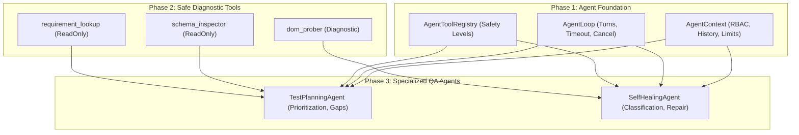

# AIQA Phase 3 Report: Specialized QA Agents

- **Date**: 2026-09-13
- **Status**: Phase 3 Complete & Verified
- **Baseline**: Branch `Demo`, Commit `0a67da3`, Phase 1 & Phase 2 Complete
- **Test Suite Verification**: **583 passed, 0 failed, 2 ignored** (521 baseline + 20 Phase 1 + 32 Phase 2 + 10 Phase 3)
- **Compiler Health**: `cargo check -p aiqa-orchestrator` passed with 0 errors

---

## 1. Executive Summary

Phase 3 implements the first production-quality specialized QA agents on top of the Phase 1 `Agent` / `AgentTool` foundation and Phase 2 Safe Diagnostic Tools:

1. **Test Planning Agent** ([`planning.rs`](file:///G:/AIQA/services/orchestrator/src/agents/planning.rs)): Inspects schemas and requirements through diagnostic tools to synthesize structured, prioritized test suites (P0–P3) and identify coverage gaps without executing test runners.
2. **Self-Healing Agent** ([`healing.rs`](file:///G:/AIQA/services/orchestrator/src/agents/healing.rs)): Performs multi-turn diagnosis on test failure evidence, probing DOM snapshots to classify root causes (renamed selectors, role-gated visibility differentials, selector ambiguity, or assertion/timing mismatches) and recommending verified fixes with confidence scoring.

### Boundary & Safety Guarantees
- **Zero OpenJarvis Code or Dependencies**: Strictly written in idiomatic, safe Rust with zero Python runtimes, PyO3, or LiteLLM dependencies.
- **Zero Production Test Execution**: Specialized agents inspect and diagnose; they **never** invoke test executors (Playwright, Newman, Pytest, Maestro, Schemathesis) or mutate target application state. Downstream `ExecutorRegistry` remains unmodified.
- **No Automatic File Mutation**: Healing recommendations and test plans are structured, advisory outputs. Agents do not automatically rewrite production test files without human approval.
- **Strict Multi-Tenancy & Project Scoping**: All agent turns verify `AgentContext::is_authorized_for_project()`, rejecting cross-project and unauthorized operations immediately.
- **Zero Private Thought Leakage**: Observations, turn decisions, and final outputs contain structured operational telemetry only. Secret redaction is applied recursively via `sanitize_secrets()`.

---

## 2. Files Created & Modified

### Files Created
1. [`services/orchestrator/src/agents/mod.rs`](file:///G:/AIQA/services/orchestrator/src/agents/mod.rs) (28 lines)
   - Specialized agents module definition and public exports.
2. [`services/orchestrator/src/agents/planning.rs`](file:///G:/AIQA/services/orchestrator/src/agents/planning.rs) (486 lines)
   - `TestPlanningAgent` implementing `Agent`.
   - Multi-turn requirement lookup and OpenAPI schema inspection.
   - Risk-driven test suite prioritization (P0 Authentication, P1 Contract, P2 Validation, P3 Resiliency).
   - Coverage gap detection against orphan requirements in the Quality Graph.
3. [`services/orchestrator/src/agents/healing.rs`](file:///G:/AIQA/services/orchestrator/src/agents/healing.rs) (506 lines)
   - `SelfHealingAgent` implementing `Agent`.
   - Multi-turn selector probing and candidate element correlation.
   - Deterministic failure classification: `SelectorRenamedOrRelocated`, `RoleGatedVisibilityDifferential`, `AmbiguousSelector`, `TimingOrAssertionMismatch`, and `SelectorNotFound`.
   - Confidence scoring algorithm with tag synonyms, label extraction, and intent overlap.
4. [`services/orchestrator/src/agents/tests.rs`](file:///G:/AIQA/services/orchestrator/src/agents/tests.rs) (525 lines)
   - 10 deterministic integration and boundary tests verifying multi-turn loops, RBAC enforcement, budget limits, coverage gaps, failure classifications, and zero test execution invariants.
5. [`docs/AIQA_PHASE_3_SPECIALIZED_AGENTS_REPORT.md`](file:///G:/AIQA/docs/AIQA_PHASE_3_SPECIALIZED_AGENTS_REPORT.md)
   - Technical specification and verification report.
6. [`Report/AIQA_PHASE_3_SPECIALIZED_AGENTS_REPORT.md`](file:///G:/AIQA/Report/AIQA_PHASE_3_SPECIALIZED_AGENTS_REPORT.md)
   - Canonical project report copy.

### Files Modified
1. [`services/orchestrator/src/lib.rs`](file:///G:/AIQA/services/orchestrator/src/lib.rs)
   - Registered `pub mod agents;`.

---

## 3. Specialized Agent Specifications

### 3.1 Test Planning Agent (`TestPlanningAgent`)

#### Responsibilities
- Receives a `PlanningRequest` specifying project ID, optional requirement queries or IDs, OpenAPI schema sources, path filters, priority hints, and test count limits.
- **Turn 0**: Issues diagnostic tool calls to `requirement_lookup` to query project quality nodes and existing test coverage.
- **Turn 1**: Issues diagnostic tool calls to `schema_inspector` to parse OpenAPI paths, methods, security schemes, and data structures.
- **Turn 2**: Synthesizes a structured `TestPlanOutput`:
  - Groups objectives into prioritized test suites:
    - **P0 / CRITICAL**: Authentication guards and security policies.
    - **P1 / HIGH**: Functional API contracts and core business flows.
    - **P2 / MEDIUM**: Request payload validation and error status handling.
    - **P3 / LOW**: Resiliency, edge cases, and boundary conditions.
  - Identifies coverage gaps where requirements lack linked test cases in SQLite `Store`.
  - Enforces `max_planned_tests` budget constraints.
  - Links every objective to its originating requirement and API endpoint.

#### Multi-Tenant Security
- Validates `context.is_authorized_for_project(&self.request.project_id)`.
- If unauthorized, returns `TurnDecision::Fail` with a cross-project violation reason.

---

### 3.2 Self-Healing Agent (`SelfHealingAgent`)

#### Responsibilities
- Receives `FailureEvidence` containing failed CSS/locator selectors, expected vs actual behavior, error messages, execution role, target URL, and crawler snapshot data.
- **Turn Phase A (Direct Probe)**: Invokes `dom_prober` without role filtering to inspect whether the target selector genuinely exists in DOM snapshots across all recorded roles.
- **Turn Phase B (Candidate Search)**: If the selector does not exist, extracts selector keywords (tag, class, or id stem) and queries `dom_prober` for matching alternative elements.
- **Turn Phase C (Synthesis & Classification)**: Evaluates collected evidence to produce `SelfHealingOutput`:
  - **`SelectorRenamedOrRelocated`**: Element was renamed or altered; candidate element identified via kind, keyword, and action intent similarity. High confidence (>= 0.80) does not require manual review; lower confidence flags `requires_review: true`.
  - **`RoleGatedVisibilityDifferential`**: Element exists in DOM but was hidden for the user role used during test execution (e.g. viewer running admin-only actions). Recommends role/credential adjustment.
  - **`AmbiguousSelector`**: Selector matches multiple elements on the same page or within the role context, creating non-deterministic test failures.
  - **`TimingOrAssertionMismatch`**: Element exists and is visible in DOM; failure was not selector-related, indicating network latency, animation delay, or assertion criteria mismatch.
  - **`SelectorNotFound`**: No plausible candidate elements found; recommends fresh crawl.

#### Safety & Integrity Guarantees
- Strictly read-only reasoning: does not edit test code files or launch browsers.
- Confidence scoring accounts for tag synonyms (`btn` ↔ `button`), textual overlap, and selector specificity.

---

## 4. Test Verification Matrix

All 10 Phase 3 agent tests pass cleanly:

| Test Name | File | Description | Status |
| :--- | :--- | :--- | :--- |
| `test_01_planning_agent_synthesizes_plan_with_schema` | [`tests.rs`](file:///G:/AIQA/services/orchestrator/src/agents/tests.rs#L143) | Multi-turn planning with schema & requirement lookup; validates P0/P1 prioritization | **PASSED** |
| `test_02_planning_agent_rejects_cross_project_access` | [`tests.rs`](file:///G:/AIQA/services/orchestrator/src/agents/tests.rs#L212) | Context isolation; blocks unauthorized project planning | **PASSED** |
| `test_03_planning_agent_detects_coverage_gaps_with_store` | [`tests.rs`](file:///G:/AIQA/services/orchestrator/src/agents/tests.rs#L238) | Detects orphaned requirements with zero test cases in SQLite Store | **PASSED** |
| `test_04_planning_agent_enforces_budget_limits` | [`tests.rs`](file:///G:/AIQA/services/orchestrator/src/agents/tests.rs#L278) | Caps synthesized test count to configured maximum budget | **PASSED** |
| `test_05_self_healing_diagnoses_renamed_selector_with_high_confidence` | [`tests.rs`](file:///G:/AIQA/services/orchestrator/src/agents/tests.rs#L310) | Multi-turn DOM probing identifies renamed button with >= 80% confidence | **PASSED** |
| `test_06_self_healing_detects_role_visibility_differential` | [`tests.rs`](file:///G:/AIQA/services/orchestrator/src/agents/tests.rs#L355) | Accurately identifies role-gated visibility failure (viewer vs admin) | **PASSED** |
| `test_07_self_healing_diagnoses_timing_mismatch_when_element_exists` | [`tests.rs`](file:///G:/AIQA/services/orchestrator/src/agents/tests.rs#L390) | Element exists in DOM; classifies failure as assertion/timing issue | **PASSED** |
| `test_08_self_healing_diagnoses_not_found_when_no_candidates_exist` | [`tests.rs`](file:///G:/AIQA/services/orchestrator/src/agents/tests.rs#L425) | Selector absent and no candidates exist; classifies `SelectorNotFound` | **PASSED** |
| `test_09_self_healing_rejects_cross_project_access` | [`tests.rs`](file:///G:/AIQA/services/orchestrator/src/agents/tests.rs#L457) | Multi-tenant RBAC rejection on self-healing request | **PASSED** |
| `test_10_boundary_zero_production_test_execution_during_agent_reasoning` | [`tests.rs`](file:///G:/AIQA/services/orchestrator/src/agents/tests.rs#L487) | Strict boundary test verifying zero test runners or executors invoked | **PASSED** |

### Complete Test Suite Summary
```text
running 585 tests
...
test result: ok. 583 passed; 0 failed; 2 ignored; 0 measured; 0 filtered out; finished in 7.83s
```

---

## 5. Architectural Alignment & Next Steps

Phase 3 completes the specialized QA agent layer on top of the approved architecture roadmap:



### Recommendation for Phase 4
Phase 3 agents provide declarative plans and healing recommendations without mutating production systems.
The natural next phase is **Phase 4 — Execution & Quality Graph Integration**:
- Controlled execution dispatch of verified plans through the existing `ExecutorRegistry` under strict user approvals.
- Bi-directional synchronization of agent planning outputs with the SQLite `Store` Quality Graph (`quality_nodes` and `quality_relations`).
