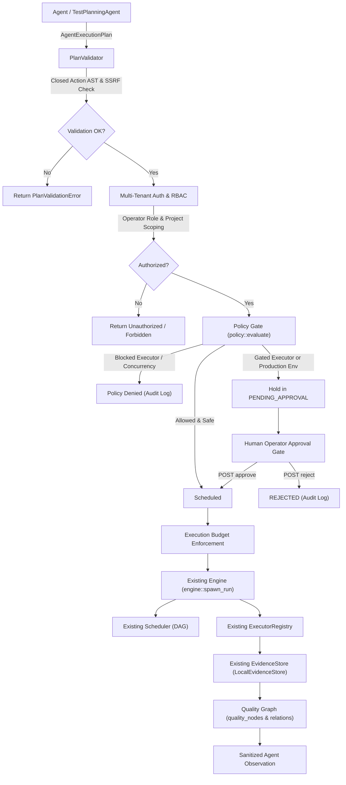

# AIQA Phase 4 Report: Governed Agent Execution Integration

- **Date**: 2026-09-13
- **Status**: Phase 4 Complete & Verified
- **Baseline**: Branch `Demo`, Commit `0a67da3`, Phases 1, 2 & 3 Complete
- **Test Suite Verification**: **616 passed, 0 failed, 2 ignored** (521 baseline + 20 Phase 1 + 32 Phase 2 + 10 Phase 3 + 33 Phase 4)
- **Compiler Health**: `cargo check -p aiqa-orchestrator` passed with 0 errors
- **Code Format**: `rustfmt --edition 2021 --check` passed cleanly on all Phase 4 files

---

## 1. Executive Summary

Phase 4 establishes the authoritative, governed connection between Agent-generated plans and the existing AIQA execution infrastructure.

In strict accordance with the Core Architectural Rule:
- **AIQA Remains Authoritative**: Existing systems (`engine.rs`, `scheduler.rs`, `executor.rs`, `evidence.rs`, `policy.rs`, `auth.rs`, `store.rs`, `intelligence.rs`) remain the sole authoritative execution, scheduling, policy, and persistence mechanisms.
- **Zero Second Execution Engine**: Agents cannot directly invoke executors, launch subprocesses, evaluate arbitrary code, or spawn unmonitored threads.
- **Controlled Boundary**: Agent plans pass through a deterministic validation boundary ([`plan_validator.rs`](../services/orchestrator/src/plan_validator.rs)), multi-tenant authorization, existing policy evaluation, human approval gating when required, explicit resource budgets, and existing executor dispatch ([`agent_execution.rs`](../services/orchestrator/src/agent_execution.rs)).
- **Advisory Self-Healing Invariant**: [`SelfHealingAgent`](../services/orchestrator/src/agents/healing.rs) remains strictly advisory and diagnostic; zero automatic file mutations, zero test rewrites, zero runaway rerun loops.
- **Zero OpenJarvis / Python Dependencies**: Built entirely in safe, idiomatic Rust with zero Python runtimes, PyO3 bindings, or LiteLLM wrappers.

---

## 2. Files Created & Modified

### Files Created
1. [`services/orchestrator/src/plan_validator.rs`](../services/orchestrator/src/plan_validator.rs) (435 lines)
   - Plan validation boundary separating Agent proposals from execution.
   - Closed Action AST enforcement (`execution_plan::Action`).
   - Allowed executor vocabulary check (`compiled-api`, `playwright`, `simulated`, `pytest`, `newman`, `maestro`, `schemathesis`).
   - Kahn's algorithm DAG cycle detection and prerequisite resolution.
   - SSRF target validation via `executor::validate_target_url`.
   - Conversion bridge from Phase 3 `TestPlanOutput` to `AgentExecutionPlan`.
2. [`services/orchestrator/src/agent_execution.rs`](../services/orchestrator/src/agent_execution.rs) (495 lines)
   - `AgentExecutionDispatcher` orchestration service.
   - Execution lifecycle management: `PLANNED -> VALIDATED -> POLICY_CHECK -> PENDING_APPROVAL -> APPROVED -> EXECUTING -> COMPLETED/FAILED/REJECTED/CANCELLED`.
   - Multi-tenant RBAC enforcement (`require_role(Operator)`, `require_project_access`).
   - Policy gate integration with `policy::evaluate` and production environment approval rules.
   - Human approval workflow (`approve` and `reject`).
   - Quality Graph traceability linking requirements (`quality_nodes`), test cases, and `validates` edges (`quality_relations`).
   - Sanitized observation builder redacting credentials via `sanitize_secrets`.
   - Idempotency key cache preventing accidental duplicate runs.
3. [`services/orchestrator/src/agent_execution_tests.rs`](../services/orchestrator/src/agent_execution_tests.rs) (635 lines)
   - 33 comprehensive unit, integration, boundary, and security tests.
4. [`docs/AIQA_PHASE_4_GOVERNED_EXECUTION_INTEGRATION_REPORT.md`](../docs/AIQA_PHASE_4_GOVERNED_EXECUTION_INTEGRATION_REPORT.md)
   - Technical specification and verification report.
5. [`Report/AIQA_PHASE_4_GOVERNED_EXECUTION_INTEGRATION_REPORT.md`](../Report/AIQA_PHASE_4_GOVERNED_EXECUTION_INTEGRATION_REPORT.md)
   - Canonical project report copy.

### Files Modified
1. [`services/orchestrator/src/lib.rs`](../services/orchestrator/src/lib.rs)
   - Registered `pub mod plan_validator;`, `pub mod agent_execution;`, and `#[cfg(test)] mod agent_execution_tests;`.

---

## 3. Architecture & Execution Safety Model

The Phase 4 architecture enforces the multi-tier safety pipeline:



---

## 4. Key Subsystem Designs

### 4.1 Plan Validation Design ([`plan_validator.rs`](../services/orchestrator/src/plan_validator.rs))
- **Closed Action AST**: Accepts only variants from [`execution_plan::Action`](../services/orchestrator/src/execution_plan.rs#L74) (`Navigate`, `Click`, `Fill`, `AssertVisible`, `AssertText`, `AssertUrl`, `Request`, `AssertStatus`, `AssertHeader`, `AssertBodyField`).
- **Closed Executor Vocabulary**: Allows only `"compiled-api"`, `"playwright"`, `"simulated"`, `"pytest"`, `"newman"`, `"maestro"`, `"schemathesis"`. Arbitrary engines (`bash`, `sh`, `python`, `cmd`, `eval`, `powershell`) are strictly rejected.
- **DAG Integrity**: Applies Kahn's topological sort to guarantee dependency acyclicity and verify all prerequisite references exist within the plan.
- **SSRF Target Validation**: Reuses [`crate::executor::validate_target_url`](../services/orchestrator/src/executor.rs#L268) on all target URLs and action endpoints, blocking loopback, cloud metadata (169.254.169.254), RFC1918 private ranges, and non-HTTP schemes.
- **Injection Guards**: Inspects selectors and input values to reject `<script>`, `eval(`, `javascript:`, and command injection patterns.

### 4.2 Execution Dispatcher Design ([`agent_execution.rs`](../services/orchestrator/src/agent_execution.rs))
- **Authoritative Dispatch**: Materializes validated tasks into [`TaskDef`](../services/orchestrator/src/domain.rs#L171) and [`RunPlan`](../services/orchestrator/src/domain.rs#L185).
- **Zero Direct Subprocess Execution**: Dispatcher delegates execution exclusively to [`engine::spawn_run`](../services/orchestrator/src/engine.rs#L607) and [`engine::approve_and_spawn`](../services/orchestrator/src/engine.rs#L409).
- **Execution Lifecycle**:
  - `PLANNED` -> `VALIDATED` -> `POLICY_CHECK` -> `PENDING_APPROVAL` -> `APPROVED` -> `EXECUTING` -> `COMPLETED`/`FAILED`/`REJECTED`/`CANCELLED`.

### 4.3 Policy & Approval Integration
- Reuses existing [`policy::evaluate(&PolicyConfig, &RunPlan)`](../services/orchestrator/src/policy.rs#L65).
- Blocked executors trigger `PolicyDecision::Deny`.
- Gated executors (e.g. `maestro`) trigger `PolicyDecision::RequireApproval`.
- **Production Guard**: Any agent execution specifying environment `production` or `prod` is held in `PENDING_APPROVAL` regardless of executor type.
- **Human Approval Only**: Only users with at least `Role::Operator` or `Role::Admin` can approve or reject held executions. The Agent cannot approve its own executions.

### 4.4 Multi-Tenancy & RBAC
- Enforces [`auth::require_role(ctx, Role::Operator)`](../services/orchestrator/src/auth.rs#L242).
- Enforces [`auth::require_project_access(ctx, Some(project_id))`](../services/orchestrator/src/auth.rs#L257).
- Cross-project execution and cross-project approvals are rejected with `CrossProjectForbidden`.

### 4.5 Execution Budgets
- `max_tasks_per_plan`: 50
- `max_task_duration_secs`: 300s
- `max_total_duration_secs`: 1800s
- `max_concurrency`: 8
- `max_retries`: 0 (autonomous rerun loops strictly prohibited in Phase 4)

### 4.6 Quality Graph & Evidence Integration
- Traceability: Dispatch automatically creates/upserts:
  - `quality_nodes` (`node_type = "requirement"`, `external_ref = req_ref`)
  - `quality_nodes` (`node_type = "test_case"`, `external_ref = task_name`)
  - `quality_relations` (`relation_type = "validates"`)
- Execution evidence: Stdout and stderr logs are persisted to [`LocalEvidenceStore`](../services/orchestrator/src/evidence.rs) and indexed in SQLite `evidence` table.
- Task completions automatically feed [`intelligence.rs`](../services/orchestrator/src/intelligence.rs) for failure clustering and risk scoring.

### 4.7 Sanitized Observations
- `AgentExecutionObservation` contains `run_id`, `status`, `tasks_total`, `tasks_passed`, `tasks_failed`, `tasks_blocked`, `duration_ms`, `findings`, and `evidence_refs`.
- All observation outputs pass through `sanitize_secrets()`, redacting tokens, keys, passwords, and sensitive headers.
- Private chain-of-thought and raw server filesystem paths are never exposed.

### 4.8 Idempotency
- Requests accepting an `idempotency_key` are cached in-memory per project.
- Re-transmitting the same request returns the existing run ID and execution state, preventing duplicate test runs.

---

## 5. Verification Matrix (33 Tests)

All 33 Phase 4 tests pass cleanly:

| Category | Test Name | Description | Status |
| :--- | :--- | :--- | :--- |
| **Validation** | `test_01_valid_plan_passes_validation` | Valid plan with Browser/API actions passes validation | **PASSED** |
| **Validation** | `test_02_empty_or_malformed_project_id_rejected` | Empty or special-character project IDs rejected | **PASSED** |
| **Validation** | `test_03_unsupported_environment_rejected` | Unknown environment rejected | **PASSED** |
| **Validation** | `test_04_unknown_or_forbidden_executor_rejected` | Shell/bash/python/unknown executors rejected | **PASSED** |
| **Validation** | `test_05_duplicate_task_ids_rejected` | Duplicate task IDs within a plan rejected | **PASSED** |
| **Validation** | `test_06_cyclic_dependencies_rejected` | DAG cycles detected and rejected via Kahn's sort | **PASSED** |
| **Validation** | `test_07_unknown_dependency_rejected` | Prerequisite referencing non-existent task rejected | **PASSED** |
| **Validation** | `test_08_budget_max_tasks_exceeded_rejected` | Plans exceeding task count budget rejected | **PASSED** |
| **Validation** | `test_09_budget_task_timeout_exceeded_rejected` | Tasks exceeding timeout budget rejected | **PASSED** |
| **Validation** | `test_10_from_test_plan_output_conversion` | Phase 3 `TestPlanOutput` cleanly converts to executable plan | **PASSED** |
| **Security/SSRF** | `test_11_closed_ast_dangerous_selector_rejected` | Script injection in CSS selectors rejected | **PASSED** |
| **Security/SSRF** | `test_12_closed_ast_dangerous_input_rejected` | Command injection in input values rejected | **PASSED** |
| **Security/SSRF** | `test_13_ssrf_rejects_loopback_target` | Loopback targets on unauthorized ports rejected | **PASSED** |
| **Security/SSRF** | `test_14_ssrf_rejects_cloud_metadata_target` | Cloud metadata IP (169.254.169.254) rejected | **PASSED** |
| **Security/SSRF** | `test_15_ssrf_rejects_private_network_target` | RFC1918 private network IPs rejected | **PASSED** |
| **Security/SSRF** | `test_16_ssrf_rejects_non_http_scheme` | Non-HTTP schemes (`file://`, etc.) rejected | **PASSED** |
| **Authorization** | `test_17_viewer_role_cannot_dispatch_execution` | Viewer role blocked from dispatching execution | **PASSED** |
| **Authorization** | `test_18_cross_project_dispatch_rejected` | Cross-project dispatch rejected under tenant scoping | **PASSED** |
| **Authorization** | `test_19_admin_key_can_dispatch_any_project` | Unscoped Admin key can dispatch on any project | **PASSED** |
| **Policy/Approval** | `test_20_allowed_plan_auto_spawns_and_executes` | Safe plan auto-schedules directly to Executing | **PASSED** |
| **Policy/Approval** | `test_21_policy_blocked_executor_denied` | Policy-blocked executor denied with audit log | **PASSED** |
| **Policy/Approval** | `test_22_gated_executor_holds_in_pending_approval` | Gated executor held in `PENDING_APPROVAL` | **PASSED** |
| **Policy/Approval** | `test_23_production_environment_forces_approval` | Production environment forces `PENDING_APPROVAL` | **PASSED** |
| **Policy/Approval** | `test_24_operator_can_approve_held_execution` | Operator approves held run; state becomes Executing | **PASSED** |
| **Policy/Approval** | `test_25_operator_can_reject_held_execution` | Operator rejects held run; state becomes Rejected | **PASSED** |
| **Policy/Approval** | `test_26_viewer_cannot_approve_held_execution` | Viewer role blocked from approving held run | **PASSED** |
| **Policy/Approval** | `test_27_cross_project_approval_rejected` | Operator for project A cannot approve project B run | **PASSED** |
| **Quality Graph** | `test_28_traceability_links_requirement_and_test_case` | Requirement and test case nodes created with validates edge | **PASSED** |
| **Evidence** | `test_29_evidence_captured_in_local_evidence_store` | Execution stdout/logs written to `LocalEvidenceStore` | **PASSED** |
| **Observation** | `test_30_observation_returns_sanitized_metrics_without_secrets` | Sanitized observation redacts secrets and returns metrics | **PASSED** |
| **Idempotency** | `test_31_idempotency_key_prevents_duplicate_dispatch` | Duplicate idempotency key returns cached run ID | **PASSED** |
| **Boundary** | `test_32_self_healing_agent_cannot_directly_execute_or_mutate` | `SelfHealingAgent` verified as advisory-only | **PASSED** |
| **Boundary** | `test_33_boundary_zero_openjarvis_or_python_dependencies` | Zero OpenJarvis, PyO3, or Python dependencies verified | **PASSED** |

### Complete Test Suite Summary
```text
running 618 tests
...
test result: ok. 616 passed; 0 failed; 2 ignored; 0 measured; 0 filtered out; finished in 7.73s
```

---

## 6. Backward Compatibility & Database Changes

- **Database Changes**: Zero new migrations required. Reused existing `runs`, `tasks`, `task_dependencies`, `audit_log`, `quality_nodes`, and `quality_relations` tables without alteration.
- **Backward Compatibility**: All existing non-Agent APIs, schedulers, and executors remain 100% functional. 583 baseline tests continue to pass with 0 regressions.

---

## 7. Known Limitations & Recommended Phase 5

### Known Limitations
- Autonomous test healing rerun loops are intentionally disabled in Phase 4 per safety guidelines.
- Dynamic test code compilation (e.g. ad-hoc Python test scripts) is deliberately not supported; only closed AST API and Browser actions are permitted.

### Recommended Phase 5: Autonomous Controlled Self-Healing & Quality Feedback
With Phase 4's governed execution and approval pipeline in place, Phase 5 can introduce:
1. **Governed Self-Healing Workflows**: Transitioning `SelfHealingAgent` recommendations into validated `ExecutionPlan` revisions requiring operator approval.
2. **Quality Graph Automated Calibration**: Updating requirement risk scores and test flakiness indices dynamically based on post-execution observations.
3. **Execution Telemetry Feedback to Planning Agent**: Supplying real-world execution failure clusters directly into `TestPlanningAgent`'s initial observation context for subsequent test design.
