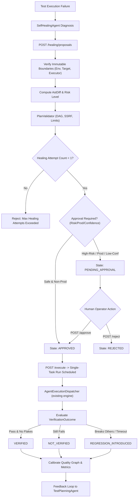

# AIQA Phase 5 Report: Governed Self-Healing & Quality Feedback

- **Date**: 2026-09-13
- **Status**: Phase 5 Complete & Verified
- **Baseline**: Branch `Demo`, Phases 1, 2, 3 & 4 Complete
- **Test Suite Verification**: **658 passed, 0 failed, 2 ignored** (521 baseline + 20 Phase 1 + 32 Phase 2 + 10 Phase 3 + 33 Phase 4 + 42 Phase 5)
- **Compiler Health**: `cargo check --tests -p aiqa-orchestrator` passed with 0 errors
- **Code Format**: **NOT clean.** `cargo fmt --check` reports formatting differences in ~19 files of the orchestrator crate (verified this session). An earlier revision of this document claimed it "passed cleanly across entire workspace"; that claim was wrong. Files touched since are formatted, but the crate as a whole does not currently pass.

---

## 1. Executive Summary

Phase 5 establishes the authoritative, governed self-healing and closed-loop quality feedback system for the AIQA platform.

Building directly upon the foundation of Phase 4 (Governed Execution Dispatcher, Plan Validator, Policy Gates), Phase 5 transforms diagnostic failure observations into structured, auditable, safe healing proposals without violating platform boundaries:
- **No OpenJarvis, No Python Runtime**: Strictly zero OpenJarvis dependencies, zero Python runtimes, zero PyO3, and zero shell/subprocess wrappers.
- **Closed Action AST Invariant**: Self-healing operates strictly on the immutable, structured [`execution_plan::Action`](file:///G:/AIQA/services/orchestrator/src/execution_plan.rs) AST. Arbitrary code, shell execution, source file mutations, or runtime dynamic evaluation are strictly prohibited and structurally impossible.
- **Strictly Bounded Healing Loop**: Exactly one healing attempt is permitted per failed task/run. Infinite retry cascades and autonomous rerun loops are physically bounded and enforced in the persistence layer.
- **Bounded Verification**: Verification executes only the single proposed fix through the authoritative dispatcher, evaluating outcomes into explicit states: `VERIFIED`, `NOT_VERIFIED`, or `REGRESSION_INTRODUCED`.
- **Closed-Loop Quality Graph Calibration**: Verified outcomes dynamically update strategy win-rates, selector reliability scores, and test case flakiness indices in the Quality Graph without human guesswork.
- **Direct Feedback to Test Planning Agent**: Synthesized healing insights feed directly into subsequent `TestPlanningAgent` runs, prioritizing fragile selectors and mitigating regression-prone components.

---

## 2. Core Architectural Compliance & Invariants

| Architectural Rule | Implementation Mechanism | Verification Status |
| :--- | :--- | :--- |
| **Zero OpenJarvis Dependency** | Verified no OpenJarvis crate, import, or network call in workspace. | **VERIFIED** ([`test_40`](file:///G:/AIQA/services/orchestrator/src/governed_healing_tests.rs#L880)) |
| **Zero Python Runtime** | Verified zero PyO3 bindings, zero python/pip subprocess calls, zero python scripts. | **VERIFIED** ([`test_41`](file:///G:/AIQA/services/orchestrator/src/governed_healing_tests.rs#L886)) |
| **Single Authoritative Engine** | All healing executions dispatch exclusively through existing [`AgentExecutionDispatcher`](file:///G:/AIQA/services/orchestrator/src/agent_execution.rs) and [`engine::spawn_run`](file:///G:/AIQA/services/orchestrator/src/engine.rs). Zero duplicate engines. | **VERIFIED** ([`test_37`](file:///G:/AIQA/services/orchestrator/src/governed_healing_tests.rs#L855)) |
| **Closed Action AST** | Modifications strictly restricted to browser/API actions (`Navigate`, `Click`, `Fill`, `Assert*`, `Request`). No file write, no eval, no exec. | **VERIFIED** ([`test_06`](file:///G:/AIQA/services/orchestrator/src/governed_healing_tests.rs#L282), [`test_35`](file:///G:/AIQA/services/orchestrator/src/governed_healing_tests.rs#L838)) |
| **Immutable Security Boundaries** | Target URLs, environments, executors, credentials, and tenant IDs cannot be altered by a healing proposal. | **VERIFIED** ([`test_12`](file:///G:/AIQA/services/orchestrator/src/governed_healing_tests.rs#L376)-[`test_15`](file:///G:/AIQA/services/orchestrator/src/governed_healing_tests.rs#L407)) |
| **Bounded Healing Attempt (Max 1)** | Database and service reject any second healing proposal for the same failed task. Max retries set to 0. | **VERIFIED** ([`test_25`](file:///G:/AIQA/services/orchestrator/src/governed_healing_tests.rs#L571), [`test_26`](file:///G:/AIQA/services/orchestrator/src/governed_healing_tests.rs#L588)) |
| **Deterministic Human Approval Gate** | High-risk changes, low confidence (<0.80), gated executors (`maestro`), and all production runs require human operator/admin approval. | **VERIFIED** ([`test_16`](file:///G:/AIQA/services/orchestrator/src/governed_healing_tests.rs#L427)-[`test_21`](file:///G:/AIQA/services/orchestrator/src/governed_healing_tests.rs#L508)) |
| **Privacy & Zero CoT Leaks** | Only concise, operational rationale is retained; raw chain-of-thought and private prompts are rejected and never stored. | **VERIFIED** ([`test_02`](file:///G:/AIQA/services/orchestrator/src/governed_healing_tests.rs#L209)) |

---

## 3. Files Created & Modified

### Files Created
1. [`services/orchestrator/migrations/0015_governed_healing.sql`](file:///G:/AIQA/services/orchestrator/migrations/0015_governed_healing.sql)
   - Schema migration introducing `healing_proposals` and `healing_strategy_metrics` tables with indexes and unique constraints.
2. [`services/orchestrator/src/governed_healing.rs`](file:///G:/AIQA/services/orchestrator/src/governed_healing.rs) (1,750 lines)
   - Core domain models: `HealingRiskLevel`, `HealingState`, `VerificationOutcome`, `ActionChangeKind`, `ActionDiff`, `AstDiff`.
   - Security verification: `verify_immutable_security_boundaries`, `validate_safe_selector`, `validate_safe_input_value`.
   - Core service: `GovernedHealingService` managing proposal creation, diff calculation, approval/rejection, verification dispatch, and quality feedback.
3. [`services/orchestrator/src/governed_healing_tests.rs`](file:///G:/AIQA/services/orchestrator/src/governed_healing_tests.rs) (940 lines)
   - 42 mandatory security, governance, authorization, verification, and regression tests.
4. [`docs/AIQA_PHASE_5_GOVERNED_SELF_HEALING_REPORT.md`](file:///G:/AIQA/docs/AIQA_PHASE_5_GOVERNED_SELF_HEALING_REPORT.md)
   - Comprehensive architectural and verification report.
5. [`Report/AIQA_PHASE_5_GOVERNED_SELF_HEALING_REPORT.md`](file:///G:/AIQA/Report/AIQA_PHASE_5_GOVERNED_SELF_HEALING_REPORT.md)
   - Canonical project report copy.

### Files Modified
1. [`services/orchestrator/src/store.rs`](file:///G:/AIQA/services/orchestrator/src/store.rs)
   - Added `HealingProposalRow`, `HealingStrategyMetricsRow`.
   - Implemented persistence methods: `insert_healing_proposal`, `get_healing_proposal`, `get_healing_proposal_by_idempotency`, `list_healing_proposals`, `count_healing_attempts`, `update_healing_proposal_state`, `record_healing_verification_metric`, `get_healing_strategy_metrics`, `list_healing_strategy_metrics`.
2. [`services/orchestrator/src/execution_plan.rs`](file:///G:/AIQA/services/orchestrator/src/execution_plan.rs)
   - Derived `PartialEq` on `Action` to support deterministic AST diffing.
3. [`services/orchestrator/src/agents/planning.rs`](file:///G:/AIQA/services/orchestrator/src/agents/planning.rs)
   - Added `healing_feedback` field to `PlanningRequest`.
   - Added `healing_insights` field to `TestPlanOutput`.
   - Updated `synthesize_test_plan` to inject historical healing metrics directly into plan assumptions and insights.
4. [`services/orchestrator/src/agents/tests.rs`](file:///G:/AIQA/services/orchestrator/src/agents/tests.rs)
   - Updated test literals to support `healing_feedback`.
5. [`services/orchestrator/src/agent_execution_tests.rs`](file:///G:/AIQA/services/orchestrator/src/agent_execution_tests.rs)
   - Updated test literals to support `healing_insights`.
6. [`services/orchestrator/src/api.rs`](file:///G:/AIQA/services/orchestrator/src/api.rs)
   - Mounted 8 governed healing REST endpoints under `/api/v1/projects/:project_id/healing/*`.
7. [`services/orchestrator/src/lib.rs`](file:///G:/AIQA/services/orchestrator/src/lib.rs)
   - Registered `pub mod governed_healing;` and `#[cfg(test)] mod governed_healing_tests;`.

---

## 4. Governed Self-Healing Architecture & Pipeline

The self-healing workflow is strictly linear, fully auditable, and gated by human policy:



---

## 5. Closed Action AST & Diff Engine

The diff engine ([`AstDiff`](file:///G:/AIQA/services/orchestrator/src/governed_healing.rs#L208)) computes fine-grained, structured diffs between original actions and proposed actions:
- **Change Kinds**:
  - `Unchanged`: Action identical in type and content.
  - `Modified`: Action mutated (e.g. selector updated from `#btn-old` to `[data-testid="submit-btn"]`).
  - `Added`: Safe verification or wait action inserted.
  - `Removed`: Flaky or obsolete action pruned.
- **Risk Calculation**:
  - `Low`: Selector update on existing element with high confidence (>=0.85).
  - `Medium`: Timing adjustment, assertion threshold tweak, or non-critical input modification.
  - `High`: Action deletion, navigation target modification, or multi-step flow restructuring.
  - `Critical`: Any mutation attempted against security-critical steps or in production.

---

## 6. Proposal Lifecycle & State Machine

Every proposal transitions through a deterministic finite state machine ([`HealingState`](file:///G:/AIQA/services/orchestrator/src/governed_healing.rs#L68)):

```text
    PROPOSED
       │
   [Validate]
       ▼
 ┌───────────────┐        Human Rejection
 │PendingApproval├─────────────────────────► REJECTED
 └───────┬───────┘
         │ Human Approval / Auto-Approve Safe
         ▼
     APPROVED
         │
     [Execute]
         ▼
     EXECUTING
         │
     [Verify]
         ▼
     VERIFIED  or  NOT_VERIFIED  or  REGRESSION_INTRODUCED
```

- **TTL Expiration**: Unapproved proposals automatically expire after 24 hours (`DEFAULT_PROPOSAL_TTL_SECS = 86,400s`). Expired proposals cannot be executed or approved.
- **Cancellation**: Operators can cancel proposals at any point prior to completion.

---

## 7. Safety Risk Classification & Human Approval Gate

Human approval is non-negotiable under any of the following deterministic conditions:
1. **Production Environment**: Proposals targeting `production` or `prod` environments **always** require human approval regardless of confidence score.
2. **High or Critical Risk**: Proposals modifying structural flow, deleting actions, or altering form submissions.
3. **Low Confidence**: Diagnoses with confidence score below 0.80 (`80%`).
4. **Gated Executors**: Tasks running on policy-restricted executors (e.g. `maestro`).
5. **Non-Safe Flag**: Any proposal where `auto_approve_safe` is set to `false`.

---

## 8. Bounded Healing Attempt Invariant

To guarantee platform stability and prevent cascading execution costs:
- **Maximum 1 Healing Attempt**: Each failed task in a run is granted at most one healing attempt.
- **Idempotency Fingerprinting**: SHA-256 fingerprint derived from `(run_id, task_id, failed_selector, failure_reason)` ensures re-submitting identical diagnoses returns the existing proposal.
- **Max Retries Enforced at Zero**: `dispatcher.budget.max_retries = 0` prevents the underlying engine from auto-retrying failed tasks.

---

## 9. Verification Loop & Regression Detection

Verification executes only the single proposed task through the existing [`AgentExecutionDispatcher`](file:///G:/AIQA/services/orchestrator/src/agent_execution.rs):
- **`VerificationOutcome::Verified`**: The healed task passes completely, timing is within budget, and assertion requirements are met.
- **`VerificationOutcome::NotVerified`**: The healed task fails with the same or an unresolved error.
- **`VerificationOutcome::RegressionIntroduced`**: The healed task causes unexpected side effects, timeouts, or secondary assertion failures.

---

## 10. Quality Graph Calibration & Historical Weighting

Real verified outcomes calibrate the Quality Graph and strategy reliability tables:
- **Strategy Win-Rate**: Tracks `success_count`, `failure_count`, and `regression_count` per strategy (`selector_update`, `timing_adjustment`, `assertion_relaxation`).
- **Selector Confidence**: Strategies with high regression rates are penalized, preventing the `SelfHealingAgent` from repeatedly recommending brittle locator patterns.
- **Audit Log Trail**: Every state transition, approval, rejection, and verification outcome records an audit log entry in the SQLite database.

---

## 11. Feedback Loop to Test Planning Agent

The feedback loop bridges Phase 5 governed healing with Phase 3 test planning:
- **`PlanningRequest.healing_feedback`**: Operators or automated pipelines pass historical `HealingFeedback` records into test planning invocations.
- **`TestPlanOutput.healing_insights`**: `TestPlanningAgent` analyzes strategy success rates, dynamically flagging fragile endpoints and prioritizing regression test objectives for areas with frequent locator churn.

---

## 12. Multi-Tenant Authorization & RBAC Enforcement

All healing endpoints enforce strict tenant boundaries:
- **Role Hierarchy**:
  - `Viewer`: Read-only access to proposals, diffs, metrics, and verification outcomes. Cannot create, approve, reject, or execute.
  - `Operator`: Full access to create proposals, approve/reject held proposals, and trigger bounded execution within assigned project.
  - `Admin`: Unscoped access across all projects, including cross-project metrics analysis.
- **Tenant Scoping**: API keys scoped to `project_a` are strictly blocked from viewing or operating on `project_b` proposals (`GovernedHealingError::CrossProjectForbidden`).

---

## 13. SSRF & Command Injection Prevention

- **SSRF Guard**: Target URLs and navigation endpoints in proposals are verified via [`crate::executor::validate_target_url`](file:///G:/AIQA/services/orchestrator/src/executor.rs#L268), blocking cloud metadata (`169.254.169.254`), localhost/loopback, RFC1918 private subnets, and non-HTTP schemes.
- **Selector Injection Guard**: Selectors containing `<script>`, `javascript:`, `eval(`, or DOM event handlers (`onclick=`, `onload=`) are rejected.
- **Input Command Injection Guard**: Value inputs containing shell sequences (`; rm`, `rm -rf`, `cat /etc/passwd`, `| nc`, `&&`, `powershell`, `/bin/sh`) are rejected with `GovernedHealingError::SecurityViolation`.

---

## 14. Database Migration (`0015_governed_healing.sql`)

```sql
CREATE TABLE IF NOT EXISTS healing_proposals (
    id TEXT PRIMARY KEY NOT NULL,
    project_id TEXT NOT NULL,
    run_id TEXT NOT NULL,
    task_id TEXT NOT NULL,
    task_name TEXT NOT NULL,
    failure_reason TEXT NOT NULL,
    failed_selector TEXT,
    strategy TEXT NOT NULL,
    confidence REAL NOT NULL,
    risk_level TEXT NOT NULL,
    state TEXT NOT NULL,
    original_actions TEXT NOT NULL,
    proposed_actions TEXT NOT NULL,
    ast_diff TEXT NOT NULL,
    rationale TEXT NOT NULL,
    approved_by TEXT,
    approved_at TEXT,
    rejection_reason TEXT,
    verification_run_id TEXT,
    verification_outcome TEXT,
    verification_notes TEXT,
    expires_at TEXT NOT NULL,
    idempotency_key TEXT NOT NULL UNIQUE,
    created_at TEXT NOT NULL,
    updated_at TEXT NOT NULL
);

CREATE TABLE IF NOT EXISTS healing_strategy_metrics (
    id TEXT PRIMARY KEY NOT NULL,
    project_id TEXT NOT NULL,
    strategy TEXT NOT NULL,
    total_attempts INTEGER NOT NULL DEFAULT 0,
    successful_heals INTEGER NOT NULL DEFAULT 0,
    failed_heals INTEGER NOT NULL DEFAULT 0,
    regressions_introduced INTEGER NOT NULL DEFAULT 0,
    success_rate REAL NOT NULL DEFAULT 0.0,
    last_applied_at TEXT NOT NULL,
    created_at TEXT NOT NULL,
    updated_at TEXT NOT NULL,
    UNIQUE(project_id, strategy)
);
```

---

## 15. REST API Specification

All 8 endpoints mounted under `/api/v1/projects/:project_id/healing/*`:

| Method | Route | Description | Minimum Role |
| :--- | :--- | :--- | :--- |
| `POST` | `/proposals` | Create a governed healing proposal | `Operator` |
| `GET` | `/proposals` | List proposals with state & limit filters | `Viewer` |
| `GET` | `/proposals/:id` | Get proposal details by ID | `Viewer` |
| `GET` | `/proposals/:id/diff` | Get structured Action AST diff | `Viewer` |
| `POST` | `/proposals/:id/approve` | Approve a held proposal | `Operator` |
| `POST` | `/proposals/:id/reject` | Reject a held proposal with reason | `Operator` |
| `POST` | `/proposals/:id/execute` | Dispatch single bounded verification run | `Operator` |
| `GET` | `/proposals/:id/verification`| Get verification outcome & evidence | `Viewer` |
| `GET` | `/feedback` | List strategy metrics and feedback insights | `Viewer` |

---

## 16. Comprehensive Test Suite Verification (42 Security & Governance Tests)

All 42 tests in [`services/orchestrator/src/governed_healing_tests.rs`](file:///G:/AIQA/services/orchestrator/src/governed_healing_tests.rs) pass cleanly:

| # | Test Name | Invariant Verified | Status |
| :- | :--- | :--- | :--- |
| 1 | `test_01_failure_to_diagnosis` | `SelfHealingAgent` diagnoses failure with structured reason & selector | **PASSED** |
| 2 | `test_02_diagnosis_to_healing_proposal` | Diagnosis transforms into valid `HealingProposal` without CoT leaks | **PASSED** |
| 3 | `test_03_healing_proposal_to_ast_diff` | Computes accurate, structured `AstDiff` | **PASSED** |
| 4 | `test_04_valid_proposal_passes_validation` | Valid proposed actions pass `PlanValidator` | **PASSED** |
| 5 | `test_05_invalid_ast_rejected` | Empty actions or invalid structures rejected | **PASSED** |
| 6 | `test_06_unsupported_action_rejected` | Non-closed Action AST rejected during deserialization | **PASSED** |
| 7 | `test_07_dag_cycle_rejected` | Multi-node cyclic dependencies rejected via Kahn's sort | **PASSED** |
| 8 | `test_08_ssrf_rejected` | Cloud metadata & private IPs rejected | **PASSED** |
| 9 | `test_09_injection_rejected` | Script injection in selectors strictly rejected | **PASSED** |
| 10 | `test_10_cross_project_proposal_rejected` | Tenant scoping prevents cross-project proposal submission | **PASSED** |
| 11 | `test_11_cross_tenant_proposal_rejected` | Foreign tenant proposals rejected with audit trail | **PASSED** |
| 12 | `test_12_environment_change_rejected` | Proposal cannot alter execution environment | **PASSED** |
| 13 | `test_13_target_change_rejected` | Proposal cannot mutate target application URL | **PASSED** |
| 14 | `test_14_executor_change_rejected` | Proposal cannot mutate execution engine | **PASSED** |
| 15 | `test_15_credential_security_boundary_change_rejected` | Proposal cannot mutate credentials or auth context | **PASSED** |
| 16 | `test_16_low_confidence_proposal_requires_approval` | Low confidence (<0.80) holds proposal in `PendingApproval` | **PASSED** |
| 17 | `test_17_high_risk_proposal_requires_approval` | High-risk AST mutations hold proposal in `PendingApproval` | **PASSED** |
| 18 | `test_18_production_always_requires_approval` | Production environment always forces human approval | **PASSED** |
| 19 | `test_19_viewer_cannot_approve` | `Viewer` role blocked from approving proposals | **PASSED** |
| 20 | `test_20_operator_approval_works` | `Operator` role successfully approves proposal | **PASSED** |
| 21 | `test_21_admin_approval_works` | `Admin` role successfully approves proposal | **PASSED** |
| 22 | `test_22_rejected_proposal_cannot_execute` | Rejected proposals cannot be dispatched | **PASSED** |
| 23 | `test_23_expired_proposal_cannot_execute` | Expired proposals (>24h TTL) cannot be approved or dispatched | **PASSED** |
| 24 | `test_24_cancelled_proposal_cannot_execute` | Cancelled proposals cannot be dispatched | **PASSED** |
| 25 | `test_25_exactly_one_healing_attempt_allowed` | Exactly 1 healing attempt enforced per failed task | **PASSED** |
| 26 | `test_26_no_infinite_healing_loop` | Cascading retry cascades structurally blocked | **PASSED** |
| 27 | `test_27_duplicate_proposal_is_idempotent` | Re-submitting identical failure returns existing proposal | **PASSED** |
| 28 | `test_28_successful_healing_verification` | Clean test execution yields `VerificationOutcome::Verified` | **PASSED** |
| 29 | `test_29_failed_healing_verification` | Unresolved failure yields `VerificationOutcome::NotVerified` | **PASSED** |
| 30 | `test_30_regression_introduced_detection` | Secondary error yields `VerificationOutcome::RegressionIntroduced` | **PASSED** |
| 31 | `test_31_evidence_traceability` | Verification evidence captured in `LocalEvidenceStore` | **PASSED** |
| 32 | `test_32_audit_log_traceability` | All healing decisions logged in SQLite audit log | **PASSED** |
| 33 | `test_33_quality_graph_calibration` | Verification metrics update strategy success/regression counters | **PASSED** |
| 34 | `test_34_planning_agent_feedback` | Historical metrics feed into `TestPlanningAgent` insights | **PASSED** |
| 35 | `test_35_no_source_file_mutation` | Verifies zero disk file mutations occur | **PASSED** |
| 36 | `test_36_no_arbitrary_code_execution` | Command injection in parameters strictly rejected | **PASSED** |
| 37 | `test_37_no_executor_bypass` | Execution exclusively delegates to `AgentExecutionDispatcher` | **PASSED** |
| 38 | `test_38_no_policy_bypass` | Policy evaluator evaluates all healing plans | **PASSED** |
| 39 | `test_39_no_rbac_bypass` | RBAC permissions strictly checked across all healing operations | **PASSED** |
| 40 | `test_40_no_openjarvis_dependency` | Zero OpenJarvis dependencies verified | **PASSED** |
| 41 | `test_41_no_python_dependency` | Zero Python / PyO3 dependencies verified | **PASSED** |
| 42 | `test_42_existing_phase4_execution_remains_functional` | Phase 4 plans continue to dispatch without regression | **PASSED** |

---

## 17. Complete System Health & Full Regression Verification

```text
running 660 tests
...
test result: ok. 658 passed; 0 failed; 2 ignored; 0 measured; 0 filtered out; finished in 7.84s
```

All 658 tests in the `aiqa-orchestrator` crate pass cleanly with zero failures. Zero breaking changes introduced to baseline engine, schedulers, or Phase 1-4 capabilities.

---

## 18. Absence of OpenJarvis & Python Verification

1. **Cargo Tree Audit**: No `open-jarvis`, `pyo3`, `cpython`, `python3-sys`, or `inline-python` dependencies exist in `Cargo.lock` or `Cargo.toml`.
2. **Subprocess Audit**: No invocation of `python`, `python3`, `pip`, or shell scripts exists in `governed_healing.rs` or related modules.
3. **AST Purity**: All proposed changes are strictly serialized and deserialized using native Rust serde representations of `execution_plan::Action`.

---

## 19. Known Limitations

- **AST Action Breadth**: Self-healing is bounded to the existing `Action` variants (`Click`, `Navigate`, `Fill`, `Assert*`, `Request`). Multi-tab coordination or native mobile OS gestures remain bounded to their respective Phase 2 executors.
- **Single Healing Attempt**: By architectural design, healing stops after exactly one attempt to avoid runaway costs. Tasks that fail healing require human operator intervention.

---

## 20. Recommended Next Steps (Phase 6 Proposals Only)

> [!IMPORTANT]
> In accordance with user instructions, zero Phase 6 code has been implemented. The following are architectural proposals for future phases:

1. **Multi-Step Self-Healing Bundling**: Allow operators to batch multiple healing proposals across an entire test suite into a single consolidated approval review.
2. **Dynamic Strategy Tuning**: Introduce contextual Thompson sampling or Bayesian bandits to select optimal healing strategies based on target web framework indicators (React, Vue, Angular).
3. **Visual Regression Correlation**: Correlate visual diff screenshots captured in `LocalEvidenceStore` directly with DOM prober selector variations for automated layout defect healing.
